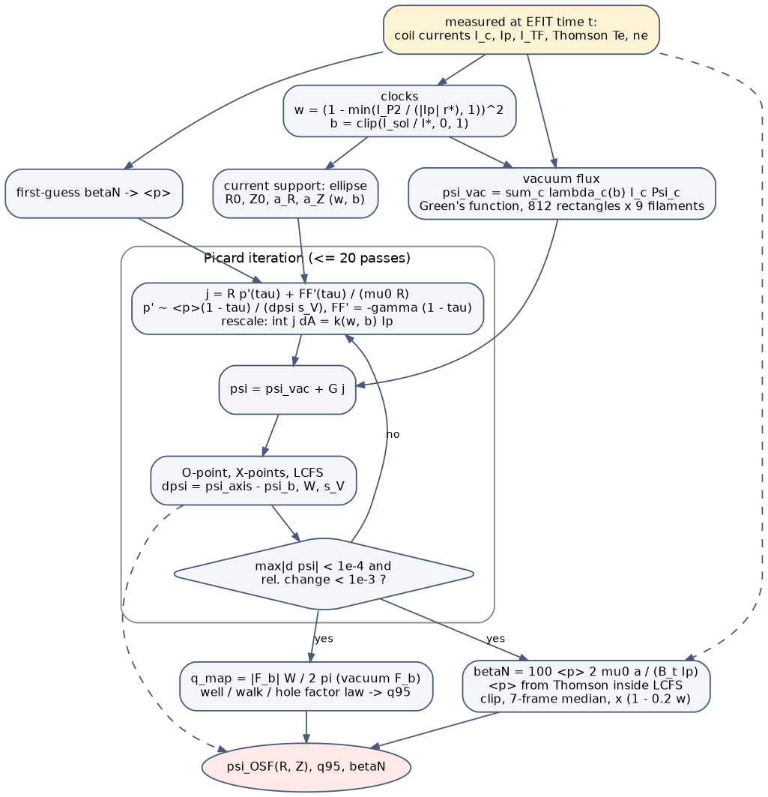

# Forward Grad–Shafranov model (OSF)

OSF (`models/osf`, model id `mast_12_osf_0.0.12`) computes, independently at every EFIT time, a
free-boundary equilibrium driven by the measured currents. It uses no flux label at inference and
no fit to measured flux. The block diagram is shown below; the following notes derive each block.

{#fig:osf}

- [Grad–Shafranov equation and sign convention](Section2/GSEquation.md)
- [Vacuum flux from the coil set](Section2/VacuumField.md)
- [Walk and bleed clocks](Section2/Clocks.md)
- [Current-density ansatz and Ampère constraint](Section2/CurrentDensity.md)
- [Picard iteration](Section2/Picard.md)
- [Magnetic topology: O-point, X-points, LCFS](Section2/Topology.md)
- [Safety factor read-out](Section2/Q95.md)
- [Normalised beta read-out](Section2/BetaN.md)
- [Machine constants versus calibrated parameters](Section2/Parameters.md)
