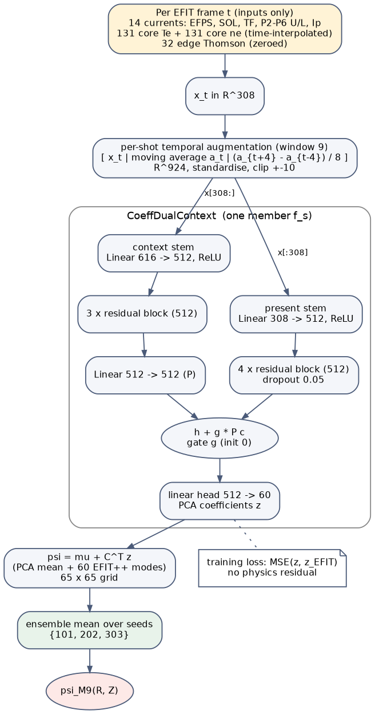

# Archive-trained flux model (M9)

M9 (`models/m9`, checkpoints `CRC_FEQ_mast_M9_win50_i{101,202,303}.pt`) is a data-driven
estimator of $\psi$ learned from FAIR-MAST EFIT++ reconstructions. It produces only the flux map;
in the hybrid mode $q_{95}$ and $\beta_N$ come from OSF.

{#fig:m9}

- [Model and loss](Section3/Loss.md)
- [PCA basis of EFIT++ flux](Section3/PCABasis.md)
- [Features and temporal context](Section3/Features.md)
- [Network](Section3/Network.md)
- [Training](Section3/Training.md)
- [Ensemble](Section3/Ensemble.md)
