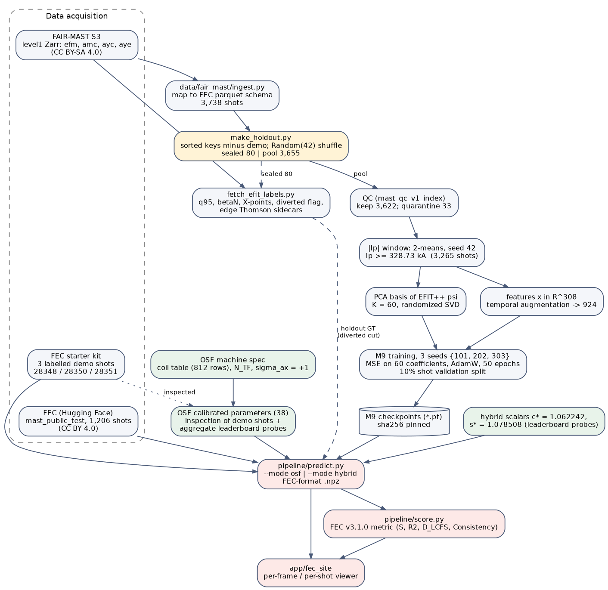

# Build pipeline

The figure below shows the complete build, from public data to scored predictions and the viewer.
Green boxes are OSF parameters, the amber box is the holdout split, red boxes are the
prediction/evaluation stages.

{#fig:pipeline}

Labels enter in exactly three places: the M9 PCA basis and loss (archive training pool), the
holdout ground truth (sealed shots, evaluation only), and — informally — the OSF calibration
(next note).
