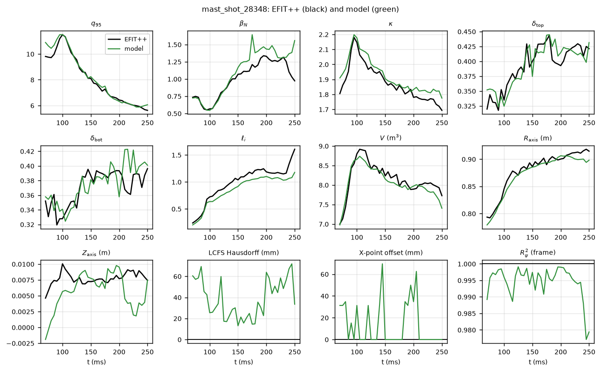
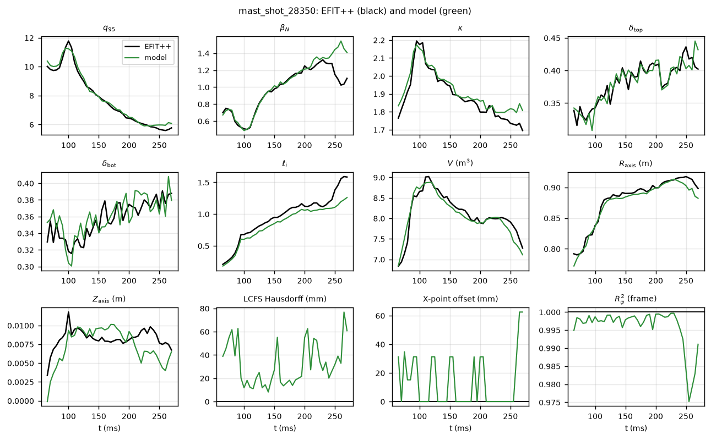
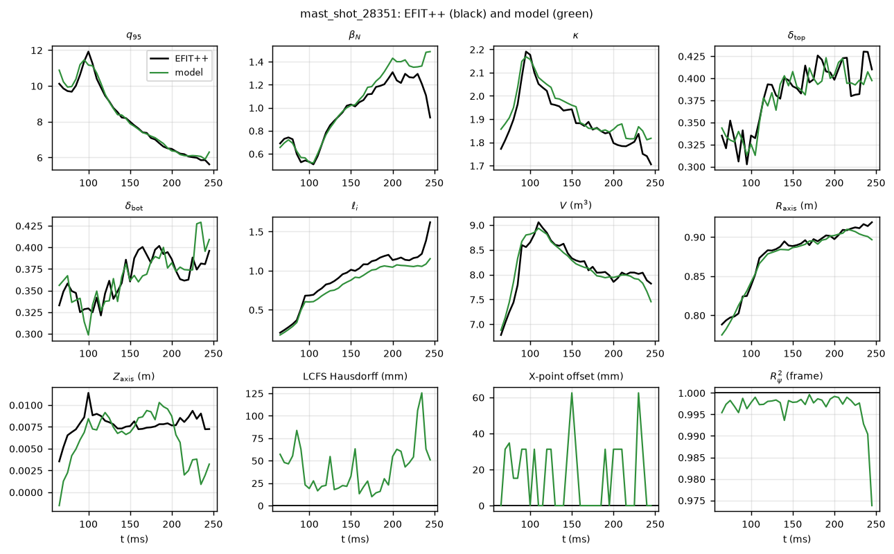

# Curve distances and time series

The curve distance between a predicted and an EFIT++ time series is reported two ways per shot:
the RMSE over the shot's frames and the time-averaged absolute difference (area between the two
curves divided by the duration); in brackets, each as a share of the EFIT++ range over the shot.
The last three rows are per-frame distances to EFIT++ (for the per-frame $R^2_\psi$, the distance
from 1), so their two numbers are the RMSE and the time average of the distance itself.

@import "../generated/model_curves.md"

Table: Curve distances between the model and EFIT++ on the three validation shots.

{#fig:ts28348}

{#fig:ts28350}

{#fig:ts28351}

$q_{95}$ follows EFIT++ within 2.7–5.8% of its range on every shot. $\beta_N$ and $\delta_{\rm bot}$
have the largest relative distances among the physical scalars (RMSE 16.6–21.9% and 22.5–27.9% of
the range). Most of the $\beta_N$ error sits at the end of the shot: the last five frames carry
51%, 94% and 77% of the squared $\beta_N$ error on 28348, 28350 and 28351, and without them the
$\beta_N$ RMSE on 28350 is 0.036 instead of 0.139. $Z_{\rm axis}$ has large relative values only
because its range over a shot is a few millimetres.
