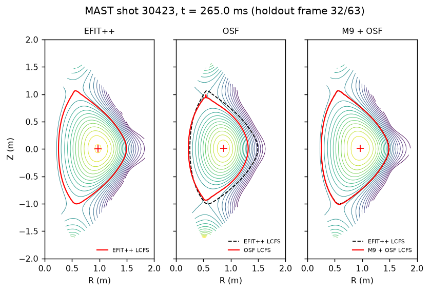
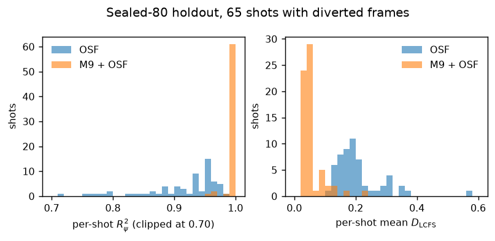

# Flux maps and per-shot spread

The example frame below is from the holdout shot whose M9 + OSF per-shot $R^2_\psi$ is the median
among shots with at least 40 frames (shot 30423, per-shot $R^2_\psi$ 0.928576 for OSF and 0.999028
for M9 + OSF), at the middle diverted frame.

{#fig:psi}

OSF reproduces the diverted topology, but its LCFS lies inside the EFIT++ LCFS, most visibly on the
outboard side and at the top; M9 + OSF overlays EFIT++ almost exactly. The per-shot distributions show the
same pattern over the whole holdout:

{#fig:pershot}

The eight shots with the lowest M9 + OSF $R^2_\psi$:

@import "../generated/holdout_worst.md"

Table: Worst holdout shots by M9 + OSF per-shot $R^2_\psi$.
