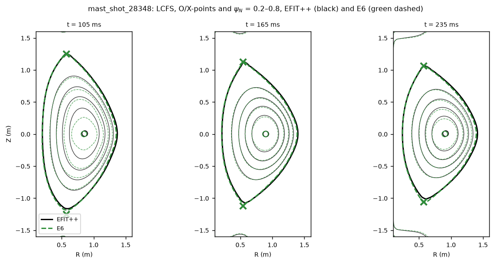
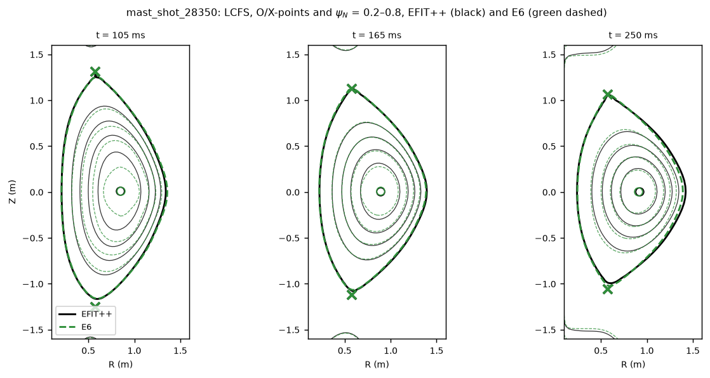
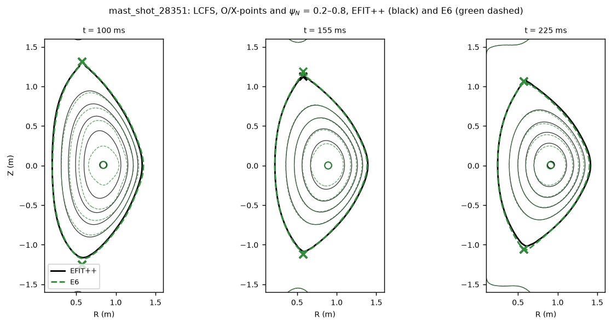

# Validation shots: boundary overlays

At 20%, 50% and 90% of each shot, the LCFS, O-point, X-points and the flux surfaces
$\psi_N=0.2$–$0.8$ of E6 are drawn over those of EFIT++.

{#fig:e6ov28348}

{#fig:e6ov28350}

{#fig:e6ov28351}

On shot 28350 the E6 LCFS lies on the EFIT++ LCFS for most of its length at all three times; the
inner flux surfaces differ more, most visibly at 105 ms and 250 ms, and at 250 ms the lower X-point
of E6 sits below that of EFIT++. Over the three shots the per-frame LCFS Hausdorff distance
averages 31–41 mm and the X-point offset 12–17 mm (curve-distance table).
