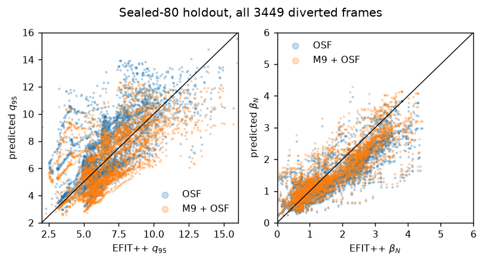
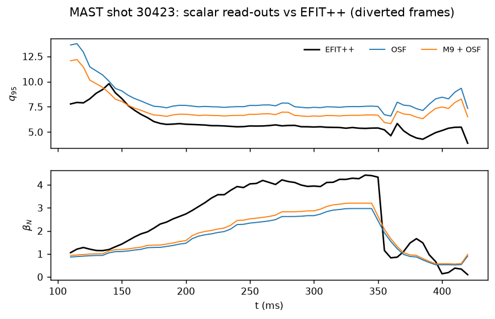

# Scalars

{#fig:scatter}

{#fig:traces}

Both read-outs track the trend of EFIT++ within a shot but carry shot-dependent offsets: on shot
30423 the OSF $q_{95}$ is about 2 too high through the flat-top (M9 + OSF about 1) and $\beta_N$ is too low at high
pressure. Two causes are structural: $q_{95}$ uses the vacuum $F$ and an OSF flux whose 95% surface
is too short, and $\beta_N$ uses a midplane line average of $2n_eT_e$ rather than a volume average.
The hybrid factors $c^{*}, s^{*}$ only rescale these values, which raises $R^2_{q_{95}}$ from
0.164457 to 0.342298 and $R^2_{\beta_N}$ from 0.379077 to 0.394260.
