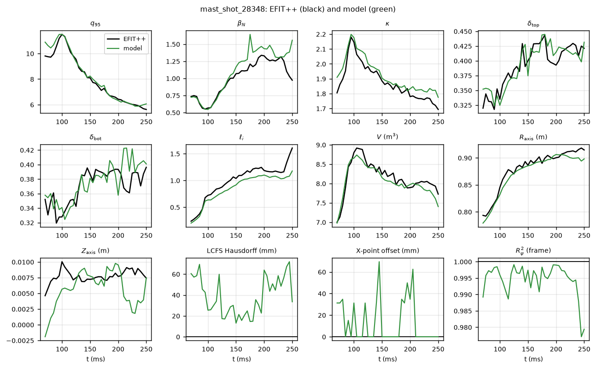
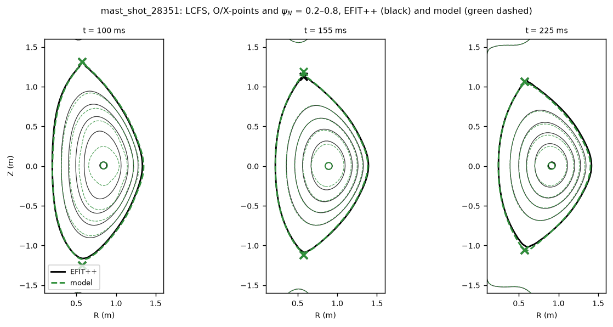

<!-- AUTO-GENERATED by scripts/compile_md_tree.py -- do not edit -->
<!-- Root: paper/MAST.md (41 notes) -->

# MAST Poloidal Flux Imputation in the Absence of Direct Magnetic Sensors

<!--
Root note of the paper. Each bullet links to a short, self-contained note; `python3 scripts/compile_md_tree.py`
flattens the tree in this order into `paper/arxiv.md`, and `bash scripts/build_paper_pdf.sh`
compiles it to `paper/MAST.pdf`. One link hop = one section level.
-->

## Abstract

We describe a model that imputes the MAST poloidal flux map $\psi(R,Z)$ on a $65\times65$ grid,
together with $q_{95}$ and $\beta_N$, at every EFIT++ time from measurements that exclude magnetic
probes and flux loops: the poloidal-field and toroidal-field coil currents, the plasma current and
the core Thomson-scattering profiles. The model is trained only on open data from the UK FAIR-MAST
archive, with the EFIT++ reconstructions stored there as ground truth. It is an ensemble of five
residual networks that output the coefficients of a 60-mode principal-component basis of EFIT++
flux, with linear scalar heads for $q_{95}$ and $\beta_N$. Calibration combines a coefficient loss
with per-shot curve distances between the predicted and EFIT++ traces of $q_{95}$, $\beta_N$,
elongation, triangularity, plasma volume and magnetic-axis position; the shape traces are read from
the predicted flux by differentiable extractors, and checkpoints are selected on archive validation
shots only. Performance is reported as ground truth against prediction with the composite score
$S$ of the FEC MAST scoring code. On a sealed holdout of 65 archive shots (3,449 frames) the model
reaches $S=0.934444$, with $R^2_\psi=0.997832$, $R^2_{q_{95}}=0.913296$ and $R^2_{\beta_N}=0.677889$;
on three held-out MAST validation shots downloaded from FAIR-MAST (115 frames) it reaches
$S=0.899573$. The largest remaining errors are $\beta_N$ in the last frames of each shot, the
plasma boundary near its top and bottom, and the shape scalars of the validation shots.

## Introduction


### Problem statement

Equilibrium reconstruction recovers the axisymmetric magnetic equilibrium of a tokamak plasma from
measurements. The standard tool, EFIT [@lao1985] and its MAST implementation EFIT++ [@appel2006],
fits the axisymmetric force-balance equation to magnetic probes and flux loops, optionally
constrained by kinetic and internal-field data. The magnetic sensors carry most of the information
about the plasma boundary.

This paper asks how much of $\psi(R,Z)$ can be recovered *without* direct magnetic sensors. The
inputs are the MAST [@darke1995; @sykes2001; @lloyd2003] actuator currents (solenoid, P2–P6
upper/lower poloidal-field circuits, the toroidal-field coil and the EFPS circuit), the plasma
current $I_p$, and the core Thomson-scattering profiles $T_e(R), n_e(R)$ on the horizontal midplane
[@scannell2010]. The targets are the EFIT++ flux map on a fixed $65\times65$ $(R,Z)$ grid, $q_{95}$
and $\beta_N$ at each EFIT time.

All data used to train, select and evaluate the model come from the open FAIR-MAST archive
[@jackson2024fairmast]. The output template and the scoring metric are those of the FEC MAST task
[@fec2026dataset; @fec2026starter]. The model, its calibration and the evaluation are
in the repository `catskillsresearch/mast-flux-imputation`.

### Target and route

The quantity a user of an imputed equilibrium asks for is a score: here the composite $S$, which
pools $R^2$ of $\psi$, $q_{95}$ and $\beta_N$ with a boundary distance and seven shape-consistency
terms (Metric section). Call this the **target**. $R^2_\psi$ carries 55% of the weight and is pooled
over pixels, so it is dominated by the large-scale vacuum field that the coil currents largely
determine; it says little about where the plasma boundary is.

The **route** is what a physicist checks for each shot in the viewer of the repository
(`app/fec_site`): the time series of $q_{95}$, $\beta_N$, elongation, triangularity, volume, the
magnetic axis and $\ell_i$, and, frame by frame, the last closed flux surface (LCFS), the O-point
and the X-points. The model is calibrated on the route directly: its loss contains the per-shot
curve distance between the predicted and the EFIT++ trace of each scalar, and its checkpoints are
chosen by the same distances on archive validation shots. The results report both the target and
the route.

### Contributions

1. A flux-imputation model for MAST: a 60-mode principal-component basis of EFIT++ flux, an
   ensemble of five residual networks with a gated temporal-context branch, and linear scalar heads
   for $q_{95}$ and $\beta_N$ (Model section).
2. A calibration that trains the network on per-shot curve distances of the scalar time series,
   reading the shape scalars from the predicted flux through differentiable extractors, and selects
   checkpoints on archive validation shots (Calibration section).
3. A build from public data only: FAIR-MAST download and ingest, quality control, a sealed holdout
   with a disjointness check, training, prediction, scoring and a browser viewer.
4. Ground-truth-against-prediction results on a sealed archive holdout and on three held-out MAST
   validation shots, with per-shot scores, curve distances, time series and boundary overlays
   (Results section), all regenerated from saved prediction and audit files.

### Related work

Free-boundary equilibrium reconstruction from magnetic measurements goes back to [@lao1985]; textbook
treatments of tokamak equilibria are given by [@freidberg2014; @wesson2011].
Reduced-order representations of fields by principal component analysis / proper orthogonal
decomposition [@pearson1901; @hotelling1933; @berkooz1993] underlie the output space of the model.

## Data


### Sources

Every shot used to train, select or evaluate the model is downloaded from FAIR-MAST
[@jackson2024fairmast], the open archive of the MAST spherical tokamak published by UKAEA. The
ground truth for every frame is the EFIT++ reconstruction [@appel2006] stored in the archive with
the shot.

The FEC MAST task [@fec2026dataset; @fec2026starter] (CC BY 4.0) supplies the scoring code and the
output template. The template holds one Parquet row per shot with nested arrays for every time
series; the prediction is $\psi$ on a fixed $65\times65$ $(R,Z)$ grid, $q_{95}$ and $\beta_N$ at each
scored EFIT time. Only *diverted* EFIT time slices are scored; a MAST slice is diverted when
EFIT++ reports an X-point (`efm/xpoint{1,2}`). The input time series are not subset, so the scored
`efit_times` need not be contiguous.

### FAIR-MAST archive and ingest

FAIR-MAST publishes the MAST archive as Zarr stores at `s3://mast/level1/shots/N.zarr` for shot
number N (endpoint `s3.echo.stfc.ac.uk`, anonymous, CC BY-SA 4.0). The ingest
(`data/fair_mast/ingest.py`) reads four groups per shot,

| group | content | use |
|---|---|---|
| `efm` | EFIT++: `psirz`, grid `r`, `z`, `q_95`, `betan`, X-points | labels only |
| `amc` | coil and plasma currents | inputs |
| `ayc` | core Thomson $T_e, n_e$ | inputs |
| `aye` | edge Thomson $T_e, n_e$ | inputs (zeroed at prediction) |

and writes one row per shot in the template layout, with `efit_psirz` and the EFIT++ grid. 3,738
shots (numbers 23240–30471) were ingested, keeping all EFIT slices (ramp-up, limited, ramp-down).

**No-plasma shots.** 349 of the 3,738 shots carry a reduced EFIT++ product: 200 slices on a fixed
5 ms clock (0–995 ms or $-50$–945 ms), 60 instead of about 150 `efm` variables, no scalar or
X-point outputs, and $\max|I_p|\le46.8$ kA (median 9.1 kA). They are shots without a plasma,
spread over the whole shot range; 335 lie in the training pool and 14 in the sealed holdout.

`data/fair_mast/fetch_efit_labels.py` adds the scalar labels `q_95`, `betan` and the diverted flag
(any finite `efm/xpoint{1,2}_rc`) for each EFIT slice, again from FAIR-MAST.

### Input vector and clocks

Per shot the model reads:

* **Actuators:** 13 current channels on a 0.2 ms (5 kHz) clock spanning $-2000$ to $4000$ ms
  (30,000 samples): `sol`, `p2u`, `p2l`, `p3u`, `p3l`, `p4u`, `p4l`, `p5u`, `p5l`, `p6u`, `p6l`,
  `tf`, `efps` (kA, or kA·turn for the P circuits), plus $I_p$.
* **Kinetic profiles:** core Thomson $T_e, n_e$ on 131 channels at about 2 ms cadence, on the
  midplane $Z=0$ [@scannell2010]. Edge Thomson (16 channels at $R\approx1.33$–$1.49$ m) is present
  in the rows and zeroed by the model at prediction time.
* **Output clock:** `efit_times` (ms). Inputs are interpolated onto it.

There are no magnetic-probe ($B_\theta$ pick-up) or flux-loop channels. The labels, however, are
EFIT++ reconstructions that *were* constrained by those sensors.

### Training pool

1. **Split.** The 80 sealed holdout shots and the three validation shots are removed from the
   3,738 ingested shots, leaving a pool of 3,655.
2. **No-plasma shots** are removed from the pool: 335 shots.
3. **Quality control:** a shot is quarantined if $\max|\psi|$ exceeds the pool median by more than
   10 median absolute deviations, or if it is short, non-finite or constant: 3,280 shots are kept.
4. **$|I_p|$ window:** frames with $|I_p|\ge I_p^{\rm lo}=328.7293519$ kA are used. The threshold
   is the midpoint of a seed-42 2-means fit to all frame values of $|I_p|$ in the pool with the
   no-plasma shots included; without them the same fit gives 471.99 kA, so the value is fixed as a
   named constant. 3,258 shots contribute 211,534 frames, limited and diverted frames alike.
5. **Archive validation:** 10% of the contributing shots after a seed-42 shuffle, 325 shots, are
   held out of training. Its first 100 shots, `archval100`, carry the validation objective of the
   calibration; the full 325 carry the selection score.

The principal-component basis and the feature statistics are fitted on the training shots only.

### Sealed holdout and disjointness

Let $\mathcal K$ be the sorted list of 3,738 ingested keys and $\mathcal V$ the three validation
shots. Then

$$
\mathcal S = \mathrm{first}_{80}\big(\mathrm{shuffle}_{42}(\mathcal K\setminus\mathcal V)\big),\qquad
\mathcal P = (\mathcal K\setminus\mathcal V)\setminus\mathcal S,\quad |\mathcal P| = 3655,
$$

with `random.Random(42).shuffle`. `data/fair_mast/make_holdout.py` recomputes the split and checks

| check | result |
|---|---|
| recomputed $\mathcal P$ equals the quality-control pool (keep ∪ quarantine) | true (3,655) |
| $\mathcal Q\cap\mathcal S$, $\mathcal P\cap\mathcal S$, $\mathcal V\cap\mathcal S$ | ∅, ∅, ∅ |
| quarantined sealed shot | 27373 ∈ $\mathcal S$ |

where $\mathcal Q$ is the set kept by quality control. The holdout is disjoint from all training
and validation data and is scored once.

**Scored frames.** Each sealed shot is restricted to its diverted EFIT slices; inputs keep their
full clocks. Fifteen sealed shots have no diverted slice (24901, 26506, 29932, 24876, 28295, 27681,
23248, 27621, 27720, 29297, 26273, 27819, 27778, 23424, 30442) and are excluded, leaving **65 shots
and 3,449 frames** out of 5,280 EFIT slices. Fourteen of the fifteen are no-plasma shots; the
fifteenth is 24876.

### Validation shots

Shots 28348, 28350 and 28351 are three consecutive MAST shots held out of the training pool, the
quality-control statistics, the principal-component basis, the feature statistics and checkpoint
selection. Their inputs and EFIT++ labels are downloaded from FAIR-MAST by the same ingest and label
scripts as the archive,

```
python data/fair_mast/ingest.py --keys 28348 28350 28351 \
    --out data/fair_mast/validation/parquet
python data/fair_mast/fetch_efit_labels.py --shots 28348 28350 28351 \
    --out data/fair_mast/validation/labels
```

and are scored on their 36, 42 and 37 diverted slices (115 frames). With only three shots, pooled
$R^2$ values on them are noisy; they are reported per shot alongside the holdout.

## Model

The model maps the measured inputs of each EFIT frame to 60 principal-component coefficients of
the EFIT++ flux and to five scalars. Five networks of identical architecture, differing only in
their initialisation seed, are averaged.

{#fig:arch}

### PCA basis of EFIT++ flux

Each EFIT++ map is flattened to $\mathbf y_t\in\mathbb R^{4225}$. With $\mu$ the sample mean and
$C\in\mathbb R^{60\times4225}$ the leading 60 principal directions (orthonormal rows)
[@pearson1901; @hotelling1933], the reduced representation and its reconstruction are

$$
z_t = C(\mathbf y_t-\mu)\in\mathbb R^{60},\qquad \hat{\mathbf y}_t = \mu + C^{\top}z_t .
\label{eq:pca}
$$

This is the proper orthogonal decomposition of the flux ensemble [@berkooz1993]. Because $C$ has
orthonormal rows, MSE on $z$ equals pixel MSE of the *projected* target. The basis is fitted with
randomized SVD [@halko2011] (scikit-learn [@pedregosa2011], seed 42, three power iterations) on at
most 200,000 frames drawn shot-balanced from the training shots after the $|I_p|$ window, so the
basis and its mean are built from FAIR-MAST EFIT++ labels of the training shots only.

### Features and temporal context

For each EFIT frame $t$ a raw vector $x_t\in\mathbb R^{308}$ is built:

| slice | content |
|---|---|
| 0–13 | 13 coil currents (EFPS, SOL, TF, P2–P6 lower/upper) and $I_p$, linearly interpolated to $t$ |
| 14–275 | 131 core-Thomson $T_e$ and 131 $n_e$ channels, interpolated in time (0 outside the Thomson clock) |
| 276–307 | 16 + 16 edge-Thomson channels; zeroed at prediction, and in training holding the edge-Thomson values of the training rows (present in 302 of the 3,258 contributing shots, 9.1% of frames) |

No spatial remapping of the Thomson channels is done; channel index stands in for radius. A per-shot
temporal augmentation with window 9 appends the centred moving average $a_t$ (clamped at the shot
edges) and its smoothed central difference $(a_{t+4}-a_{t-4})/8$, giving
$A(x)_t=[x_t\,|\,a_t\,|\,\dot a_t]\in\mathbb R^{924}$. Features are standardised with the training
mean and standard deviation and clipped to $\pm10$:
$\tilde x_t=\mathrm{clip}_{\pm10}\big((A(x)_t-m)/\sigma\big)$.

Since the context uses EFIT frames up to four steps ahead, the model is a smoother over the shot,
not a causal real-time estimator.

### Network and scalar heads

Each member $f_s$ (`CoeffDualContext`) has two residual encoders [@he2016]:

$$
\begin{aligned}
h &= \mathrm{Res}^{(4)}_{512}\big(\mathrm{ReLU}(W_h\,\tilde x_{[0,308)})\big), &
c &= \mathrm{Res}^{(3)}_{512}\big(\mathrm{ReLU}(W_c\,\tilde x_{[308,924)})\big),\\
h' &= h + g\,P\,c, & z &= W_z\,h' + b_z\in\mathbb R^{60},
\end{aligned}
\label{eq:net}
$$

where $\mathrm{Res}^{(n)}_{512}$ is a stack of $n$ residual blocks of width 512 with dropout 0.05,
$P$ is a $512\times512$ linear projection and $g$ is a scalar gate initialised to 0, so training
starts from the present-frame encoder alone and learns how much temporal context to admit. The
predicted flux is reconstructed with \eqref{eq:pca}.

Five linear heads read the same representation,

$$
\hat u_j = w_j^{\top}h' + b_j,\qquad j\in\{q_{95},\ \beta_N,\ R_{\rm axis},\ Z_{\rm axis},\ \ell_i\},
$$

each trained on the EFIT++ value standardised with its training mean and standard deviation. The
$q_{95}$ and $\beta_N$ heads, de-standardised, are the model's $q_{95}$ and $\beta_N$ outputs. The
axis and $\ell_i$ heads are trained as auxiliary targets; in scoring, these quantities are derived
from the predicted flux map.

### Differentiable shape read-outs

The scorer derives elongation, triangularity, volume and the magnetic axis from contours of the
flux map, which are not differentiable. For training, the same quantities are read from the
predicted $\hat\psi$ by soft extractors (`experiments/e6.py`, `soft_feats`):

* the flux is normalised with the EFIT++ axis and boundary values,
  $\psi_N=(\psi_{\rm ax}-\hat\psi)/(\psi_{\rm ax}-\psi_b)$, and the plasma interior is the soft level
  set $s=\sigma\big((1-\psi_N)/\tau\big)$, $\tau=0.02$, restricted to the EFIT++ LCFS interior dilated
  by two cells (the vessel-envelope mask of the scoring code where no EFIT++ LCFS is available);
* each grid column gives a sub-grid top and bottom of the interior (centroid $\pm$ half the soft
  height) and each grid row a sub-grid inner and outer edge; $Z_{\max}$, $Z_{\min}$, $R_{\max}$,
  $R_{\min}$ and the $R$ of the highest and lowest points are soft-argmax read-outs over those
  columns and rows (temperature 0.03 m);
* $\kappa=(Z_{\max}-Z_{\min})/(R_{\max}-R_{\min})$, $\delta_{\rm top}=(R_{\rm geo}-R_{Z_{\max}})/a$,
  $\delta_{\rm bot}=(R_{\rm geo}-R_{Z_{\min}})/a$ with $a=(R_{\max}-R_{\min})/2$ and
  $R_{\rm geo}=(R_{\max}+R_{\min})/2$;
* $V=2\pi\sum R\,s\,\Delta A$, and the axis is the soft-argmin of $\psi_N$ (temperature 0.02).

The read-outs are checked against the scorer's extractor in two ways: on EFIT++ maps, by the
correlation of the soft and the scorer values; on predicted maps, by the correlation of the soft
error and the scorer error against EFIT++.

| read-out | correlation of values on EFIT++ $\psi$ | correlation of errors on network $\psi$ |
|---|---|---|
| $\kappa$ | 0.997 | 0.434 |
| $\delta_{\rm top}$ | 0.981 | 0.177 |
| $\delta_{\rm bot}$ | 0.901 | -0.056 |
| $V$ | 1.000 | 0.781 |
| $R_{\rm axis}$ | 1.000 | 0.987 |
| $Z_{\rm axis}$ | 1.000 | 0.846 |

Table: Soft read-outs against the scorer's extractor on archive validation frames.

On EFIT++ maps all six read-outs track the scorer closely. The errors track it well for $V$ and
the axis, moderately for $\kappa$, and hardly for $\delta_{\rm top}$ and $\delta_{\rm bot}$, whose
scorer values depend on where the contour extractor places the tip of the LCFS.

### Ensemble

Five members differ only in their initialisation seed $s\in\{101,202,303,404,505\}$; the data, split,
basis and feature statistics are shared. The flux prediction is the mean of the reconstructed maps
and the scalar prediction the mean of the heads,

$$
\hat\psi = \frac15\sum_{s}\Big(\mu+C^{\top}f_s(\tilde x)\Big),\qquad
\hat u_j = \frac15\sum_s \hat u_{j,s}.
$$

Which training state of each member enters the ensemble is set by the selection rule of the
Calibration section.

## Calibration

The calibration fixes the loss, the training schedule and the choice of checkpoints. It uses the
training shots and the archive validation split only; neither the sealed holdout nor the three
validation shots enter it.

### Loss

For a batch of whole shots with frames $t$, predicted coefficients $\hat z_t$, EFIT++ coefficients
$z_t$ and heads $\hat u_t$, the loss is

$$
\begin{aligned}
\mathcal L ={}& \overline{\|\hat z_t-z_t\|^2}
 + w_{cd}\,\mathcal L_{cd} + w_{\rm LCFS}\,\overline{\big(1-\mathrm{IoU}_{\rm soft}\big)}
 + w_b\,\mathcal L_{b} + w_{\rm tip}\,\mathcal L_{\rm tip}\\
&+ w_c\,\mathcal L_{c} + w_t\,\overline{\|(\hat z_t-\hat z_{t-1})-(z_t-z_{t-1})\|^2}
 + w_s\sum_j \mathrm{Huber}\big(\hat u_{j,t}-u_{j,t}\big).
\end{aligned}
\label{eq:loss}
$$

* **Coefficient anchor.** MSE on the 60 coefficients, i.e. pixel MSE of the projected target.
* **Curve distance** $\mathcal L_{cd}$, the main calibration term. For each series
  $k\in\{q_{95},\beta_N,\kappa,\delta_{\rm top},\delta_{\rm bot},V,R_{\rm axis},Z_{\rm axis}\}$ the error
  $e_{k,t}=(\hat u_{k,t}-u_{k,t})/r_{k,n}$ is normalised by the range $r_{k,n}$ of the EFIT++ trace
  over shot $n$, floored at 0.25 of the series' global standard deviation. $q_{95}$ and $\beta_N$ come
  from the heads, the six shape series from the soft read-outs of $\hat\psi$. Per shot,
  $$
  d_{k,n} = \frac{\sum_t w_{k,t}\,e_{k,t}^2}{\sum_t w_{k,t}}
  + \lambda_d\,\frac{\sum_t w_{k,t}\,(e_{k,t}-e_{k,t-1})^2}{\sum_t w_{k,t}},\qquad \lambda_d=0.5,
  $$
  with the late weights $w_{k,t}$ of the next note, and
  $\mathcal L_{cd}=\sum_k\omega_k\,\overline{d_{k,n}}\big/\sum_k\omega_k$, the bar averaging over shots.
* **Soft LCFS.** One minus the soft intersection-over-union of the soft interior $s$ and the EFIT++
  LCFS interior, $w_{\rm LCFS}=w_{cd}/3$.
* **Boundary band** $\mathcal L_b$: pixel error inside $|\psi_N-1|<0.1$ of the EFIT++ LCFS;
  **tip band** $\mathcal L_{\rm tip}$: the same restricted to the top and bottom 15% of the EFIT++
  LCFS height, where the scorer reads $\delta_{\rm top}$ and $\delta_{\rm bot}$.
* **Critical points** $\mathcal L_c$: $|\nabla\hat\psi|^2$ at the EFIT++ O- and X-points and the
  X-point flux mismatch.
* **Temporal term** on frame-to-frame coefficient differences.
* **Scalar heads:** Huber loss ($\delta=1$) on the five standardised EFIT++ scalars.

| weight | $w_{cd}$ | $w_{\rm LCFS}$ | $w_b$ | $w_{\rm tip}$ | $w_c$ | $w_t$ | $w_s$ |
|---|---|---|---|---|---|---|---|
| value | 0.01 | 0.00333 | 3 | 10 | $10^{-3}$ | 1 | $3\times10^{-3}$ |

Table: Loss weights.

### Weighting

Two weights concentrate the curve distance where the errors matter most.

* **Late weight.** With $t_{\rm frac}\in[0,1]$ the position of a frame within its shot,
  $$
  w_{k,t} = 1 + \alpha_k\,\mathrm{clip}\Big(\frac{t_{\rm frac}-0.8}{0.2},\,0,\,1\Big),
  $$
  rising linearly over the last 20% of the shot, with $\alpha_k=4$ for $\beta_N$ and 2 for the other
  series. The end of the shot, where $\beta_N$ falls quickly, is otherwise a few frames among many.
* **Series weight.** $\omega_k=2$ for $\beta_N$, $\delta_{\rm top}$ and $\delta_{\rm bot}$ and 1 for
  the other five series.

The validation objective uses the same weights and adds the soft-LCFS term with $\alpha=2$ and
$\omega_{\rm LCFS}=1$.

### Optimisation and stopping

**Batches.** Each step takes 32 whole training shots and up to 128 frames per shot, in time order,
so that the per-shot curve distance and the frame differences are defined within the batch.

**Optimiser.** AdamW [@loshchilov2019] with learning rate $10^{-3}$, weight decay $10^{-4}$ and
gradient-norm clip 1.0; ReduceLROnPlateau on the validation objective (factor 0.5, patience 4,
threshold $10^{-3}$, minimum $2\times10^{-5}$). An exponential moving average (EMA) of the weights
with decay 0.998 per step is kept and evaluated. Every member is trained from scratch. PyTorch
[@paszke2019].

**Validation objective.** After each epoch the EMA weights are scored on `archval100` by

$$
J = \frac{\sum_k\omega_k\,\overline{\big(\mathrm{nRMSE}_{k,n}+\lambda_d\,\mathrm{nRMSE}'_{k,n}\big)}
 + \omega_{\rm LCFS}\,\overline{\big(1-\mathrm{IoU}_{\rm soft}\big)}_{\,n}}{\sum_k\omega_k+\omega_{\rm LCFS}},
$$

where $\mathrm{nRMSE}_{k,n}$ and $\mathrm{nRMSE}'_{k,n}$ are the square roots of the two per-shot terms
of $d_{k,n}$, and the LCFS term is the late-weighted per-shot mean.

**Spike guard.** If $J$ exceeds 1.2 times the best value so far, the weights return to the best EMA
state and the learning rate is halved.

**Stopping.** Training stops when $J$ has not improved by more than 0.2% for 20 epochs and is no
longer falling (less than 1% below its value five epochs earlier), with at least 30 and at most
300 epochs. The three EMA states with the lowest $J$ are kept for each member.

### Loss weight, seeds and selection

**Curve-distance weight.** $w_{cd}$ was chosen on seed 101 with 40-epoch runs by the lowest $J$:

| $w_{cd}$ | best $J$ (40 epochs, seed 101) | chosen |
|---|---|---|
| 0.01 | 0.15583 | yes |
| 0.03 | 0.15732 |  |
| 0.1 | 0.16716 |  |
| 0.3 | 0.15665 |  |

Table: Curve-distance weight against the best validation objective $J$.

**Seeds.** Five members were then trained with $w_{cd}=0.01$:

| seed | epochs trained | best-$J$ epoch | best $J$ | returns to best weights | minutes |
|---|---|---|---|---|---|
| 101 | 104 | 82 | 0.12436 | 1 | 10.6 |
| 202 | 173 | 152 | 0.12272 | 1 | 17.8 |
| 303 | 128 | 107 | 0.12421 | 2 | 12.8 |
| 404 | 143 | 122 | 0.11819 | 2 | 13.7 |
| 505 | 107 | 86 | 0.12318 | 2 | 10.7 |

Table: Training records of the five members. "Returns to best weights" counts the spike guard.

**Selection.** For $k=1,2,3$ the ensemble of the five members' $k$-th best EMA states (by $J$) is
formed. The first $k$ whose archive-validation score $S$ (all 325 shots) reaches the fixed
threshold 0.934308 is used:

| ensemble of the five seeds | $J$ | $S$ (archive validation) | used |
|---|---|---|---|
| rank-1 states | 0.10765 | 0.933913 |  |
| rank-2 states | 0.10730 | 0.934929 | yes |

Table: Ensemble selection on archive validation.

The rank-1 states fail the threshold; the rank-2 states (epochs 103, 154, 106, 121 and 86 for seeds
101–505) pass and form the model.

## Metric

All results use the scoring code of the FEC MAST task, v3.1.0 [@fec2026starter], vendored
byte-identical in `fec_scoring/`; `pipeline/score.py` ports the fold reduction.

### Composite score

For a fold of shots, with $R^2 = 1-\mathrm{SS}_{\rm res}/\mathrm{SS}_{\rm tot}$ pooled over all
frames (and, for $\psi$, all pixels) of the fold and $\mathrm{SS}_{\rm tot}$ taken about the
ground-truth mean,

$$
S = 0.55\,\max(0,R^2_\psi) + 0.15\,\max\Big(0,\tfrac12\big(R^2_{q_{95}}+R^2_{\beta_N}\big)\Big)
+ 0.10\,\big(1-\min(1,D_{\rm LCFS})\big) + 0.20\,\mathrm{Cons}.
\label{eq:score}
$$

Pooling over the fold means that shots with many frames weigh more, and that $R^2$ is measured
against the variance *across* shots, which is large for $\psi$ and comparatively small for
$q_{95}$ and $\beta_N$.

### LCFS distance

For each frame the last closed flux surface $\Gamma$ is extracted from the predicted and from the
EFIT++ map by the same code (marching squares inside the vessel envelope). The per-frame distance is
the symmetric Hausdorff distance [@huttenlocher1993] normalised by the reference geometric major
radius of the shot,

$$
d_t = \min\Big(1,\ \frac{d_H(\Gamma^{\rm pred}_t,\Gamma^{\rm EFIT}_t)}{R_{\rm geo}}\Big),\qquad
d_H(A,B)=\max\Big\{\sup_{a\in A}\inf_{b\in B}|a-b|,\ \sup_{b\in B}\inf_{a\in A}|a-b|\Big\}.
$$

$D_{\rm LCFS}$ averages $d_t$ over the frames of a shot and then over shots. A failed predicted
LCFS counts as $d_t=1$; frames whose *reference* LCFS cannot be extracted are dropped.

### Consistency scalars

Seven scalars are derived from each predicted and each EFIT++ map by the same routine
(`fec_scoring/derive.py`): the magnetic-axis position $R_{\rm axis}, Z_{\rm axis}$; elongation
$\kappa$ and upper/lower triangularity $\delta_{\rm top},\delta_{\rm bot}$ from the LCFS extremes;
the plasma volume $V = 2\pi\int_A R\,dR\,dZ$ inside the LCFS; and the internal inductance in the
ITER form $\ell_i(2)=\langle B_p^{2}\rangle_V/(\mu_0I_p/\ell_p)^{2}$, evaluated from $|\nabla\psi|$.
With $R^2_j$ the pooled $R^2$ of scalar $j$,

$$
\mathrm{Cons} = \frac17\sum_{j=1}^{7}\max\big(0,R^2_j\big).
$$

The term measures whether the predicted map is geometrically equivalent to the reconstruction, not
whether it is close pixel by pixel.

### Sign and missing-value policy

A single fold-global sign $s\in\{+1,-1\}$ is chosen to minimise $\mathrm{SS}_{\rm res}(\psi)$, and the
contour work uses the axis sign $\sigma_{\rm ax}s$; all runs here select $s=+1$. Non-finite
predicted pixels or scalars are replaced by the ground-truth mean, and a derived scalar that cannot
be computed from the prediction is replaced in the same way, so failures cost score rather than
being skipped.

## Results

All numbers in this section compare the model's predictions with the FAIR-MAST EFIT++ ground truth
on frames that took no part in training or selection. They are regenerated from the saved
prediction files and audit summaries by `scripts/make_model_report.py`; the same predictions are
shown, shot by shot, in the viewer (`app/fec_site`).

### Score

The score box of the viewer is given for each validation shot scored alone, for the three
validation shots pooled, and for the sealed holdout (65 shots, 3,449 frames).

| row | 28348 | 28350 | 28351 | 3 validation shots | sealed holdout (65 shots) |
|---|---|---|---|---|---|
| $S$ | 0.874374 | 0.910541 | 0.905806 | 0.899573 | 0.934444 |
| $R^2_\psi$ | 0.998652 | 0.998881 | 0.999105 | 0.998879 | 0.997832 |
| $R^2_{q_{95}}$ | 0.964105 | 0.984437 | 0.977610 | 0.976192 | 0.913296 |
| $R^2_{\beta_N}$ | 0.533545 | 0.701931 | 0.734513 | 0.663238 | 0.677889 |
| $1-D_{\rm LCFS}$ | 0.951246 | 0.960200 | 0.947812 | 0.953086 | 0.938632 |
| Consistency | 0.588334 | 0.693293 | 0.665541 | 0.659619 | 0.862171 |
| $R_{\rm axis}$ | 0.932495 | 0.952810 | 0.965624 | 0.951177 | 0.903677 |
| $Z_{\rm axis}$ | -12.735748 | -2.058536 | -5.969494 | -5.467191 | 0.961958 |
| $\kappa$ | 0.780307 | 0.872967 | 0.806884 | 0.827382 | 0.900994 |
| $\delta_{\rm top}$ | 0.719959 | 0.707625 | 0.677179 | 0.709255 | 0.912428 |
| $\delta_{\rm bot}$ | 0.063399 | 0.586994 | 0.485911 | 0.427937 | 0.761293 |
| $V$ | 0.842196 | 0.891153 | 0.890091 | 0.879737 | 0.920641 |
| $\ell_i$ | 0.779984 | 0.841500 | 0.833096 | 0.821846 | 0.674204 |

Table: Composite score $S$, its terms and the seven consistency $R^2$ values. Each column is one fold; $R^2$ values are pooled over the frames of the fold.

On the sealed holdout the model reaches $S=0.934444$. The flux term is $R^2_\psi=0.997832$; the scalar
terms are $R^2_{q_{95}}=0.913296$ and $R^2_{\beta_N}=0.677889$; $1-D_{\rm LCFS}=0.938632$ and the
Consistency term is 0.862171, with every consistency $R^2$ between 0.674204 ($\ell_i$) and 0.961958
($Z_{\rm axis}$).

On the three validation shots pooled $S=0.899573$, with $R^2_\psi=0.998879$ and
$R^2_{q_{95}}=0.976192$, both above their holdout values. The difference in $S$ comes from the
Consistency term (0.659619): $Z_{\rm axis}$ varies by only a few millimetres within these shots, so a
millimetre-scale offset gives $R^2_{Z_{\rm axis}}=-5.467191$, which is clipped to zero, and
$\delta_{\rm bot}$ reaches $R^2=0.427937$. Shot 28348 has the lowest score, $S=0.874374$, with
$R^2_{\beta_N}=0.533545$ and $R^2_{\delta_{\rm bot}}=0.063399$; shots 28350 and 28351 score 0.910541
and 0.905806.

### Boundary and critical points

The viewer flags, per frame, the boundary and critical-point distances between the predicted and
the EFIT++ map. Their fold means are:

| quantity | 3 validation shots | sealed holdout (65 shots) |
|---|---|---|
| frames with LCFS tip gap $\ge$ 50 mm | 28.7% | 32.4% |
| mean LCFS Hausdorff (mm) | 37.1 | 45.5 |
| p95 LCFS Hausdorff (mm) | 67.7 | 102.3 |
| mean X-point offset (mm) | 14.1 | 34.3 |
| mean O-point offset (mm) | 7.3 | 11.7 |
| limited/diverted flips | 1.7% | 3.6% |

Table: Boundary and critical-point distances. Tip gap: vertical gap of the LCFS top or bottom of at least 50 mm; flips: frames where the predicted map is limited and EFIT++ diverted, or the reverse.

On the holdout the LCFS of the model lies within a mean Hausdorff distance of 45.5 mm of EFIT++,
with a 95th percentile of 102.3 mm. The largest boundary errors are at the top and bottom of the
LCFS: 32.4% of holdout frames have a tip gap of at least 50 mm. The O-point is placed within
11.7 mm and the X-point within 34.3 mm on average, and 3.6% of frames flip between limited and
diverted. The three validation shots have smaller distances on every row.

### Curve distances and time series

The curve distance between a predicted and an EFIT++ time series is reported two ways per shot:
the RMSE over the shot's frames and the time-averaged absolute difference (area between the two
curves divided by the duration); in brackets, each as a share of the EFIT++ range over the shot.
The last three rows are per-frame distances to EFIT++ (for the per-frame $R^2_\psi$, the distance
from 1), so their two numbers are the RMSE and the time average of the distance itself.

| curve | 28348 RMSE | 28348 area | 28350 RMSE | 28350 area | 28351 RMSE | 28351 area |
|---|---|---|---|---|---|---|
| $q_{95}$ | 0.3405 (5.8%) | 0.2017 (3.4%) | 0.2306 (3.7%) | 0.184 (3.0%) | 0.2714 (4.3%) | 0.1669 (2.7%) |
| $\beta_N$ | 0.1721 (21.9%) | 0.1054 (13.4%) | 0.1393 (17.0%) | 0.06563 (8.0%) | 0.1331 (16.6%) | 0.07035 (8.8%) |
| $\kappa$ | 0.05502 (11.3%) | 0.04634 (9.5%) | 0.0456 (9.1%) | 0.03424 (6.9%) | 0.05108 (10.5%) | 0.03927 (8.1%) |
| $\delta_{\rm top}$ | 0.01774 (14.1%) | 0.01492 (11.8%) | 0.01543 (12.8%) | 0.01062 (8.8%) | 0.01732 (13.6%) | 0.01422 (11.2%) |
| $\delta_{\rm bot}$ | 0.02147 (27.9%) | 0.01601 (20.8%) | 0.01694 (22.5%) | 0.01392 (18.5%) | 0.01958 (24.4%) | 0.01553 (19.3%) |
| $\ell_i$ | 0.1521 (11.1%) | 0.1241 (9.1%) | 0.138 (10.0%) | 0.1068 (7.7%) | 0.1345 (9.5%) | 0.1066 (7.5%) |
| $V$ (m$^3$) | 0.162 (8.5%) | 0.1397 (7.3%) | 0.1677 (7.7%) | 0.1262 (5.8%) | 0.1645 (7.2%) | 0.1168 (5.1%) |
| $R_{\rm axis}$ (m) | 0.009627 (7.6%) | 0.007907 (6.3%) | 0.008259 (6.5%) | 0.005894 (4.6%) | 0.007218 (5.5%) | 0.005236 (4.0%) |
| $Z_{\rm axis}$ (m) | 0.003557 (65.7%) | 0.002822 (52.1%) | 0.002178 (25.9%) | 0.001827 (21.7%) | 0.003156 (40.2%) | 0.002422 (30.8%) |
| LCFS Hausdorff (mm) | 43.01 | 38.54 | 36.43 | 31.2 | 48.97 | 41.18 |
| X-point offset (mm) | 24.11 | 13.14 | 21.94 | 11.88 | 24.48 | 16.56 |
| $R^2_\psi$ (frame) | 0.007255 | 0.005151 | 0.006807 | 0.003937 | 0.005342 | 0.002926 |

Table: Curve distances between the model and EFIT++ on the three validation shots.

{#fig:ts28348}

{#fig:ts28350}

{#fig:ts28351}

$q_{95}$ follows EFIT++ within 2.7–5.8% of its range on every shot. $\beta_N$ and $\delta_{\rm bot}$
have the largest relative distances among the physical scalars (RMSE 16.6–21.9% and 22.5–27.9% of
the range). Most of the $\beta_N$ error sits at the end of the shot: the last five frames carry
51%, 94% and 77% of the squared $\beta_N$ error on 28348, 28350 and 28351, and without them the
$\beta_N$ RMSE on 28350 is 0.036 instead of 0.139. $Z_{\rm axis}$ has large relative values only
because its range over a shot is a few millimetres.

### Boundary overlays

At 20%, 50% and 90% of each validation shot, the LCFS, O-point, X-points and the flux surfaces
$\psi_N=0.2$–$0.8$ of the model are drawn over those of EFIT++.

{#fig:ov28348}

{#fig:ov28350}

{#fig:ov28351}

Over the three shots the per-frame LCFS Hausdorff distance averages 31–41 mm and the X-point offset
12–17 mm (curve-distance table).

## Reproducibility, provenance and limitations


### Commands

```
python data/fair_mast/ingest.py \
    --pool data/fair_mast/mast_pool3.txt --shots 5000
python data/fair_mast/make_holdout.py     # sealed-80 + checks
python data/fair_mast/fetch_efit_labels.py \
    --keys-json data/fair_mast/holdout_seed42.json
python data/fair_mast/ingest.py --keys 28348 28350 28351 \
    --out data/fair_mast/validation/parquet
python data/fair_mast/fetch_efit_labels.py --shots 28348 28350 28351 \
    --out data/fair_mast/validation/labels
python -m models.m9.train --build-cache   # features, split, PCA basis
bash scripts/run_e6.sh                    # train, select, predict, score
python scripts/make_compare_preds.py demo holdout  # viewer predictions
python -m pipeline.score outputs/compare/demo_e6.npz
python -m pipeline.audit outputs/compare/demo_e6.npz \
    --tag compare_demo_e6                 # boundary and curve distances
python scripts/make_model_report.py       # tables and figures
python -m app.fec_site --port 8770        # viewer
```

Predictions are `.npz` files in the template layout with keys `shot_XXXX_psirz` $(T,65,65)$,
`shot_XXXX_q95` and `shot_XXXX_betaN` $(T,)$, plus a JSON sidecar giving the shot order. Models only
see `inputs_only(row)`, which removes every `efit_*` label column. Raw data, trained weights and
outputs are not in the repository; paths may point at an existing data copy through
`FAIR_MAST_DIR`, `FAIR_MAST_LABELS_DIR` or `CATSKILLS_FUSION_LAB`.

### Data provenance

1. **Training inputs and labels** are FAIR-MAST shots read from `s3://mast/level1/shots` by
   `data/fair_mast/ingest.py`: currents (`amc`), Thomson (`ayc`, `aye`) and EFIT++ (`efm`). The
   feature cache is rebuilt exactly from these rows.
2. **Scalar labels** ($q_{95}$, $\beta_N$, axis, $\ell_i$, diverted flag) are read from FAIR-MAST
   `efm` by `data/fair_mast/fetch_efit_labels.py`.
3. **PCA basis, mean and feature statistics** are fitted on the training shots.
4. **Archive validation and the sealed holdout** are FAIR-MAST shots processed by the same ingest
   and label scripts.
5. **The three validation shots** are downloaded from FAIR-MAST by the same scripts into
   `data/fair_mast/validation/`.
6. **Scoring code and vessel-envelope mask** (`fec_scoring/`, `mast_envelope.npz`) come from the FEC
   MAST task; the mask is also used by the soft read-outs where no EFIT++ LCFS is available.
7. **Static tables.** The archive training rows also hold coil-geometry and Thomson-chord tables in
   the template layout, filled from the template's example row. The model reads none of these
   columns; the grid it uses is the EFIT++ grid, which equals `efm/r`, `efm/z`.
8. **No magnetic sensor** is a model input; the EFIT++ labels were reconstructed with magnetic
   sensors.

The same list, with file-level detail, is in `DATA_PROVENANCE.md` of the repository.

### Verification

| check | result |
|---|---|
| `pipeline.score` vs an independent implementation of the scorer, same predictions | $S$ and every term identical on the holdout and on the validation shots |
| `pipeline.audit` $S$ vs `pipeline.score` $S$ | identical on both folds |
| sealed split recomputed, disjointness checks | all true |
| validation-shot diverted-frame counts from FAIR-MAST `efm` X-points | 36 / 42 / 37 |
| result tables, regenerated from the saved prediction files and audit summaries | identical to the tables in this paper |

GPU non-determinism means a retrain reproduces the recipe, not the bytes, of a checkpoint.

### Limitations

* **$\beta_N$ at the end of the shot.** On the validation shots the last five frames carry 51%, 94%
  and 77% of the squared $\beta_N$ error; on shot 28350 the $\beta_N$ RMSE is 0.139 with them and
  0.036 without. Holdout $R^2_{\beta_N}$ is 0.677889, the lowest of the three main terms.
* **Boundary tips and X-points.** 32.4% of holdout frames have an LCFS tip gap of at least 50 mm,
  the 95th-percentile Hausdorff distance is 102.3 mm and the mean X-point offset 34.3 mm. The soft
  read-outs track the scorer's $\delta_{\rm top}$ and $\delta_{\rm bot}$ errors only weakly
  (correlation 0.177 and $-0.056$), so the calibration acts on the boundary tips mainly through the
  tip band.
* **Shape scalars on the validation shots.** $R^2_\kappa$ is 0.827382 and $R^2_{\delta_{\rm bot}}$
  0.427937 on the three shots pooled (0.063399 on 28348), against 0.900994 and 0.761293 on the
  holdout.
* **Internal inductance.** $R^2_{\ell_i}=0.674204$ on the holdout, the lowest consistency term
  there; $\ell_i$ is derived from $|\nabla\psi|$ and depends on the plasma current profile, which
  the inputs constrain only through the Thomson profiles.
* **Labels are magnetics-based.** EFIT++ used probes and flux loops; the task is imputation of a
  magnetics-constrained reconstruction, and its errors are inherited.
* **Small validation set.** The three validation shots are consecutive (115 frames); pooled $R^2$
  values on them are noisy, and $R^2_{Z_{\rm axis}}$ is negative because $Z_{\rm axis}$ barely varies
  within them.
* **Non-causal context.** The model uses EFIT frames up to four steps ahead; it is an offline
  smoother.

## Conclusion

From coil currents, plasma current and core Thomson scattering alone, with no magnetic sensors,
the model imputes the MAST flux map with $R^2_\psi=0.997832$ and reaches a composite score
$S=0.934444$ on a sealed holdout of 65 FAIR-MAST shots, and $S=0.899573$ on three held-out
validation shots. It is a 60-mode principal-component basis of EFIT++ flux driven by an ensemble of
five residual networks with scalar heads for $q_{95}$ and $\beta_N$, calibrated on per-shot curve
distances of the scalar time series read through differentiable extractors, and selected on
archive validation shots. Training, selection and evaluation use only open FAIR-MAST data; the
scoring code and output template are those of the FEC MAST task. The remaining errors are
$\beta_N$ at the end of each shot, the top and bottom of the plasma boundary and the X-point
position, and the shape scalars of the validation shots. The repository, the paper sources and all
result tables are reproducible from public data.

## References
