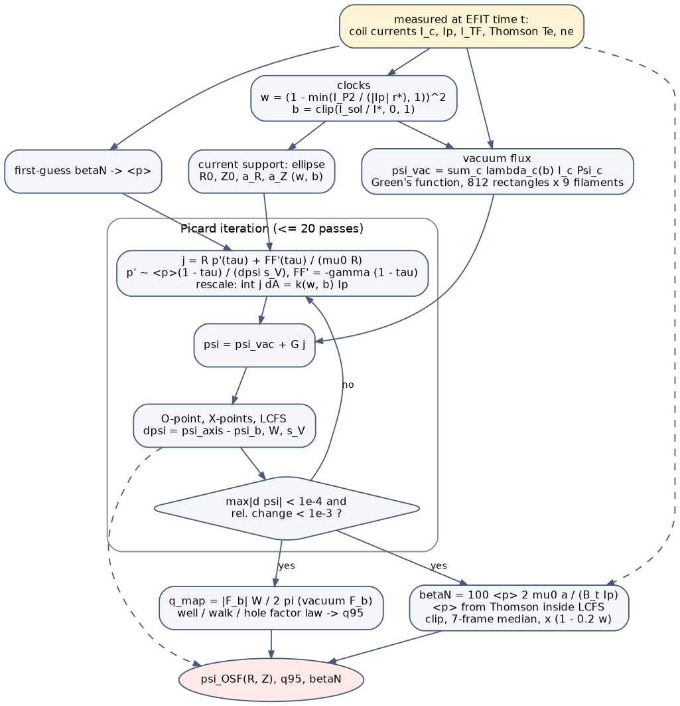
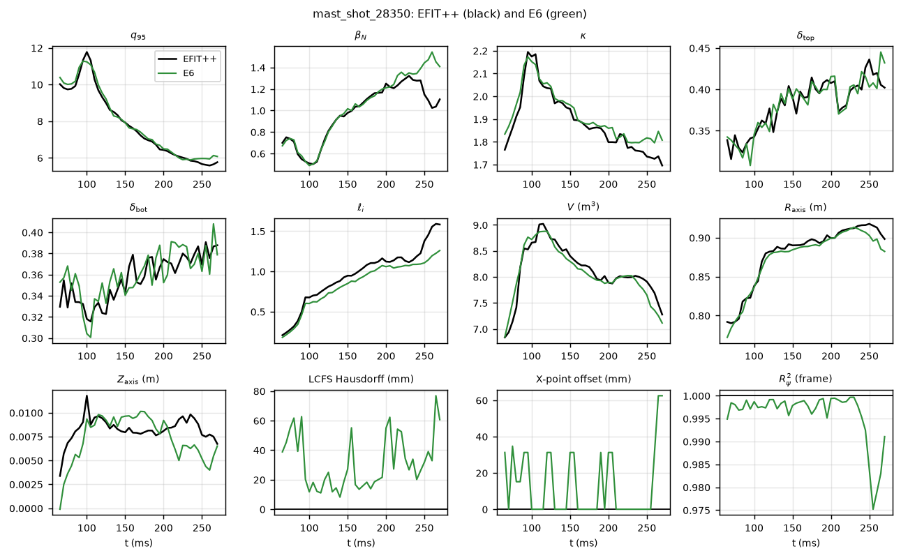
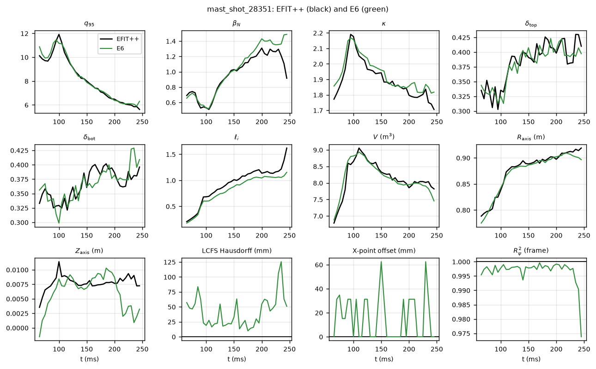
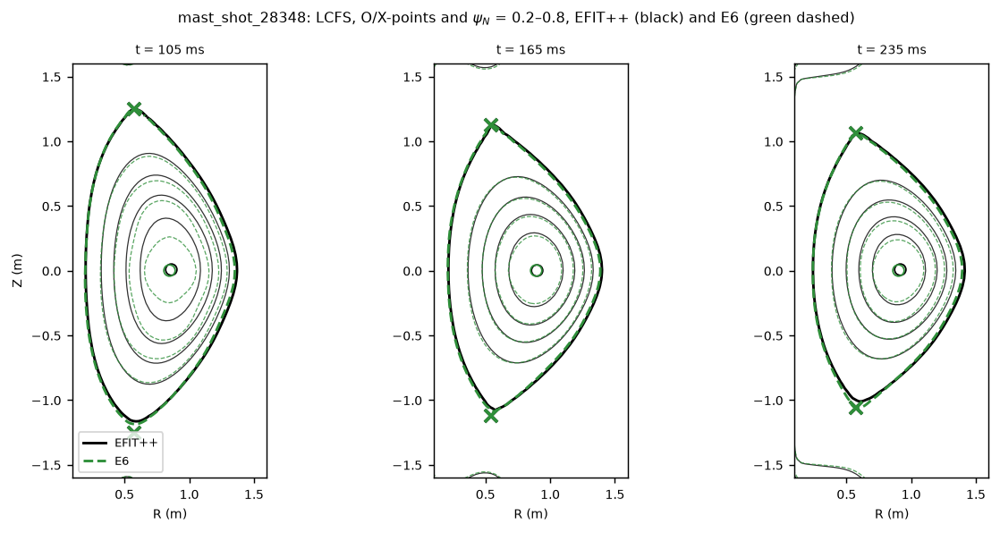
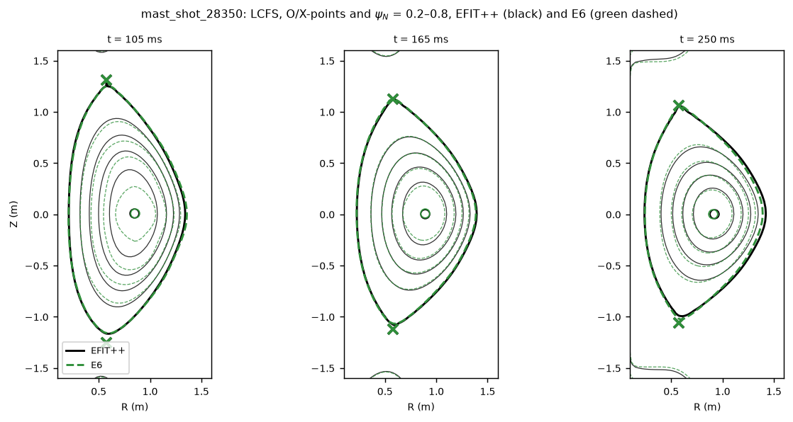

<!-- AUTO-GENERATED by scripts/compile_md_tree.py -- do not edit -->
<!-- Root: paper/MAST.md (70 notes) -->

# MAST Poloidal Flux Imputation in the Absence of Direct Magnetic Sensors

<!--
Root note of the paper. Each bullet links to a short, self-contained note; `python3 scripts/compile_md_tree.py`
flattens the tree in this order into `paper/arxiv.md`, and `bash scripts/build_paper_pdf.sh`
compiles it to `paper/MAST.pdf`. One link hop = one section level.
-->

## Abstract

A model judged by a composite score can reach a high value of that score with a simple loss, such
as mean squared error on a compressed representation of the field, and still fail to reproduce the
physical observables the score is meant to summarise. We state the hypothesis that such a model
generalises less well than one guided by matching those observables in intensity (the flux field
and its scalar time series) and in geometry (the last closed flux surface, O-point and X-points),
and we formalise a two-part objective: the *target* is the challenge score; the *route* is a set of
observable distances computed frame by frame. The setting is the reconstruction of MAST poloidal
flux $\psi(R,Z)$ on a $65\times65$ grid, with $q_{95}$ and $\beta_N$, from poloidal-field coil
currents, plasma current, toroidal-field current and midplane Thomson scattering, with no magnetic
probe or flux-loop input. The model is a hybrid of M9, a PCA-basis neural surrogate trained on
FAIR-MAST EFIT++ flux, and OSF, a free-boundary Grad–Shafranov forward solver over the 812-element
MAST coil set. Trained with coefficient MSE alone on FAIR-MAST (3,258 shots, 10% of them for validation), the
hybrid reaches
$S=0.874196$ and $R^2_\psi=0.997808$ on a sealed, seed-42 FAIR-MAST holdout disjoint from training
(65 shots, 3,449 diverted frames). Yet it has a top or bottom boundary-tip gap of at least 50 mm in
24.9% of frames, $R^2=0.697184$ for lower triangularity and $R^2=0.444019$ for $q_{95}$, and
between the three validation shots and the holdout its X-point offset, p95 boundary distance and
$q_{95}$ error grow while its score rises. An automated observable audit measures the route for
every frame, and a FAIR-MAST-only training regime compares MSE-only and observable-guided training
on the same data and holdout. Adding the scalar observables to training raises holdout $S$ from
0.874196 to 0.931421 with no use of challenge labels, and training on per-shot curve distances of
the scalar time series raises it to 0.934444, with lower-triangularity $R^2$ 0.761293; the
geometric route terms tried (boundary band, soft LCFS, critical points) do not improve the
boundary beyond coefficient MSE.

## Introduction


### Problem statement

Equilibrium reconstruction recovers the axisymmetric magnetic equilibrium of a tokamak plasma from
measurements. The standard tool, EFIT [@lao1985] and its MAST implementation EFIT++ [@appel2006],
fits the Grad–Shafranov equation [@shafranov1958; @grad1958] to magnetic probes and flux loops,
optionally constrained by kinetic and internal-field data. The magnetic sensors carry most of the
information about the plasma boundary.

The Fusion Equilibrium Challenge (FEC) [@fec2026dataset; @fec2026starter] poses the inverse
question: how much of $\psi(R,Z)$ can be recovered *without* direct magnetic sensors? Its MAST
[@darke1995; @sykes2001; @lloyd2003] inputs are the actuator currents (solenoid, P2–P6 upper/lower
poloidal-field circuits, the toroidal-field coil and the EFPS circuit), the plasma current $I_p$,
and the core and edge Thomson scattering profiles $T_e(R), n_e(R)$ on the horizontal midplane
[@scannell2010]. The targets are the EFIT++ flux map on a fixed $65\times65$ $(R,Z)$ grid,
$q_{95}$ and $\beta_N$ at each EFIT time.

This paper describes, at the level of the code, a MAST-only system for this task extracted into
the repository `catskillsresearch/mast-flux-imputation`, and reports its measured performance on a
sealed archive holdout.

### Thesis: target and route

The quantity a user of an imputed equilibrium asks for is a score: here the Fusion Equilibrium
Challenge composite $S$, which pools $R^2$ of $\psi$, $q_{95}$ and $\beta_N$ with a boundary
distance and shape consistency terms (Section 6). Call this the **target**. The cheapest way to
raise it is to fit the dominant term with the simplest loss, for example mean squared error on the
leading principal components of $\psi$, since $R^2_\psi$ carries 55% of the weight.

Our thesis is that such a fit can give a superficially high target score on the data it was fitted
or selected on, but need not generalise, unless training and model selection are guided by the
**route**: matching the physical observables a physicist checks in a viewer, in *intensity*
(the $\psi$ field and the scalar time series $q_{95}$, $\beta_N$, $\kappa$, $\delta$, $\ell_i$, $V$)
and in *geometry* (the last closed flux surface, the O-point and the X-points). A pooled pixel
$R^2$ near one is dominated by the large-scale vacuum field; it says little about where the
boundary is, which is what the observables measure.

We treat this as a hypothesis. Section 7 defines the objective, and Section 7.5 reports the
evidence available from the existing models, which is consistent with it: the hybrid model's
$R^2_\psi$ is above 0.997 on both the validation shots and a sealed holdout, while its boundary-tip
and $q_{95}$ errors are large and grow on the holdout, and lower triangularity is poorly reproduced
on both. The direct test trains the
same network on the same FAIR-MAST data with and without observable terms and scores both once on
the same sealed holdout (Section 10.6). Training on the scalar observables raises the holdout score
from $S=0.874196$ to $0.931421$; the geometric terms as implemented do not improve the boundary
beyond coefficient MSE.

### Contributions

1. A two-part objective for flux imputation: the challenge score as target, and frame-by-frame
   observable distances (field, boundary, O/X-points, scalar traces) as route, with the hypothesis
   that the route is needed for the target to generalise (Section 7).
2. An automated observable audit, `pipeline/audit.py`, that computes the route quantities for every
   frame of any FAIR-MAST shot, reproduces the official composite score, and reports the measured
   gaps between target and route (Section 7.5).
3. A complete mathematical description of OSF (`mast_12_osf_0.0.12`), a free-boundary
   Grad–Shafranov forward solver driven by measured currents, separating machine constants from the
   38 calibrated parameters (Section 3).
4. An exact description of M9, an ensemble of PCA-basis neural surrogates of EFIT++ flux trained
   on FAIR-MAST [@jackson2024fairmast] (Section 4), and of the hybrid M9 + OSF (Section 5).
5. A reproducible build: data acquisition, ingest, quality control, holdout construction with a
   disjointness proof, training, prediction, scoring and a browser viewer (Section 5), with measured
   results on a sealed holdout re-derived from saved audit files (Section 8).
6. A record of the data each component was trained or tuned on (Section 9.2), and a
   FAIR-MAST-only training regime that tests the thesis directly: MSE-only and route-guided M9
   ensembles and a FAIR-MAST-only OSF read-out, with the route-guided pick reaching $S=0.931421$ on
   the sealed holdout against $0.874196$ for MSE only, and a curve-distance calibration (E6)
   reaching $S=0.934444$ (Sections 8 and 10.6).

### Related work

Free-boundary equilibrium solvers based on Green's functions of the Grad–Shafranov operator and
Picard iteration go back to [@lackner1976]; textbook treatments are given by
[@freidberg1987; @freidberg2014; @jardin2010; @wesson2011]. Neural networks have been used as
Grad–Shafranov solvers [@vanmilligen1995] and, constrained by measured magnetic signals, for fast
reconstruction [@joung2020]. Reduced-order representations of fields
by principal component analysis / proper orthogonal decomposition
[@pearson1901; @hotelling1933; @berkooz1993] underlie the M9 output space.

## Data

All training and test data come from the FAIR-MAST archive. The Fusion Equilibrium Challenge (FEC)
MAST task supplies the output format, the frame selection rule and the scoring definitions; its
three labelled release shots serve as the validation shots. Models only ever see inputs; EFIT++
reconstructions are labels.

### Output format and validation shots

The output format follows the FEC MAST task [@fec2026dataset] (CC BY 4.0): one Parquet row per
shot with nested arrays for every time series, the EFIT++ flux on a fixed $65\times65$ $(R,Z)$ grid,
and $q_{95}$ and $\beta_N$ at each EFIT time. Only *diverted* EFIT time slices are scored; for MAST a
slice is diverted when EFIT++ reports an X-point (`efm/xpoint{1,2}`). The input time series are
not subset, so `efit_times` is not contiguous.

The three labelled shots of the FEC starter kit [@fec2026starter], 28348, 28350 and 28351 (36, 42
and 37 diverted frames), are the validation shots. They are fetched with
`data/fec/fetch.py --demo` (checksum-verified) and are excluded from the FAIR-MAST training pool, the
quality-control statistics and the PCA basis.

### FAIR-MAST archive and ingest

FAIR-MAST [@jackson2024fairmast] publishes the MAST archive as Zarr stores at
`s3://mast/level1/shots/N.zarr` for shot number N (endpoint `s3.echo.stfc.ac.uk`, anonymous, CC BY-SA 4.0). The
ingest (`data/fair_mast/ingest.py`) reads four groups per shot,

| group | content | use |
|---|---|---|
| `efm` | EFIT++: `psirz`, `q_95`, `betan`, X-points | labels only |
| `amc` | coil and plasma currents | inputs |
| `ayc` | core Thomson $T_e, n_e$ | inputs |
| `aye` | edge Thomson $T_e, n_e$ | inputs |

and writes one row in the FEC schema plus `efit_psirz`. Static tables (coil geometry, chord
positions) are copied from a released FEC row; they are given inputs, not labels. 3,738 shots
(numbers 23240–30471) were ingested, keeping all EFIT slices (ramp-up, limited, ramp-down).

**No-plasma shots.** 349 of the 3,738 shots carry a reduced EFIT++ product: 200 slices on a fixed
5 ms clock (0–995 ms or $-50$–945 ms), 60 instead of about 150 `efm` variables, no scalar or
X-point outputs, and $\max|I_p|\le46.8$ kA (median 9.1 kA). They are shots without a plasma,
spread over the whole shot range. 335 are in the QC keep list and 14 in the sealed 80.

`data/fair_mast/fetch_efit_labels.py` adds the scalar labels and the diverted flag. Its rule (any
finite `efm/xpoint{1,2}_rc`) reproduces the FEC frame selection on all three demo shots, and its
`q_95`, `betan` and edge-Thomson arrays match the FEC demo rows exactly (`tests/test_labels.py`).
For the three validation shots 28348, 28350 and 28351, the FAIR-MAST EFIT++ $\psi$, $q_{95}$ and
$\beta_N$ labels are bit-for-bit identical to the challenge organizers' release.

### Input vector and clocks

Per shot the model inputs are:

* **Actuators:** 13 current channels on a 0.2 ms (5 kHz) clock spanning $-2000$ to $4000$ ms
  (30,000 samples): `sol`, `p2u`, `p2l`, `p3u`, `p3l`, `p4u`, `p4l`, `p5u`, `p5l`, `p6u`, `p6l`,
  `tf`, `efps` (kA, or kA·turn for the P circuits), plus $I_p$.
* **Kinetic profiles:** core Thomson $T_e, n_e$ on 131 channels at about 2 ms cadence (130 chord
  radii in the FEC rows) and edge Thomson on 16 channels at $R\approx1.33$–$1.49$ m. All chords lie
  on the midplane $Z=0$ [@scannell2010].
* **Geometry:** the 812-row coil table (656 solenoid rows, 156 P2–P6 elements; centre, width,
  height), the 146-chord Thomson table and the $65\times65$ grid
  $R\in[0.06,2.00]$ m, $Z\in[-2,2]$ m.
* **Output clock:** `efit_times` (ms). Inputs are interpolated onto it.

There are no magnetic-probe ($B_\theta$ pick-up) or flux-loop channels. The labels, however, are
EFIT++ reconstructions that *were* constrained by those sensors.

### Sealed holdout and disjointness

The holdout is the split built into the M9 training code. Let $\mathcal K$ be the sorted list of
3,738 ingested keys and $\mathcal D$ the three demo shots. Then

$$
\mathcal S = \mathrm{first}_{80}\big(\mathrm{shuffle}_{42}(\mathcal K\setminus\mathcal D)\big),\qquad
\mathcal P = (\mathcal K\setminus\mathcal D)\setminus\mathcal S,\quad |\mathcal P| = 3655,
$$

with `random.Random(42).shuffle`. Quality control on $\mathcal P$ keeps the set $\mathcal Q$
(Section 4). `data/fair_mast/make_holdout.py` recomputes the split and checks

| check | result |
|---|---|
| recomputed $\mathcal P$ equals the QC training set (keep ∪ quarantine) | true (3,655) |
| $\mathcal Q\cap\mathcal S$, $\mathcal P\cap\mathcal S$, $\mathcal D\cap\mathcal S$ | ∅, ∅, ∅ |
| quarantined sealed shot | 27373 ∈ $\mathcal S$ |

and every M9 training run uses the same seed-42 split. The holdout is therefore disjoint from all
M9 training and validation data.

**FEC-protocol cut.** Each sealed shot is restricted to its diverted EFIT slices with the FEC rule;
inputs keep their full clocks. Fifteen sealed shots have no diverted slice (24901, 26506, 29932,
24876, 28295, 27681, 23248, 27621, 27720, 29297, 26273, 27819, 27778, 23424, 30442) and are
excluded, leaving **65 shots and 3,449 frames** out of 5,280 EFIT slices. Edge Thomson missing from
the ingest is overlaid from `aye` (60 of 65 shots).

Fourteen of the fifteen excluded shots are no-plasma shots (Section 2.2); the fifteenth is 24876.

**Caveat.** OSF was not fitted to these shots' labels, but some of its hand-set values were chosen
with reference to aggregate scores on the FEC public-test fold (Section 5.3), which may share shots
with the archive.

## Forward Grad–Shafranov model (OSF)

OSF (`models/osf`, model id `mast_12_osf_0.0.12`) computes, independently at every EFIT time, a
free-boundary equilibrium driven by the measured currents. It uses no flux label at inference and
no fit to measured flux. The block diagram is shown below; the following notes derive each block.

{#fig:osf}

### Grad–Shafranov equation and sign convention

In cylindrical coordinates $(R,\varphi,Z)$ an axisymmetric field is
$\mathbf B = \nabla\psi\times\nabla\varphi + F(\psi)\nabla\varphi$, with $\psi$ the poloidal flux per
radian (Wb rad$^{-1}$, the FEC convention) and $F=RB_\varphi$. Force balance
$\mathbf j\times\mathbf B=\nabla p$ with $p=p(\psi)$ gives the Grad–Shafranov equation
[@shafranov1958; @grad1958; @freidberg2014]

$$
\Delta^{*}\psi \equiv R\frac{\partial}{\partial R}\Big(\frac{1}{R}\frac{\partial\psi}{\partial R}\Big)+\frac{\partial^{2}\psi}{\partial Z^{2}}
= -\mu_0 R\,j_\varphi = -\mu_0R^2p'(\psi) - F F'(\psi).
\label{eq:gs}
$$

The toroidal current density is therefore $j_\varphi = R\,p'(\psi) + FF'(\psi)/(\mu_0R)$.

**Sign convention.** In the EFIT++/FAIR-MAST data the magnetic axis is a *maximum* of $\psi$; we
write $\sigma_{\rm ax}=+1$. OSF solves directly in this
convention (`sigma_ax = 1`), so its output needs no sign flip, and the scorer's global sign probe
selects $s=+1$ on every run reported here.

**Free-boundary form.** With the Green's function $G$ of $\Delta^*$ (next note) the solution in the
whole domain is

$$
\psi(\mathbf x) = \psi_{\rm vac}(\mathbf x) + \int_{\Omega_p} G(\mathbf x,\mathbf x')\,j_\varphi(\mathbf x')\,dA',
\label{eq:freeb}
$$

where $\psi_{\rm vac}$ is generated by the external coils and $\Omega_p$ is the support of the plasma
current [@lackner1976; @jardin2010]. Vessel and passive-structure eddy currents are not modelled.

### Vacuum flux from the coil set

The flux per radian at $(R,Z)$ from a coaxial circular filament of radius $R'$ at height $Z'$
carrying current $I$ is [@jacksonCED1999; @lackner1976]

$$
\psi = I\,G(R,Z;R',Z'),\qquad
G = \frac{\mu_0\sqrt{RR'}}{2\pi k}\Big[(2-k^{2})K(k)-2E(k)\Big],\qquad
k^{2}=\frac{4RR'}{(R+R')^{2}+(Z-Z')^{2}},
\label{eq:green}
$$

with $K$ and $E$ the complete elliptic integrals of the first and second kind
[@abramowitz1964] (SciPy `ellipk`, `ellipe` with parameter $m=k^2$). $G$ is set to 0 on the axis
$R=0$ and $k^2$ is clipped below 1 to avoid the logarithmic singularity at coincident points.

The FEC MAST coil table has 812 rectangular elements: 656 solenoid rows, each one turn carrying
$I_{\rm sol}$, and 156 elements of the P2–P6 upper/lower circuits, each carrying its circuit's
ampere-turns divided by the number of elements of that circuit. Each rectangle of width $w$ and
height $h$ is replaced by the mean of $3\times3$ filaments at offsets $\{-1,0,1\}\cdot w/3$,
$\{-1,0,1\}\cdot h/3$. This gives one unit map $\Psi_c(R,Z)$ per circuit $c$, and

$$
\psi_{\rm vac}(R,Z) = \sum_{c}\lambda_c(b)\,I_c\,\Psi_c(R,Z).
\label{eq:vac}
$$

The TF and EFPS circuits do not enter $\psi_{\rm vac}$. The multipliers $\lambda_c$ are calibrated
functions of the bleed clock $b$ (next note):

| circuit | multiplier |
|---|---|
| P2 upper and lower | $\lambda_V = 1.8 - b$ |
| P2 lower, additionally | $\times\,(1+0.105(1-b))$ |
| P4 pair | $1.15$ |
| P5 pair | $\times\,(1-0.18(1-b))$ |
| solenoid | $0.5+0.10\,b$ |
| P3, P6 | 1 |

The plasma term in \eqref{eq:freeb} uses the same kernel evaluated between grid nodes, assembled once
as a $4225\times4225$ matrix including the cell area $\Delta R\,\Delta Z$.

### Walk and bleed clocks

A MAST discharge moves from a solenoid-driven start-up towards a diverted flat-top. OSF summarises
the phase with two dimensionless "clocks" computed from the measured currents at each EFIT time:

$$
w = \Big(1-\min\Big(\frac{\bar I_{P2}}{|I_p|\,r_\star},\,1\Big)\Big)^{2},\qquad
\bar I_{P2}=\tfrac12\big(|I_{P2U}|+|I_{P2L}|\big),\qquad
b = \mathrm{clip}\Big(\frac{I_{\rm sol}}{I_\star},0,1\Big),
\label{eq:clocks}
$$

with $r_\star=0.34$ and $I_\star=16.3$ kA. The divertor "walk" $w$ approaches 1 as the P2 current
becomes small relative to $I_p$; the solenoid "bleed" $b$ is 1 while the solenoid still carries
positive current and 0 once it has swung through zero. In the code these clocks set the current
support, the coil multipliers, the enclosed-current factor and the read-out laws. They are not
fitted per shot; they are deterministic functions of the actuators, which is how OSF blends
limited-like and diverted-like behaviour without a classifier.

### Current-density ansatz and Ampère constraint

**Support.** The plasma current is confined to a fixed ellipse $\Omega_p$ (the alternative D-shaped
support of the source code is disabled for MAST, `USE_VACUUM_XD = False`):

$$
\begin{aligned}
R_0 &= 0.82+0.10\,w-0.02\,b, & Z_0 &= 0.009-0.004\,b,\\
a_R &= 0.50+0.08\,w, & a_Z &= a_R+0.08+0.42\,b+0.18\,(1-b),
\end{aligned}
$$

all in metres, with the geometric normalised radius
$\tau=\rho^2=((R-R_0)/a_R)^2+((Z-Z_0)/a_Z)^2\in[0,1]$ on $\Omega_p$. $\tau$ is geometric, not a
function of $\psi$: the current shape is held fixed so that it cannot chase an outboard maximum.

**Profiles.** With $s_V$ the volume average over $\Omega_p$ of $s(\tau)=\tfrac12(1-\tau)^2$
(the integral of the pressure-derivative shape from $\tau$ to 1) and
$\Delta\psi=\psi_{\rm ax}-\psi_b$,

$$
p'(\tau) = \frac{\langle p\rangle\,(1-\tau)}{\Delta\psi\,s_V},\qquad
FF'(\tau) = -\bar\gamma\,(1-\tau),\quad \bar\gamma=-1,\qquad
j_\varphi = R\,p' + \frac{FF'}{\mu_0R}\ \text{ on }\Omega_p .
\label{eq:jphi}
$$

The pressure scale comes from a first-guess normalised beta $\beta_N^{(0)}$,

$$
\langle p\rangle = \frac{\beta_N^{(0)}}{100}\,\frac{B_t}{2\mu_0}\,\frac{I_p[\mathrm{MA}]}{a_R},
$$

where $\beta_N^{(0)}$ is
computed from the median Thomson pressure $2n_eT_e e$ over chords with $R\in[0.25,1.45]$ m, clipped to
$[0.2,4]$ (default 1.3 when no chord is valid).

**Ampère constraint.** The amplitude is then rescaled so that the enclosed current matches a
calibrated fraction of the measured plasma current:

$$
\int_{\Omega_p} j_\varphi\,dA = k\,I_p,\qquad k = 0.70+0.30\,w+0.15\,b+0.20\,(1-b).
\label{eq:ampere}
$$

The factor $k\ne1$ absorbs, in an averaged way, the current that a fixed ellipse misplaces and the
missing vessel currents. Only the *ratio* of the $p'$ and $FF'$ terms survives the rescaling, so the
pressure guess shapes the current but does not set its total.

### Picard iteration

Because $p'$ in \eqref{eq:jphi} depends on $\Delta\psi$ and $s_V$, and the read-outs depend on the
flux-surface geometry, the solve is a fixed-point (Picard) iteration. Starting from
$\psi^{(0)}=\psi_{\rm vac}$, pass $n$:

1. locate the O-point and the last closed surface of $\psi^{(n-1)}$; if they are acceptable,
   set $\Delta\psi$ from them and $W=\oint d\ell/(R|\nabla\psi|)$ on the 95% surface, otherwise
   fall back to the maximum of $\psi$ inside $\Omega_p$ and the mean outside;
2. evaluate $j_\varphi$ from \eqref{eq:jphi} and rescale it with \eqref{eq:ampere};
3. update $\psi^{(n)} = \psi_{\rm vac} + G\,j_\varphi$.

The loop stops when $\max|\psi^{(n)}-\psi^{(n-1)}|<10^{-4}$ Wb rad$^{-1}$ *and* the relative
changes of $W$, $\Delta\psi$ and $s_V$ are all below $10^{-3}$, or after 20 passes. "One-shot"
in the name OSF means that nothing is fitted to measured flux; numerically OSF performs up to 20
Picard passes per frame.

### Magnetic topology: O-point, X-points, LCFS

The magnetic axis is the maximum of $\psi$ (since $\sigma_{\rm ax}=+1$) inside the box
$R\in[0.65,1.05]$ m, $|Z|\le0.5$ m. During the iteration the last closed surface is the outermost
compact closed contour around the axis (elongation $\le2.6$, vertical span $\le2.8$ m, outer radius
$\ge1.0$ m, inner radius $\le0.4$ m); candidate X-points are saddles in $R\in[0.25,1.5]$ m with
$|Z|\ge0.4$ m.

For the read-outs, OSF calls the *scorer's* LCFS extractor (`fec_scoring/lcfs.py`, marching squares
via scikit-image [@vanderwalt2014]) restricted by the MAST vessel envelope
`mast_envelope.npz` (`mask_coarse`). OSF uses the envelope
mask in the $q_{95}$ and $\beta_N$ read-outs only. If the scorer extractor fails,
OSF falls back to its own closed-contour search.

### Safety factor read-out

For a flux surface the safety factor is $q = \frac{F}{2\pi}\oint\frac{d\ell}{R^{2}B_p}
= \frac{F}{2\pi}\oint\frac{d\ell}{R\,|\nabla\psi|}$ [@freidberg2014; @wesson2011]. OSF evaluates
the geometric integral on the 95% surface $\psi=\psi_{\rm ax}-0.95\,\Delta\psi$,

$$
W=\oint_{\psi_{95}}\frac{d\ell}{R\,|\nabla\psi|},\qquad q_{\rm map} = \frac{|F_b|\,W}{2\pi},\qquad
F_b = \frac{\mu_0N_{\rm TF}I_{\rm TF}}{2\pi},\ N_{\rm TF}=24,
\label{eq:qmap}
$$

with $F_b$ the *vacuum* toroidal function (no plasma dia/paramagnetism). Because $\psi$ is not
fully self-consistent, $q_{\rm map}$ is corrected by a calibrated factor law in the clocks:

$$
\begin{aligned}
u&=\mathrm{clip}\Big(\frac{q_{\rm map}-8}{17-8},0,1\Big),\qquad
d = 1+0.35\,(1-w)(1-b),\qquad
h = 2\,b(1-b)^{3},\\
q_{95} &= \big(0.55\,u + (1-u)\,d + h\big)\,q_{\rm map}.
\end{aligned}
\label{eq:qlaw}
$$

The "well" weight $u$ is 1 while the surface is long (ohmic phase), $d$ raises $q$ in the diverted
phase, and $h$ is a bump at the solenoid swing. If no closed surface is found the cylindrical
estimate $q^{*} = 5a^{2}|B_t|/(R_0 I_p[\mathrm{MA}])$ is returned. In the hybrid the OSF value passes
through an affine map fitted to FAIR-MAST labels (Section 5.1).

### Normalised beta read-out

The Troyon-normalised beta [@troyon1984] is
$\beta_N = 100\,\beta_t\,a\,B_t/I_p[\mathrm{MA}]$ with $\beta_t = 2\mu_0\langle p\rangle/B_t^{2}$, i.e.

$$
\beta_N = \frac{100\,\langle p\rangle\,2\mu_0\,a}{B_t\,I_p[\mathrm{MA}]},\qquad B_t = F_b/R_0 .
\label{eq:betan}
$$

OSF estimates $\langle p\rangle$ as the mean of $2n_eT_e e$ (equal ion and electron pressure assumed)
over Thomson chords, interpolated to the EFIT time, whose radius lies inside the extracted LCFS,
$R\in[r_{\rm in},r_{\rm out}]$, with $a=(r_{\rm out}-r_{\rm in})/2$. Per frame the value is
clipped to $[0.2,4]$; over the shot a 7-frame running median removes single laser spikes, and the
result is multiplied by $(1-0.2\,w)$. The pressure is a midplane line average, not a volume average,
which is one reason the $\beta_N$ skill is limited (Section 8).

### Machine constants versus calibrated parameters

`models/osf/calibration.py` splits the symbols of the source file into four groups. The values are
copied exactly; there is no fitting code.

| group | count | examples | origin |
|---|---|---|---|
| `MACHINE_SPEC` | 12 | $N_{\rm TF}=24$, $\sigma_{\rm ax}=+1$, column names | MAST hardware, FEC schema |
| `GRID_GATES` | 15 | O-point box, X-point box, compactness gates | numerical acceptance on the $65\times65$ grid |
| `SWITCHES` | 12 | measured $I_p$ for read-out, LCFS-window pressure | code path |
| `CALIBRATED` | 38 | $r_\star, I_\star$, ellipse, $k$, $\lambda_c$, $q$ law, $\beta$ law | calibration (Section 5) |

The 38 calibrated values are those appearing in \eqref{eq:clocks}–\eqref{eq:qlaw} and the
$\beta_N$ post-processing:

* clocks: $r_\star=0.34$, $I_\star=16.3$ kA;
* ellipse: 0.82, 0.10, 0.02, 0.009, 0.004, 0.50, 0.08, 0.08, 0.42, 0.18;
* profiles: $\bar\gamma=-1$; $k$ coefficients 0.70, 0.30, 0.15, 0.20; two zero offsets;
* coil multipliers: 1.8, $-1$, 0.105, 1.15, $-0.18$, 0.5, 0.10;
* $q$ law: 17, 8, 0.55, 0.35, 2, 3;
* $\beta$ law: 7-frame median, 0.20, clip $[0.2,4]$, fallback 1.3, $s_\beta=1$.

## Archive-trained flux model (M9)

M9 (`models/m9`, checkpoints `CRC_FEQ_mast_M9_win50_i{101,202,303}.pt`) is a data-driven
estimator of $\psi$ learned from FAIR-MAST EFIT++ reconstructions. It produces only the flux map;
in the hybrid mode $q_{95}$ and $\beta_N$ come from OSF.

{#fig:m9}

### Model and loss

M9 is a PCA basis of EFIT++ flux combined with an ensemble of three residual multilayer
perceptrons that map the measured inputs to the 60 PCA coefficients. The base recipe
trains them with the mean-squared error between predicted and EFIT++ coefficients,

$$
\mathcal L(\theta) = \frac{1}{|B|}\sum_{t\in B}\frac{1}{60}\big\|f_\theta(\tilde x_t) - z_t\big\|_2^{2},
\qquad z_t = C\,(\psi^{\rm EFIT}_t-\mu).
$$

The physical structure of the output comes from the EFIT++ training targets and from the PCA
subspace they span. The network also has five scalar heads ($q_{95}$, $\beta_N$, $R_{\rm axis}$,
$Z_{\rm axis}$, $\ell_i$). With the base recipe they carry no loss; from experiment E3 on (Section 10.6)
they are trained on EFIT++ labels and supply $q_{95}$ and $\beta_N$.

### PCA basis of EFIT++ flux

Each EFIT++ map is flattened to $\mathbf y_t\in\mathbb R^{4225}$. With $\mu$ the sample mean and
$C\in\mathbb R^{60\times4225}$ the leading 60 principal directions (orthonormal rows)
[@pearson1901; @hotelling1933], the reduced representation and its reconstruction are

$$
z_t = C(\mathbf y_t-\mu)\in\mathbb R^{60},\qquad \hat{\mathbf y}_t = \mu + C^{\top}z_t .
\label{eq:pca}
$$

This is the proper orthogonal decomposition of the flux ensemble [@berkooz1993]. Because $C$ has
orthonormal rows, MSE on $z$ equals pixel MSE of the *projected* target. The basis is fitted with
randomized SVD [@halko2011] (scikit-learn [@pedregosa2011], seed 42, three power iterations) on at
most 200,000 frames drawn shot-balanced from the training shots, after the $|I_p|$ window of the
next note. The PCA basis and mean are therefore built from FAIR-MAST EFIT++ labels (Section 9.2).

### Features and temporal context

For each EFIT frame $t$ a raw vector $x_t\in\mathbb R^{308}$ is built:

| slice | content |
|---|---|
| 0–13 | 13 coil currents (EFPS, SOL, TF, P2–P6 lower/upper) and $I_p$, linearly interpolated to $t$ |
| 14–275 | 131 core-Thomson $T_e$ and 131 $n_e$ channels, interpolated in time (0 outside the Thomson clock) |
| 276–307 | 16 + 16 edge-Thomson channels; **zeroed at inference** (`mask_edge`); in training they hold what the ingest carried, which for most archive shots is nothing (60 of the 65 evaluated holdout shots lacked edge Thomson in the ingest) |

No spatial remapping of the Thomson channels is done; channel index stands in for radius. A per-shot
temporal augmentation with window 9 appends the centred moving average $a_t$ (clamped at the shot
edges) and its smoothed central difference $(a_{t+4}-a_{t-4})/8$, giving
$A(x)_t=[x_t\,|\,a_t\,|\,\dot a_t]\in\mathbb R^{924}$. Features are standardised with the training
mean and standard deviation and clipped to $\pm10$:
$\tilde x_t=\mathrm{clip}_{\pm10}\big((A(x)_t-m)/\sigma\big)$.

Since the context uses EFIT frames up to four steps ahead, M9 is a smoother over the shot, not a
causal real-time estimator.

### Network

Each member $f_s$ (`CoeffDualContext`) has two residual encoders [@he2016]:

$$
\begin{aligned}
h &= \mathrm{Res}^{(4)}_{512}\big(\mathrm{ReLU}(W_h\,\tilde x_{[0,308)})\big), &
c &= \mathrm{Res}^{(3)}_{512}\big(\mathrm{ReLU}(W_c\,\tilde x_{[308,924)})\big),\\
h' &= h + g\,P\,c, & z &= W_z\,h' + b_z\in\mathbb R^{60},
\end{aligned}
\label{eq:net}
$$

where $\mathrm{Res}^{(n)}_{512}$ is a stack of $n$ residual blocks of width 512 with dropout 0.05,
$P$ is a $512\times512$ linear projection and $g$ is a scalar gate initialised to 0, so training
starts from the present-frame encoder alone and learns how much temporal context to admit. The
predicted flux is reconstructed with \eqref{eq:pca}.

### Training

The base recipe (`models/m9/train.py` with `--seed 42 --epochs 50 --qc --shot-balanced --mask-edge
--win`; the experiments of Section 10.6 call it through `experiments/m9x.py`) is:

1. **Split** as in Section 2.4: 80 sealed shots, pool of 3,655.
2. **No-plasma shots** (Section 2.2) removed from the pool: 335 shots.
3. **QC:** quarantine a shot if $\max|\psi|$ exceeds the pool median by more than 10 median
   absolute deviations, or if it is short, non-finite or constant: 3,280 kept.
4. **$|I_p|$ window:** frames with $|I_p|\ge I_p^{\rm lo}=328.7293519$ kA are used. The threshold
   is the midpoint of a seed-42 2-means fit to all frame values of $|I_p|$ in the pool before the
   no-plasma shots are removed; without them the same fit gives 471.99 kA, so it is fixed as a
   named constant. 3,258 shots contribute 211,534 frames. Limited and diverted frames are both
   included.
5. **PCA** with $K=60$ (Section 4.2), fitted once on the training shots.
6. **Validation:** 10% of the contributing shots (seed-42 shuffle), 325 shots.
7. **Optimisation:** AdamW [@loshchilov2019] (learning rate $10^{-3}$, weight decay $10^{-4}$),
   gradient-norm clip 1.0, batches of 2048 frames drawn shot-balanced (uniform shot, then uniform
   frame), $\lceil N_{\rm train}/2048\rceil$ steps per epoch, 50 epochs, keeping the epoch with the
   lowest validation coefficient MSE (47, 46 and 49 for members 101, 202 and 303 of the MSE-only
   run E1). PyTorch [@paszke2019].

The route-guided runs of Section 10.6 keep this data, split, basis and optimiser and change only
the loss and the checkpoint rule.

### Ensemble

Three members differ only in their initialisation seed $s\in\{101,202,303\}$ (the data split is
shared). The prediction is the mean of the reconstructed maps,

$$
\hat\psi_{\rm M9} = \frac13\sum_{s\in\{101,202,303\}}\Big(\mu+C^{\top}f_s(\tilde x)\Big).
$$

Each checkpoint stores its own $\mu$, $C$ and feature statistics, so the average is taken in
$\psi$-space.

## Hybrid mode, build and calibration


### Hybrid M9 + OSF

The model combines the two components. The flux map is the M9 ensemble mean, $\psi=\hat\psi_{\rm M9}$.
In the MSE-only form of the model (experiments E1 and E2 of Section 10.6) $q_{95}$ and $\beta_N$
come from the OSF read-outs through affine maps fitted to FAIR-MAST EFIT++ labels on 200 training
shots (experiment E5),

$$
q_{95} = \mathrm{clip}\big(a_q\,q_{95}^{\rm OSF}+b_q,\,2,\,25\big),\qquad
\beta_N = \mathrm{clip}\big(a_b\,\beta_N^{\rm OSF}+b_b,\,0.2,\,5\big),
$$

with $a_q=0.626$, $b_q=1.957$, $a_b=1.013$, $b_b=0.093$. The OSF read-outs are evaluated on the OSF
flux, not on the M9 flux. From experiment E3 on, the network's scalar heads, trained on EFIT++
labels, supply $q_{95}$ and $\beta_N$; in that form OSF is not evaluated at inference and serves as
the physics reference, the source of the read-out baseline and the comparison model of the audit.

### Build pipeline

The figure below shows the complete build, from public data to scored predictions and the viewer.
Green boxes are OSF parameters, the amber box is the holdout split, red boxes are the
prediction/evaluation stages.

{#fig:pipeline}

Labels enter in exactly three places: the M9 PCA basis and loss (archive training pool), the
holdout ground truth (sealed shots, evaluation only), and the OSF calibration, which used the
three demo shots (next note).

### How OSF was calibrated

No fitting code exists for OSF's solver; its 38 calibrated values (Section 3.9) are hand-set
constants. They were chosen by

* inspecting physics end-members (ohmic start, solenoid swing, diverted flat-top) on the three
  labelled starter-kit shots, with $R^2$ values on those shots used to justify shape choices; and
* a small number of aggregate scores on the FEC public-test fold `mast_public_test`.

The three validation shots are therefore *not* held out for OSF, and the public-test fold has been
used, in aggregate, for tuning. The sealed archive holdout is label-disjoint from all of this. The
$q_{95}$ and $\beta_N$ read-out maps of the hybrid are fitted on FAIR-MAST training shots only
(experiment E5, Section 10.6).

### Commands

```
python data/fec/fetch.py --demo           # 3 labelled shots
python data/fec/fetch.py --public-test    # 1,206 public-test shots
python data/fair_mast/ingest.py \
    --pool data/fair_mast/mast_pool3.txt --shots 5000
python data/fair_mast/make_holdout.py     # sealed-80 + checks
python data/fair_mast/fetch_efit_labels.py \
    --keys-json data/fair_mast/holdout_seed42.json
python -m models.m9.train --build-cache
python -m models.m9.train --member all
bash scripts/run_experiments.sh          # E1-E5 (Section 10.6)
bash scripts/run_e6.sh                   # E6 curve-distance run
python -m pipeline.predict --split holdout --mode osf
python -m pipeline.predict --split holdout --mode hybrid
python -m pipeline.score outputs/holdout_hybrid.npz
python -m pipeline.audit outputs/holdout_hybrid.npz \
    --tag holdout_hybrid          # route quantities
python -m app.fec_site --port 8770
```

Predictions are FEC-format `.npz` files with keys `shot_XXXX_psirz` $(T,65,65)$, `shot_XXXX_q95`
and `shot_XXXX_betaN` $(T,)$, plus a JSON sidecar giving the shot order. Models only see
`inputs_only(row)`, which removes every `efit_*` label column. Paths may point at an existing data
copy through `FEC_MAST_DIR`, `FEC_DEMO_DIR`, `FAIR_MAST_DIR`, `FAIR_MAST_LABELS_DIR`,
`M9_WEIGHTS_DIR` or `CATSKILLS_FUSION_LAB`.

## Scoring

All results use the FEC scoring code v3.1.0 [@fec2026starter], vendored byte-identical in
`fec_scoring/`; `pipeline/score.py` ports the fold reduction.

### Composite score

For a fold of shots, with $R^2 = 1-\mathrm{SS}_{\rm res}/\mathrm{SS}_{\rm tot}$ pooled over all
frames (and, for $\psi$, all pixels) of the fold and $\mathrm{SS}_{\rm tot}$ taken about the
ground-truth mean,

$$
S = 0.55\,\max(0,R^2_\psi) + 0.15\,\max\Big(0,\tfrac12\big(R^2_{q_{95}}+R^2_{\beta_N}\big)\Big)
+ 0.10\,\big(1-\min(1,D_{\rm LCFS})\big) + 0.20\,\mathrm{Cons}.
\label{eq:score}
$$

Pooling over the fold means that shots with many frames weigh more, and that $R^2$ is measured
against the variance *across* shots, which is large for $\psi$ and comparatively small for
$q_{95}$ and $\beta_N$.

### LCFS distance

For each frame the last closed flux surface $\Gamma$ is extracted from the predicted and from the
EFIT++ map by the same code (marching squares inside the vessel envelope). The per-frame distance is
the symmetric Hausdorff distance [@huttenlocher1993] normalised by the reference geometric major
radius of the shot,

$$
d_t = \min\Big(1,\ \frac{d_H(\Gamma^{\rm pred}_t,\Gamma^{\rm EFIT}_t)}{R_{\rm geo}}\Big),\qquad
d_H(A,B)=\max\Big\{\sup_{a\in A}\inf_{b\in B}|a-b|,\ \sup_{b\in B}\inf_{a\in A}|a-b|\Big\}.
$$

$D_{\rm LCFS}$ averages $d_t$ over the frames of a shot and then over shots. A failed predicted
LCFS counts as $d_t=1$; frames whose *reference* LCFS cannot be extracted are dropped.

### Consistency scalars

Seven scalars are derived from each predicted and each EFIT++ map by the same routine
(`fec_scoring/derive.py`): the magnetic-axis position $R_{\rm axis}, Z_{\rm axis}$; elongation
$\kappa$ and upper/lower triangularity $\delta_{\rm top},\delta_{\rm bot}$ from the LCFS extremes;
the plasma volume $V = 2\pi\int_A R\,dR\,dZ$ inside the LCFS; and the internal inductance in the
ITER form $\ell_i(2)=\langle B_p^{2}\rangle_V/(\mu_0I_p/\ell_p)^{2}$, evaluated from $|\nabla\psi|$.
With $R^2_j$ the pooled $R^2$ of scalar $j$,

$$
\mathrm{Cons} = \frac17\sum_{j=1}^{7}\max\big(0,R^2_j\big).
$$

The term measures whether the predicted map is geometrically equivalent to the reconstruction, not
whether it is close pixel by pixel.

### Sign and missing-value policy

A single fold-global sign $s\in\{+1,-1\}$ is chosen to minimise $\mathrm{SS}_{\rm res}(\psi)$, and the
contour work uses the axis sign $\sigma_{\rm ax}s$; all runs here select $s=+1$. Non-finite
predicted pixels or scalars are replaced by the ground-truth mean, and a derived scalar that cannot
be computed from the prediction is replaced in the same way, so failures cost score rather than
being skipped.

## Objective: target and route

The models of Sections 3–5 are two ways of reducing one objective. This section defines that
objective, states the hypothesis it rests on, and reports the evidence the existing models give.

### Target: the challenge score

The target is what the user of the imputation asks for: the composite score $S$ of
Eq. \eqref{eq:score}, with its terms $R^2_\psi$, $R^2_{q_{95}}$, $R^2_{\beta_N}$, $1-D_{\rm LCFS}$ and
the consistency average over $R_{\rm axis}, Z_{\rm axis}, \kappa, \delta_{\rm top},
\delta_{\rm bot}, V, \ell_i$ (Section 6). $S$ is a fold-level number: every $R^2$ is pooled over all
frames of all shots, so it rewards matching the variance *between* shots and is dominated, through
the 0.55 weight on $R^2_\psi$, by the large-scale flux that the coil currents largely determine.

### Route: observable distances

The route consists of the quantities a physicist reads off the viewer `app/fec_site` for each
frame $t$ of a shot: the flux map with its last closed flux surface (LCFS) $\Gamma_t$, enclosed region
$\Omega_t$, O-point $x_{O,t}$ and X-points $x_{X,t}$, and the scalar traces below it. With hats for
the prediction and no hat for EFIT++, the audit `pipeline/audit.py` computes, per frame, the intensity terms

$$
e_{\psi,t}=\frac{1}{N}\sum_{ij}\big(\hat\psi_{t,ij}-\psi_{t,ij}\big)^2,\qquad
e_{s,t}=\big|\hat s_t-s_t\big|,\quad s\in\{q_{95},\beta_N,R_{\rm axis},Z_{\rm axis},\kappa,
\delta_{\rm top},\delta_{\rm bot},V,\ell_i\},
\label{eq:route-intensity}
$$

the geometry terms

$$
h_t=d_H(\hat\Gamma_t,\Gamma_t),\qquad a_t=\frac{|\hat\Omega_t\,\triangle\,\Omega_t|}{|\Omega_t|},\qquad
o_t=|\hat x_{O,t}-x_{O,t}|,\qquad x_t=|\hat x_{X,t}-x_{X,t}|,
\label{eq:route-geometry}
$$

and the indicators $j_t=[\,g_t\ge 50\ \mathrm{mm}\,]$ with
$g_t=\max(|\Delta Z_{\rm top}|,|\Delta Z_{\rm bot}|)$ the vertical gap of the LCFS tips (the
viewer's jump flag), X-point lost or gained, and limited/diverted flip. Per shot, each scalar trace
also gets a lag $\ell_s=\arg\max_{|L|\le4}\mathrm{corr}(\hat s_{t+L},s_t)$, a jitter ratio
$J_s=\mathrm{rms}(\Delta^2\hat s)/\mathrm{rms}(\Delta^2 s)$ and a linear drift of $\hat s-s$.

The route functional is a weighted sum of fold means of these quantities, each scaled by a
reference value $m_k^{\rm ref}$ (for example the value of the current model),

$$
\mathcal R=\sum_k w_k\,\frac{\overline{m}_k}{m_k^{\rm ref}} .
\label{eq:route}
$$

The weights $w_k$ are a design choice of the planned training regime and are not fixed here. For
comparing two models the audit avoids them: it reports every $\overline m_k$ and every target term
separately, and a new model is accepted only if it is at least as good as the old one on each.

### Hypothesis

Let a model be trained by minimising a simple loss $\mathcal L$ that is close to one target term,
here coefficient MSE, which is close to $1-R^2_\psi$ restricted to the PCA subspace. The hypothesis
is:

> **H.** Minimising $\mathcal L$ can give a high target score $S$ on the data used for fitting or
> selection while the route quantities $\overline m_k$ stay large; such a model generalises less
> well, in $S$ and in the route, than one whose training or selection also reduces $\mathcal R$.

The mechanism is that $R^2_\psi$ is pooled over pixels and dominated by the vacuum field, so a
residual concentrated near the boundary, where the LCFS, X-points, $\delta$ and $q_{95}$ are
decided, costs little in $\mathcal L$ but a lot in geometry and in the scalar terms of $S$. Matching
the observables constrains exactly that residual.

### How the current models realise the objective

The two components address different parts of the objective.

* **M9** trained with coefficient MSE over 60 principal components of EFIT++ flux (Section 4)
  minimises an intensity term; the network sees no boundary, point or scalar term, and its training
  records only the validation coefficient MSE.
* **OSF** imposes Grad–Shafranov physics, which fixes the relation between currents, field and
  boundary, and reads $q_{95}$ and $\beta_N$ off the solved equilibrium (Section 3). Its calibrated
  parameters were set by hand from physics end-members on the three validation shots, inspected in
  the viewer (Section 5.3); this is the route applied by eye.
* **Selection** by coefficient MSE or by a flux threshold on a few shots uses the target, not the
  route.

The audit of Section 7.2 is the formal version of the viewer inspection (Section 7.5); putting
$\mathcal R$ into training and checkpoint selection is the regime of Section 10.6.

### Evidence from the existing models

The audit was run on the hybrid trained with coefficient MSE alone (experiment E1 of Section 10.6:
M9 flux, OSF $q_{95}$ and $\beta_N$ through read-out maps fitted on FAIR-MAST) and on OSF alone
with the same read-out, on the three validation shots (115 frames) and on the sealed holdout (65
shots, 3,449 frames; never used for fitting or selection). It reproduces the official scorer's $S$
on every run.

| quantity | M9 + OSF (E1) demo | M9 + OSF (E1) holdout | OSF demo | OSF holdout |
|---|---|---|---|---|
| $S$ | 0.863300 | 0.874196 | 0.750287 | 0.640558 |
| $R^2_\psi$ | 0.998826 | 0.997808 | 0.982004 | 0.917210 |
| $R^2_{q_{95}}$ | 0.635596 | 0.444019 | 0.635596 | 0.444019 |
| $R^2_{\beta_N}$ | 0.576591 | 0.391840 | 0.576591 | 0.391840 |
| $1-D_{\rm LCFS}$ | 0.949921 | 0.944528 | 0.876086 | 0.734036 |
| Cons | 0.640195 | 0.841297 | 0.158309 | 0.000000 |
| $R^2(Z_{\rm axis})$ | -89.624564 | 0.921938 | -0.221832 | -0.137536 |
| $R^2(\delta_{\rm bot})$ | 0.339750 | 0.697184 | -0.133666 | -0.169103 |
| $R^2(\ell_i)$ | 0.923484 | 0.664240 | 0.328462 | -0.278707 |

Table: Target terms from the audit (scorer v3.1.0 definitions).

| quantity | M9 + OSF (E1) demo | M9 + OSF (E1) holdout | OSF demo | OSF holdout |
|---|---|---|---|---|
| mean LCFS Hausdorff (mm) | 40.5 | 41.0 | 98.6 | 207.2 |
| p95 LCFS Hausdorff (mm) | 87.5 | 104.2 | 215.9 | 585.7 |
| mean LCFS area mismatch | 2.2% | 2.9% | 8.5% | 21.5% |
| mean O-point offset (mm) | 11.9 | 16.0 | 16.0 | 75.1 |
| mean X-point offset (mm) | 8.9 | 20.5 | 77.8 | 109.9 |
| frames with LCFS tip gap $\ge$ 50 mm | 31.3% | 24.9% | 73.0% | 90.5% |
| frames with X-point lost | 0.0% | 0.5% | 4.3% | 1.2% |
| limited/diverted flips | 0.0% | 2.6% | 0.0% | 6.2% |
| mean $\lvert\Delta q_{95}\rvert$ | 0.787524 | 1.223836 | 0.787524 | 1.223836 |
| mean $\lvert\Delta\beta_N\rvert$ | 0.132847 | 0.498597 | 0.132847 | 0.498597 |
| mean absolute lag of scalar traces (frames) | 1.030303 | 0.802557 | 1.272727 | 2.103693 |

Table: Route quantities from the audit: per-frame means or rates pooled over all frames; the lag is averaged over shots and scalar traces.

Three observations bear on the hypothesis.

1. **A near-saturated flux score coexists with large observable errors.** On the holdout the hybrid
   has $R^2_\psi=0.997808$, yet a boundary-tip gap of at least 50 mm in 24.9% of frames, a p95
   Hausdorff distance of 104.2 mm, a limited/diverted flip in 2.6% of frames,
   $R^2(\delta_{\rm bot})=0.697184$ and $R^2_{q_{95}}=0.444019$. The term that coefficient MSE
   targets is almost perfect; the boundary and the scalars are not.
2. **From validation shots to holdout, the score rises while much of the route degrades.**
   $R^2_\psi$ goes from 0.998826 to 0.997808 and $S$ from 0.863300 to 0.874196, while the p95
   Hausdorff distance goes from 87.5 to 104.2 mm, the mean X-point offset from 8.9 to 20.5 mm, the
   flip rate from 0.0% to 2.6%, $R^2_{q_{95}}$ from 0.635596 to 0.444019 and $R^2(\ell_i)$ from
   0.923484 to 0.664240. The tip-gap rate falls (31.3% to 24.9%). A rising score does not mean the
   observables carried over.
3. **The physics model shows the boundary pattern more strongly.** OSF goes from $S=0.750287$ to
   $0.640558$, and its tip-gap rate from 73.0% to 90.5%.

These observations are consistent with H but do not test it. The validation shots are three
consecutive shots, so their pooled $R^2$ values are noisy: $R^2(Z_{\rm axis})=-89.624564$ there
reflects a tiny between-shot variance, and several consistency terms are *higher* on the holdout
(Cons 0.640195 versus 0.841297). The two populations also differ in shot mix. The direct test is
the FAIR-MAST-only regime of Section 10.6: the same network, data, seeds and holdout, trained once
with coefficient MSE alone and once with route terms in the loss and in checkpoint selection,
compared term by term with this audit.

## Results

Every number in this section is read from saved audit summaries (`outputs/audit/<tag>/summary.json`)
and per-frame audit files by `scripts/make_results_tables.py` and `scripts/make_e6_report.py`,
which write the tables and figures below. The current calibration of the hybrid is E6, the
curve-distance run of Section 10.6; E1 (coefficient MSE only) and E4 (the pick of E1–E5) are shown
on the holdout for comparison. Scorer v3.1.0, seed-42 sealed holdout.

### Sealed holdout

Sealed-80 holdout (seed 42), restricted to diverted frames: 65 shots, 3,449 frames, scored once per
model.

| model | $S$ | $R^2_\psi$ | $R^2_{q_{95}}$ | $R^2_{\beta_N}$ | $1-D_{\rm LCFS}$ | Cons | tip gap $\ge$ 50 mm | p95 $d_H$ (mm) | X-pt (mm) | flips |
|---|---|---|---|---|---|---|---|---|---|---|
| OSF | 0.640558 | 0.917210 | 0.444019 | 0.391840 | 0.734036 | 0.000000 | 90.5% | 585.7 | 109.9 | 6.2% |
| E1 (MSE) | 0.874196 | 0.997808 | 0.444019 | 0.391840 | 0.944528 | 0.841297 | 24.9% | 104.2 | 20.5 | 2.6% |
| E4 | 0.931421 | 0.997837 | 0.916470 | 0.689018 | 0.945939 | 0.838024 | 23.1% | 97.9 | 22.0 | 3.0% |
| E6 | 0.934444 | 0.997832 | 0.913296 | 0.677889 | 0.938632 | 0.862171 | 32.4% | 102.3 | 34.3 | 3.6% |

Table: Composite score, its terms and route quantities on the sealed holdout. OSF uses the E5 read-out maps; E1 is the hybrid trained with coefficient MSE only. Tip gap: share of frames with an LCFS tip gap of at least 50 mm; X-pt: mean X-point offset; flips: limited/diverted flips.

E6 has the highest score, $S=0.934444$, against 0.931421 for E4 and 0.874196 for the MSE-only
hybrid E1. The flux term is the same for the three trained models to four decimals
($R^2_\psi=0.997832$ for E6). The scalar terms come from the trained heads ($R^2_{q_{95}}=0.913296$,
$R^2_{\beta_N}=0.677889$), and the Consistency term rises to 0.862171 from 0.841297 (E1) and
0.838024 (E4). The boundary route moves the other way: E6 has more frames with a tip gap of at
least 50 mm (32.4% against 24.9% for E1 and 23.1% for E4), a larger mean X-point offset (34.3 mm
against 20.5 and 22.0 mm), more flips (3.6%) and a slightly lower $1-D_{\rm LCFS}$ (0.938632
against 0.944528 and 0.945939). The curve-distance terms pull the shape scalars towards EFIT++
along each shot, while the LCFS and X-point position carry only a small weight in the loss.

OSF alone, with no flux labels, reaches $R^2_\psi=0.917210$, but its geometry is biased enough that
every consistency $R^2$ is negative.

### Consistency components

Pooled $R^2$ of the seven derived scalars on the sealed holdout (before the $\max(0,\cdot)$ of the
Consistency term):

| model | $R_{\rm axis}$ | $Z_{\rm axis}$ | $\kappa$ | $\delta_{\rm top}$ | $\delta_{\rm bot}$ | $V$ | $\ell_i$ |
|---|---|---|---|---|---|---|---|
| OSF | -0.492257 | -0.137536 | -0.069541 | -0.502441 | -0.169103 | -2.645417 | -0.278707 |
| E1 (MSE) | 0.892622 | 0.921938 | 0.899906 | 0.898269 | 0.697184 | 0.914924 | 0.664240 |
| E4 | 0.891041 | 0.867777 | 0.903901 | 0.899385 | 0.684079 | 0.919919 | 0.700065 |
| E6 | 0.903677 | 0.961958 | 0.900994 | 0.912428 | 0.761293 | 0.920641 | 0.674204 |

Table: Consistency components on the sealed holdout.

The two terms aimed at by E6 improve most: lower triangularity from 0.697184 (E1) and 0.684079
(E4) to 0.761293, and upper triangularity to 0.912428. $Z_{\rm axis}$ rises to 0.961958 and
$R_{\rm axis}$ to 0.903677. $\ell_i$ stays the weakest term (0.674204, against 0.700065 for E4):
it has no curve-distance term in the loss, and the current-profile peaking is the least
constrained by the inputs. For OSF the volume $R^2$ of $-2.645417$ reflects a systematically small
LCFS.

### Validation shots: score box

The three labelled FEC shots 28348, 28350 and 28351 (115 frames) are held-out validation shots for
the trained models: they are excluded from training, the PCA basis and checkpoint selection. They
are scored once for E6, against EFIT++.

| row | E6 (3 FEC demo shots) |
|---|---|
| $S$ | 0.899567 |
| $R^2_\psi$ | 0.998879 |
| $R^2_{q_{95}}$ | 0.976192 |
| $R^2_{\beta_N}$ | 0.663239 |
| $1-D_{\rm LCFS}$ | 0.953087 |
| Consistency | 0.659589 |
| $R_{\rm axis}$ | 0.951177 |
| $Z_{\rm axis}$ | -5.467374 |
| $\kappa$ | 0.827419 |
| $\delta_{\rm top}$ | 0.709166 |
| $\delta_{\rm bot}$ | 0.427796 |
| $V$ | 0.879735 |
| $\ell_i$ | 0.821831 |

Table: E6 on the three validation shots: composite score, its terms and the seven consistency components (pooled $R^2$).

On these shots E6 reaches $S=0.899567$ with $R^2_\psi=0.998879$, $R^2_{q_{95}}=0.976192$ and
$R^2_{\beta_N}=0.663239$. With only three consecutive shots, the pooled $R^2$ of a scalar with
little between-shot variance can be extreme: $R^2(Z_{\rm axis})=-5.467374$ comes from a tiny
$\mathrm{SS}_{\rm tot}$ (the per-shot curve distances of the next note are a few millimetres), not
from a large error. The weakest physical terms are $\delta_{\rm bot}$ (0.427796) and $\kappa$
(0.827419).

### Validation shots: time series and curve distances

The curve distance between a predicted and an EFIT++ time series is reported two ways per shot:
the RMSE over the shot's frames and the time-averaged absolute difference (area between the two
curves divided by the duration); in brackets, each as a share of the EFIT++ range over the shot.
The last three rows are per-frame distances to EFIT++ (for the per-frame $R^2_\psi$, the distance
from 1), so their two numbers are the RMSE and the time average of the distance itself.

| curve | 28348 RMSE | 28348 area | 28350 RMSE | 28350 area | 28351 RMSE | 28351 area |
|---|---|---|---|---|---|---|
| $q_{95}$ | 0.3405 (5.8%) | 0.2017 (3.4%) | 0.2306 (3.7%) | 0.184 (3.0%) | 0.2714 (4.3%) | 0.1669 (2.7%) |
| $\beta_N$ | 0.1721 (21.9%) | 0.1054 (13.4%) | 0.1393 (17.0%) | 0.06563 (8.0%) | 0.1331 (16.6%) | 0.07035 (8.8%) |
| $\kappa$ | 0.05501 (11.3%) | 0.04634 (9.5%) | 0.04557 (9.1%) | 0.03422 (6.9%) | 0.05109 (10.5%) | 0.03928 (8.1%) |
| $\delta_{\rm top}$ | 0.01774 (14.1%) | 0.01492 (11.8%) | 0.01544 (12.8%) | 0.01062 (8.8%) | 0.01732 (13.6%) | 0.01422 (11.2%) |
| $\delta_{\rm bot}$ | 0.02147 (27.9%) | 0.01601 (20.8%) | 0.01694 (22.5%) | 0.01393 (18.5%) | 0.01958 (24.4%) | 0.01552 (19.3%) |
| $\ell_i$ | 0.1521 (11.1%) | 0.1241 (9.1%) | 0.138 (10.0%) | 0.1068 (7.7%) | 0.1345 (9.5%) | 0.1066 (7.5%) |
| $V$ (m$^3$) | 0.162 (8.5%) | 0.1397 (7.3%) | 0.1677 (7.7%) | 0.1262 (5.8%) | 0.1645 (7.2%) | 0.1168 (5.1%) |
| $R_{\rm axis}$ (m) | 0.009627 (7.6%) | 0.007907 (6.3%) | 0.008259 (6.5%) | 0.005894 (4.6%) | 0.007218 (5.5%) | 0.005236 (4.0%) |
| $Z_{\rm axis}$ (m) | 0.003557 (65.7%) | 0.002822 (52.1%) | 0.002178 (25.9%) | 0.001827 (21.7%) | 0.003156 (40.2%) | 0.002422 (30.8%) |
| LCFS Hausdorff (mm) | 43.01 | 38.54 | 36.41 | 31.18 | 48.99 | 41.19 |
| X-point offset (mm) | 24.11 | 13.14 | 21.94 | 11.88 | 24.48 | 16.56 |
| $R^2_\psi$ (frame) | 0.007255 | 0.005151 | 0.006807 | 0.003937 | 0.005342 | 0.002926 |

Table: Curve distances of E6 to EFIT++ on the three validation shots.

{#fig:e6ts28348}

{#fig:e6ts28350}

{#fig:e6ts28351}

$q_{95}$ follows EFIT++ within 2.7–5.8% of its range on every shot. $\beta_N$ and $\delta_{\rm bot}$
have the largest relative distances among the physical scalars (RMSE 16.6–21.9% and 22.5–27.9% of
the range). Most of the $\beta_N$ error sits at the end of the shot: the last five frames carry
51%, 94% and 77% of the squared $\beta_N$ error on 28348, 28350 and 28351, and without them the
$\beta_N$ RMSE on 28350 is 0.036 instead of 0.139. $Z_{\rm axis}$ has large relative values only because its range over a shot is a few
millimetres.

### Validation shots: boundary overlays

At 20%, 50% and 90% of each shot, the LCFS, O-point, X-points and the flux surfaces
$\psi_N=0.2$–$0.8$ of E6 are drawn over those of EFIT++.

{#fig:e6ov28348}

{#fig:e6ov28350}

{#fig:e6ov28351}

On shot 28350 the E6 LCFS lies on the EFIT++ LCFS for most of its length at all three times; the
inner flux surfaces differ more, most visibly at 105 ms and 250 ms, and at 250 ms the lower X-point
of E6 sits below that of EFIT++. Over the three shots the per-frame LCFS Hausdorff distance
averages 31–41 mm and the X-point offset 12–17 mm (curve-distance table).

## Reproducibility and limitations


### Verification

| check | result |
|---|---|
| `pipeline.score` vs an independent implementation of the scorer reduction, same predictions | 19 of 19 result fields identical, all four runs checked |
| `pipeline.audit` $S$ vs `pipeline.score` $S$ | identical on every audited run |
| sealed split recomputed, disjointness checks | all true (Section 2.4) |
| FAIR-MAST labels vs FEC demo rows | $\psi$ bit-identical; $q_{95}$, $\beta_N$ and the diverted-frame counts (36/42/37) exact |
| result tables, regenerated from the saved audit summaries | identical to the tables in this paper and the repository README |

Not verified: predictions on the public-test fold, which has no labels. GPU non-determinism means a
retrain reproduces the recipe, not the bytes, of a checkpoint.

### Data use and tuning facts

What each component was trained, tuned or evaluated on, as established from the code and data:

1. M9's training targets and PCA basis are FAIR-MAST EFIT++ $\psi$ from the QC-kept archive pool
   (3,280 shots; 3,258 contribute frames after the $|I_p|$ window, 211,534 frames), with 10% of the
   contributing shots (325) as the validation split. M9 trains on all windowed frames, limited
   ones included.
2. The 335 no-plasma shots of the pool are removed before QC. They contribute no frame in any case
   but would set the window threshold (328.73 kA with them, 471.99 kA without), so the threshold is
   fixed at 328.7293519 kA.
3. The base loss is MSE on the 60 PCA coefficients; the route-guided runs add the terms of
   Section 10.6, and from E3 on the five scalar heads are trained on EFIT++ $q_{95}$, $\beta_N$,
   $R_{\rm axis}$, $Z_{\rm axis}$, $\ell_i$.
4. OSF's read-outs extract the LCFS with the scorer's vessel-envelope mask (`mast_envelope.npz`,
   `mask_coarse`).
5. OSF's shape parameters were chosen with reference to $R^2$ values on the three labelled demo
   shots and a small number of aggregate scores on the public-test fold; the demo shots are not
   held out for OSF.
6. The hybrid's OSF read-out maps (E5) are fitted on 200 FAIR-MAST training shots only.
7. OSF performs up to 20 Picard passes per frame (Section 3.5). Its $q_{95}$ uses the vacuum $F_b$
   and an empirical factor law (Section 3.7).
8. FAIR-MAST and FEC carry bit-identical EFIT++ $\psi$ for the same shot and time; the two differ in
   frame population (all slices versus diverted slices only).
9. No magnetic sensor is a model input; the EFIT++ labels were reconstructed from magnetic sensors.
10. The sealed-80 holdout is label-disjoint from all training, validation and read-out fitting.
11. The holdout inputs are processed by the archive ingest, which differs from the FEC rows in
    current resampling, edge-Thomson source and core radius table (Section 9.3).
12. The FAIR-MAST pool very likely shares shots with the FEC withheld test folds.

The same list, with file-level detail, is in `DATA_PROVENANCE.md` of the repository.

### Limitations

* **Labels are magnetics-based.** EFIT++ used probes and flux loops; the task is imputation of a
  magnetics-constrained reconstruction, and its errors are inherited.
* **Archive generalisation, not zero-shot.** The FAIR-MAST training pool very likely shares shots
  with the FEC withheld test folds, so the scores here measure generalisation to unseen archive
  shots, not a zero-shot result on the FEC folds.
* **Not fully blind OSF.** Some of OSF's shape choices used the validation shots and aggregate
  scores on the public-test fold.
* **Archive input format.** The archive ingest resamples the currents differently from the FEC
  release format (up to 44 kA in $I_p$ on shot 28348, a 0.1 ms clock offset), overlays edge
  Thomson from `aye`, and keeps a 131-entry core radius array.
* **Small validation set.** The three validation shots are consecutive (115 frames); pooled $R^2$
  values on them are noisy, so the archive validation split carries the selection.
* **Non-causal context.** M9 uses EFIT frames up to four steps ahead; it is an offline smoother.
* **No vessel currents** in OSF, and a fixed elliptical current support.

## Future work: audit-guided training

During development the author compared imputed and EFIT++ boundaries by eye in the viewer
`app/fec_site`, frame by frame, and inspected the tracked time series for degeneracies. That does
not scale to the 3,738 ingested archive shots, let alone all of FAIR-MAST. The per-frame quantities,
time-series checks and failure tags below are implemented in `pipeline/audit.py` and produced the
evidence of Section 7.5; the use of the audit in training and checkpoint selection is implemented in `experiments/` and
reported in Section 10.6: an MSE-only model and route-guided models (E1–E6), trained on the same FAIR-MAST
data and compared on the same sealed holdout, which is the direct test of the hypothesis of
Section 7.3. The ranked reports linked into the viewer and the end-to-end workflow are planned.

### What the viewer showed by eye

For one frame of one shot the viewer displays a scorecard ($S$, $R^2_\psi$, $R^2_{q_{95}}$,
$R^2_{\beta_N}$, $1-D_{\rm LCFS}$, Consistency at fold, shot and frame level); a diagnostics line
(frame MSE, a flag for LCFS jumps of 50 mm or more between frames, the Ampère ratio
$\hat I_p/I_p$, validity of equal-$T_e$ chord pairs on the EFIT and model flux, and the share of the
residual lying outside the PCA subspace); side-by-side $\psi$ panels (EFIT++, model, difference)
with LCFS, O-point, X-points and equal-$T_e$ pairs; residual histograms; $j_\varphi$ panels; a zoom on
the X-point region; and $q_{95}$, $\beta_N$ time series against EFIT++ with their difference. Each of
these was a judgement made one frame at a time.

### Per-frame audit quantities

For every frame of every FAIR-MAST shot, compute from the model and EFIT++ maps, with the scorer's
own extractors:

* LCFS symmetric Hausdorff distance and the area of the symmetric difference of the two enclosed
  regions, normalised by the EFIT++ area;
* O-point displacement $|\Delta(R,Z)_{\rm axis}|$ and X-point displacement for each active X-point;
* topology flags: X-point lost or gained, and limited/diverted flips relative to EFIT++;
* errors of $\kappa$, $\delta_{\rm top}$, $\delta_{\rm bot}$, $V$ and $\ell_i$;
* the fraction of the residual outside the 60-mode PCA subspace (what M9 cannot represent);
* for OSF, the Ampère ratio and the number of Picard passes.

### Time-series checks

Along each shot, for the boundary and every scalar above, detect

* **jumps:** frame-to-frame changes exceeding a threshold (e.g. LCFS moves of 50 mm or more) that
  EFIT++ does not show;
* **lag:** the cross-correlation lag between model and EFIT++ series, which exposes the temporal
  window of M9;
* **drift:** a slowly growing offset, found by fitting a low-order trend to the difference;
* **flat-lining or saturation:** stretches where a read-out sits at a clip limit.

### Failure classes and ranked reports

Each frame receives zero or more tags from a small fixed vocabulary — for example *X-point lost*,
*LCFS too wide*, *LCFS too narrow*, *$\kappa$ biased*, *axis displaced*, *temporal jitter*, *lag*,
*drift*, *outside PCA subspace*. Tags are aggregated into ranked worst-shot and worst-frame tables
whose rows link directly to the corresponding frame in the viewer, so that inspection by eye is spent
on the cases the audit has already identified.

### Using the audit in training

The audit turns inspection into training signal:

1. **Reweighting and targeted sampling** of frames and shots in the over-represented failure
   classes, in place of uniform shot-balanced sampling;
2. **Route terms in the loss** beyond MSE on PCA coefficients: LCFS-distance, X-point and
   $\kappa$/$\delta$ penalties evaluated through differentiable surrogates of the quantities in
   Eq. \eqref{eq:route-geometry};
3. **A checkpoint gate** defined by route quantities and failure-class rates on a fixed archive
   validation set together with the three validation shots, replacing the current acceptance
   threshold on the three shots alone ($R^2_\psi\ge0.9976$).

The thesis test is a paired comparison: arm A trains with coefficient MSE and selects by
$R^2_\psi$, arm B adds items 1–3; both use the same FAIR-MAST training shots, seeds and network,
and both are scored once on the same sealed holdout with the audit. H predicts that B matches or
exceeds A in $S$ on the holdout and reduces the route quantities, with a smaller gap between
validation and holdout.

### Experiments E1–E6

Six experiments retrain M9 and fit the OSF read-outs from FAIR-MAST alone and compare MSE-only
training (E1) with route-guided training (E2–E4, E6) under the same scorer and audit. All tables
are written by `scripts/make_experiment_tables.py` and `scripts/make_e6_report.py` from the saved
audit summaries and training records.

#### Protocol

The rules below were fixed in `docs/TRAINING_REGIME.md` before any experiment was run; the code is
`experiments/`, and one command, `scripts/run_experiments.sh`, runs every stage in order and
resumably.

* **Data.** The sealed-80 split of Section 2 is untouched. The training pool is the remaining
  archive minus the 335 no-plasma shots of the pool; QC is recomputed; the $|I_p|$ window is fixed
  at 328.7293519 kA; one 60-mode PCA basis is fitted once and shared by every experiment and
  member. This leaves 3,258 contributing shots and 211,534 frames (Section 4).
* **Splits.** Archive validation is the first 10% of the contributing shots after a seed-42
  shuffle (325 shots); `archval100` and `select30` are its first 100 and 30 shots; `osftrain200` is
  200 training shots (seed 43). None of these validation shots is used to fit any model. The three
  FEC validation shots are never trained on. Archive shots are evaluated with the FEC protocol cut
  (diverted EFIT frames only).
* **Route score.** $\mathcal R$ is the mean, over the tip-gap rate, the p95 and mean Hausdorff
  distances, the relative LCFS area mismatch, the X-point and O-point offsets and the topology-flip
  rate (plus 0.005), of the ratio of a model's value to a reference model's value on the same
  shots. $\mathcal R<1$ is better than the reference. Sweeps and checkpoint choices on `select30`
  use a fixed M9 ensemble trained with coefficient MSE as reference; the tables in this section
  report $\mathcal R$ relative to E1.
* **E1, MSE only.** The base recipe of Section 4.5: coefficient MSE, per member the epoch with the
  lowest archive-validation coefficient MSE, members 101/202/303, 50 epochs.
* **E2.** Coefficient MSE plus a boundary band (pixel error inside $|\psi_N-1|<0.1$ of the EFIT
  LCFS, weight $w_b$) and a soft-LCFS area term ($1-$soft IoU, weight $w_a$). A sweep on member 101
  (10 epochs) picks $(w_b,w_a)$ by the lowest $\mathcal R$ on `select30`; then three members of 50
  epochs; per member the checkpoint (epochs 19, 29, 39, 44, 49 or best MSE) with the lowest
  $\mathcal R$ on `select30`.
* **E3.** E2 plus the network's scalar heads trained with a Huber loss on standardised EFIT++
  $q_{95}$, $\beta_N$, $R_{\rm axis}$, $Z_{\rm axis}$, $\ell_i$ (weight $w_s$); the heads supply
  $q_{95}$ and $\beta_N$.
* **E4.** E3 plus critical-point terms ($|\nabla\hat\psi|^2$ at the EFIT O- and X-points and the
  X-point flux mismatch, weight $w_c$) and a temporal term on frame-to-frame coefficient
  differences (weight $w_t$).
* **E5.** OSF read-out maps from FAIR-MAST only: OSF is solved on `osftrain200` and affine maps of
  $q_{95}$ and $\beta_N$ (clipped to $[2,25]$ and $[0.2,5]$) are fitted by Nelder–Mead to the
  EFIT++ labels. E1 and E2 take $q_{95}$, $\beta_N$ from OSF through these maps (Section 5.1).
* **Final pick.** Among E2–E4, the lowest $\mathcal R$ on `archval100`; ties to four decimals
  broken by validation-shot $S$.
* **Holdout, once.** After the pick, E1, the pick and OSF with the E5 maps are scored once on the
  sealed holdout.

#### Selection runs

Each weight sweep trains member 101 for 10 epochs per setting and scores it on `select30` (flux
only; $q_{95}$ and $\beta_N$ held constant except where the heads are trained, so $R^2_{qb}$ is
comparable only within E3 and E4). The setting with the lowest $\mathcal R$ against the fixed
reference ensemble carries forward (E3: the highest $R^2_{qb}$ among settings within 5% of the
lowest $\mathcal R$).

| stage | weights | $R^2_\psi$ | $R^2_{qb}$ | chosen |
|---|---|---|---|---|
| E2 | (1, 0) | 0.995867 | -1.011686 |  |
| E2 | (3, 0) | 0.996032 | -1.011686 | yes |
| E2 | (1, 0.003) | 0.995763 | -1.011686 |  |
| E2 | (3, 0.01) | 0.995206 | -1.011686 |  |
| E3 | (3, 0, 0.0003) | 0.995885 | 0.695109 |  |
| E3 | (3, 0, 0.003) | 0.995907 | 0.761765 | yes |
| E4 | (3, 0, 0.003, 0.001, 1) | 0.996076 | 0.786291 | yes |
| E4 | (3, 0, 0.003, 0.01, 1) | 0.995572 | 0.781717 |  |

Table: Weight sweeps; weights are $(w_b,w_a)$, $(w_b,w_a,w_s)$ and $(w_b,w_a,w_s,w_c,w_t)$; the chosen setting carries forward.

The soft-LCFS term raised $\mathcal R$ at both weights tried, so E2–E4 use the boundary band alone
($w_b=3$). The larger head weight gave both the lower $\mathcal R$ and the higher $R^2_{qb}$; the
smaller critical-point weight gave the lowest $\mathcal R$ of all sweeps.

| stage | seed | chosen state | best-MSE epoch |
|---|---|---|---|
| E1 | 101 | best_mse | 47 |
| E1 | 202 | best_mse | 46 |
| E1 | 303 | best_mse | 49 |
| E2 | 101 | best_mse | 46 |
| E2 | 202 | ep49 | 43 |
| E2 | 303 | ep44 | 43 |
| E3 | 101 | best_mse | 46 |
| E3 | 202 | best_mse | 47 |
| E3 | 303 | ep44 | 46 |
| E4 | 101 | best_mse | 45 |
| E4 | 202 | ep44 | 49 |
| E4 | 303 | best_mse | 43 |

Table: Per-member checkpoint selected by $\mathcal R$ on `select30` (E1: best coefficient MSE).

Route-based checkpoint selection chose the best-MSE state for 5 of the 9 route-guided members and
the epoch-44 or epoch-49 state for the other four; it changed little relative to the MSE rule.

#### Validation shots and archive validation

| model | $S$ | $R^2_\psi$ | $R^2_{q_{95}}$ | $R^2_{\beta_N}$ | $1-D$ | Cons | gap $\ge$ 50 mm | p95 $d_H$ (mm) | X-pt (mm) | flips | $\mathcal R$ |
|---|---|---|---|---|---|---|---|---|---|---|---|
| E1 | 0.8633 | 0.9988 | 0.6356 | 0.5766 | 0.9499 | 0.6402 | 31.3% | 87.5 | 8.9 | 0.0% | 1.0000 |
| E2 | 0.8582 | 0.9985 | 0.6356 | 0.5766 | 0.9522 | 0.6145 | 28.7% | 82.6 | 9.8 | 0.0% | 1.0295 |
| E3 | 0.8649 | 0.9985 | 0.9734 | 0.2968 | 0.9581 | 0.6230 | 25.2% | 74.7 | 9.0 | 0.0% | 0.9677 |
| E4 | 0.8671 | 0.9988 | 0.9753 | 0.4174 | 0.9526 | 0.5904 | 22.6% | 80.6 | 11.5 | 0.0% | 1.0243 |

Table: The three validation shots (115 frames); gap is the share of frames with an LCFS tip gap of at least 50 mm. $\mathcal R$ relative to E1.

| model | $S$ | $R^2_\psi$ | $R^2_{q_{95}}$ | $R^2_{\beta_N}$ | $1-D$ | Cons | gap $\ge$ 50 mm | p95 $d_H$ (mm) | X-pt (mm) | flips | $\mathcal R$ |
|---|---|---|---|---|---|---|---|---|---|---|---|
| E1 | 0.8589 | 0.9975 | 0.3211 | 0.3308 | 0.9447 | 0.8346 | 26.1% | 123.7 | 23.7 | 3.2% | 1.0000 |
| E2 | 0.8584 | 0.9975 | 0.3211 | 0.3308 | 0.9453 | 0.8320 | 26.1% | 123.7 | 24.0 | 3.3% | 1.0135 |
| E3 | 0.9343 | 0.9975 | 0.9189 | 0.7391 | 0.9442 | 0.8343 | 28.0% | 120.9 | 23.1 | 2.8% | 0.9874 |
| E4 | 0.9343 | 0.9974 | 0.9136 | 0.7244 | 0.9458 | 0.8416 | 24.9% | 120.8 | 21.8 | 2.8% | 0.9557 |

Table: `archval100` (100 archive-validation shots, 5,737 frames). $\mathcal R$ relative to E1.

On the validation shots E4 has the highest $S$ (0.867116 against 0.863300 for E1). The flux term
is not the cause: $R^2_\psi$ is 0.998764 for E4 and 0.998826 for E1. The difference is in the
scalars: E1 and E2 take $q_{95}$ and $\beta_N$ from OSF through the E5 maps and reach
$R^2_{q_{95}}=0.635596$ on these three shots; the heads of E3 and E4 reach $R^2_{q_{95}}=0.973$
and 0.975 but $R^2_{\beta_N}$ of only 0.297 and 0.417, against 0.577 for E1. E2–E4 have fewer
tip-gap frames than E1 (22.6–28.7% against 31.3%).

On `archval100` the heads raise $S$ from 0.8589 (E1) to 0.9343 (E3, E4), and E4 has the lowest
$\mathcal R$, 0.9557 relative to E1, which makes E4 the final pick. E2 alone is worse than E1 on
$\mathcal R$ (1.0135).

The E5 maps fitted on `osftrain200` give OSF the following scalar terms:

| run | $S$ | $R^2_{q_{95}}$ | $R^2_{\beta_N}$ | mean $\lvert\Delta q_{95}\rvert$ | mean $\lvert\Delta\beta_N\rvert$ |
|---|---|---|---|---|---|
| OSF + E5 maps, validation shots | 0.7503 | 0.6356 | 0.5766 | 0.7875 | 0.1328 |
| OSF + E5 maps, archval100 | 0.6208 | 0.3211 | 0.3308 | 1.4305 | 0.5819 |
| OSF + E5 maps, holdout | 0.6406 | 0.4440 | 0.3918 | 1.2238 | 0.4986 |

Table: OSF with the E5 maps ($a_q=0.626$, $b_q=1.957$, $a_b=1.013$, $b_b=0.093$).

#### Sealed holdout

After the pick, the holdout (65 shots, 3,449 diverted frames) was scored once for E1, E4 and OSF
with the E5 maps, with the same scorer and audit.

| model | $S$ | $R^2_\psi$ | $R^2_{q_{95}}$ | $R^2_{\beta_N}$ | $1-D$ | Cons | gap $\ge$ 50 mm | p95 $d_H$ (mm) | X-pt (mm) | flips | $\mathcal R$ |
|---|---|---|---|---|---|---|---|---|---|---|---|
| E1 | 0.8742 | 0.9978 | 0.4440 | 0.3918 | 0.9445 | 0.8413 | 24.9% | 104.2 | 20.5 | 2.6% | 1.0000 |
| E4 (pick) | 0.9314 | 0.9978 | 0.9165 | 0.6890 | 0.9459 | 0.8380 | 23.1% | 97.9 | 22.0 | 3.0% | 1.0186 |

Table: Sealed holdout. $\mathcal R$ relative to E1.

E4 reaches $S=0.931421$ against $0.874196$ for E1. $R^2_\psi$ is the same to four decimals
(0.997837 against 0.997808); the gain is in the scalars: $R^2_{q_{95}}$ rises from 0.444019 to
0.916470 and $R^2_{\beta_N}$ from 0.391840 to 0.689018. On the route, E4 is better on the tip-gap
rate (23.1% against 24.9%), the p95 Hausdorff distance (97.9 against 104.2 mm) and the mean
Hausdorff distance, and worse on the O- and X-point offsets (X-point 22.0 against 20.5 mm) and the
flip rate (3.0% against 2.6%), so its composite $\mathcal R$ relative to E1 is 1.0186.

OSF with the E5 maps reaches $S=0.640558$; its flux is the same as OSF alone, and the maps set its
$q_{95}$ and $\beta_N$ terms.

Between the validation shots and the holdout, $S$ rises for E1 (0.863300 to 0.874196) and E4
(0.867116 to 0.931421).

#### Verdict

H predicted that the route-guided pick would match or exceed the MSE-only E1 on holdout $S$ and on
the route metrics.

* *Target.* Confirmed for $S$: 0.931421 against 0.874196. The whole gain comes from the scalar
  terms, through the network's scalar heads trained on EFIT++ $q_{95}$, $\beta_N$, $R_{\rm axis}$,
  $Z_{\rm axis}$, $\ell_i$, which is the intensity part of the route (scalar time series). Flux
  $R^2_\psi$ is unchanged.
* *Geometry.* Not confirmed. The boundary band and soft-LCFS terms (E2) did not improve on MSE in
  $\mathcal R$; the critical-point and temporal terms (E4) reduced the tip-gap rate and the
  Hausdorff distances on the holdout but increased the O- and X-point offsets and the flip rate,
  so the composite $\mathcal R$ of E4 relative to E1 is 1.0186 on the holdout, after 0.9557 on
  `archval100`. Route-based checkpoint selection mostly chose the best-MSE state.
* *Generalisation.* The MSE-only flux generalises well: E1's $R^2_\psi$ is 0.998826 on the
  validation shots and 0.997808 on the holdout. FAIR-MAST-trained scalars (E5 maps, heads) carry
  over to unseen shots; the boundary errors grow from validation shots to holdout for every model.

The supported form of the thesis is therefore narrower than H: an MSE fit of the flux leaves the
score limited by the quantities MSE does not see, here $q_{95}$ and $\beta_N$, and adding those
observables to training raises the score on unseen shots; the geometric route terms as
implemented here (pixel band, soft LCFS, gradient at critical points) do not yet improve the
boundary beyond what coefficient MSE achieves.

#### E6: curve-distance calibration

E6 trains the hybrid's network against the time series the score and the viewer compare, shot by
shot. It starts from E4's terms and adds, on whole shots (32 shots per step, at most 128 frames
each):

* a **curve distance** per shot and series, the range-normalised RMSE between predicted and EFIT++
  traces plus half the same distance on frame-to-frame differences, for $q_{95}$ and $\beta_N$ from
  the heads and for $\kappa$, $\delta_{\rm top}$, $\delta_{\rm bot}$, $V$, $R_{\rm axis}$,
  $Z_{\rm axis}$ from a differentiable read-out of $\hat\psi$ (weight $w_{cd}$);
* a **late-shot weight** $1+\alpha\,r(t)$, with $r$ a ramp over the last 20% of each shot, $\alpha=4$
  for $\beta_N$ and 2 for the other series, and series weights of 2 for $\beta_N$,
  $\delta_{\rm top}$ and $\delta_{\rm bot}$;
* a **tip band** (weight 10): pixel error in the top and bottom 15% of the LCFS height, aimed at
  triangularity; and a soft-LCFS term with weight $w_{cd}/3$.

The other weights are E4's ($w_b=3$, $w_c=10^{-3}$, $w_t=1$, $w_s=3\times10^{-3}$). The
differentiable read-out takes the LCFS as a soft level set and its extremes as soft column and row
maxima; its agreement with the scorer's extractor on archive frames is:

| read-out | correlation of levels (EFIT++ $\psi$) | correlation of errors (E4 $\psi$ minus EFIT++) |
|---|---|---|
| $\kappa$ | 0.997 | 0.434 |
| $\delta_{\rm top}$ | 0.981 | 0.177 |
| $\delta_{\rm bot}$ | 0.901 | -0.056 |
| $V$ | 1.000 | 0.781 |
| $R_{\rm axis}$ | 1.000 | 0.987 |
| $Z_{\rm axis}$ | 1.000 | 0.846 |

Table: Differentiable read-out against the scorer's extractor on `archval100` frames: correlation of the values on EFIT++ flux, and of the errors on E4 flux.

The levels agree closely; the errors agree well for $V$ and the axis and poorly for the
triangularities, which is why the tip band carries the triangularity signal.

**Validation objective and stopping.** Checkpoints are judged by $J$, the same weighted curve
distances on `archval100` plus $1-$soft IoU of the LCFS. Training uses AdamW ($10^{-3}$), a plateau
schedule (factor 0.5, patience 4, floor $2\times10^{-5}$) and an exponential moving average of the
weights (0.998). If $J$ exceeds 1.2 times its best, the run returns to the best averaged weights and
halves the learning rate. A run stops when $J$ has not improved by more than 0.2% for 20 epochs
and is no longer falling (less than 1% below its value five epochs earlier), after at least 30 and
at most 300 epochs.

| $w_{cd}$ | $w_{\rm lcfs}$ | best $J$ (40 epochs) | best coefficient MSE | picked |
|---|---|---|---|---|
| 0.01 | 0.003333 | 0.15583 | 4.920e-04 | yes |
| 0.03 | 0.01 | 0.15732 | 7.222e-04 |  |
| 0.1 | 0.03333 | 0.16716 | 1.274e-03 |  |
| 0.3 | 0.1 | 0.15665 | 2.074e-03 |  |

Table: Weight sweep on seed 101, 40 epochs per setting.

| seed | epochs trained | stopping epoch | best-$J$ epoch | best $J$ | minutes |
|---|---|---|---|---|---|
| 101 | 104 | 103 | 82 | 0.12436 | 10.6 |
| 202 | 173 | 172 | 152 | 0.12272 | 17.8 |
| 303 | 128 | 127 | 107 | 0.12421 | 12.8 |
| 404 | 143 | 142 | 122 | 0.11819 | 13.7 |
| 505 | 107 | 106 | 86 | 0.12318 | 10.7 |

Table: The five seeds of E6 with the chosen $w_{cd}=0.01$. Each run returned to its best weights one or two times after a spike.

**Selection.** For $k=1,2,3$ the ensemble of every seed's $k$-th best averaged state is scored on
`archval100`; the first whose $S$ is not below E4's is taken. Re-selecting the existing E3/E4
checkpoints by $J$ lowers $J$ but also $S$, so E6 needed new training.

| ensemble (archval100) | $J$ | $S$ | $R^2_\psi$ | $R^2_{q_{95}}$ | $R^2_{\beta_N}$ | $1-D_{\rm LCFS}$ | Consistency |
|---|---|---|---|---|---|---|---|
| E4 (3 seeds) | 0.15321 | 0.934308 | 0.997368 | 0.913581 | 0.724441 | 0.945809 | 0.841616 |
| E3/E4 checkpoints re-selected by $J$ (3 seeds) | 0.14643 | 0.933418 | 0.997439 | 0.915563 | 0.727589 | 0.945714 | 0.835093 |
| E6 rank-1 states (5 seeds) | 0.10765 | 0.933913 | 0.997473 | 0.913015 | 0.717466 | 0.939810 | 0.845179 |
| E6 rank-2 states (5 seeds) (picked) | 0.10730 | 0.934929 | 0.997488 | 0.912828 | 0.718412 | 0.941152 | 0.849264 |

Table: Ensembles on `archval100`.

The rank-1 ensemble has $S=0.933913$, below E4's 0.934308; the rank-2 ensemble (epochs 103, 154,
106, 121 and 86 of the five seeds) has $S=0.934929$ and is the pick. Scored once on the holdout:

| row | E4 | E6 |
|---|---|---|
| $S$ | 0.931421 | 0.934444 |
| $R^2_\psi$ | 0.997837 | 0.997832 |
| $R^2_{q_{95}}$ | 0.916470 | 0.913296 |
| $R^2_{\beta_N}$ | 0.689018 | 0.677889 |
| $1-D_{\rm LCFS}$ | 0.945939 | 0.938632 |
| Consistency | 0.838024 | 0.862171 |
| $R_{\rm axis}$ | 0.891041 | 0.903677 |
| $Z_{\rm axis}$ | 0.867777 | 0.961958 |
| $\kappa$ | 0.903901 | 0.900994 |
| $\delta_{\rm top}$ | 0.899385 | 0.912428 |
| $\delta_{\rm bot}$ | 0.684079 | 0.761293 |
| $V$ | 0.919919 | 0.920641 |
| $\ell_i$ | 0.700065 | 0.674204 |

Table: Sealed holdout, E4 and E6: composite score, its terms and the consistency components.

E6 is higher than E4 on $S$, Consistency and five of the seven consistency components, most of all
$\delta_{\rm bot}$ (0.761293 against 0.684079) and $Z_{\rm axis}$ (0.961958 against 0.867777). It
is lower on $1-D_{\rm LCFS}$ (0.938632 against 0.945939), $R^2_{\beta_N}$ (0.677889 against
0.689018), $R^2_{q_{95}}$, $\kappa$ and $\ell_i$. $\ell_i$ has no curve-distance term; $\kappa$'s
read-out errors agree only moderately with the scorer's (0.434), so the $\kappa$ term pushes partly
in the wrong direction; and the boundary position carries a small weight next to the shape
scalars, which costs LCFS distance and X-point offset (Section 8.1). On the three validation shots
E6 scores $S=0.899567$ against 0.867116 for E4, with $R^2_{\beta_N}$ 0.663239 against 0.417430.

### Planned end-to-end automated workflow

*Planned; not implemented.* The repository currently provides the individual steps as separate
commands (Section 5.4). The goal is a single parameterised, controllable workflow that rebuilds both
models from public data with no manual intervention:

1. **Download.** FEC MAST public-test fold and the three labelled starter-kit shots from Hugging Face
   [@fec2026dataset; @fec2026starter]; FAIR-MAST shots from the public S3 archive
   [@jackson2024fairmast], each file checksummed.
2. **Ingest** FAIR-MAST into the FEC parquet schema, using the same clocks, resampling, chord radii
   and edge-Thomson handling as the FEC rows (see the compatibility notes below), and fetch the
   EFIT++ scalar labels.
3. **QC and split.** The quality fence, the $|I_p|$ window and the sealed holdout, all
   recomputed with recorded seeds; the disjointness checks run and fail the workflow if violated.
4. **Calibrate OSF** from scratch: the calibrated parameter group (Section 3.9) fitted by an explicit
   optimiser on training shots only, replacing the hand-set values.
5. **Train M9** from scratch: PCA basis, network and ensemble members.
6. **Validate and gate.** Validation on the three FEC demo shots — provided the compatibility
   conditions below are met — together with the archive validation split, and the failure-mode audit
   of this section as the acceptance gate for checkpoints and calibrations.
7. **Score the sealed holdout once**, at the end, and write the tables and figures of this paper.

Every parameter (data sources and shot lists, seeds, QC thresholds, PCA rank, network sizes,
optimiser settings, calibration bounds, audit thresholds) would come from one versioned
configuration file, each stage would be cached and resumable, and every run would record its
configuration, data checksums and code version alongside its outputs.

**Demo shots as validation set.** A column-by-column comparison of the FAIR-MAST ingest rows of
shots 28348, 28350 and 28351 with the FEC demo rows shows: the EFIT++ $\psi$ on the 36, 42 and 37
diverted frames is bit-identical; the M9 input features at those frames agree (currents within
0.001 kA, core Thomson to relative $5\times10^{-5}$); and the three shots are excluded from the
training pool, the QC keep list and the PCA basis. They differ in edge Thomson (present in the demo
rows, absent from the ingest rows), in the magnetics clock (a 0.1 ms offset of the raw 5 kHz
series, which changes $I_p$ by up to 63 kA in fast transients but not at the EFIT frames), in the
core chord-radius table (131 versus 130 entries), and in the ingest carrying all EFIT slices but no
scalar labels. With edge Thomson and the clocks harmonised, the demo shots are compatible as a
validation set. They remain a very small one (three consecutive shots, 115 frames) and were already
used for OSF tuning, so they should complement, not replace, a larger
archive validation split, and they cannot be reported as held-out results.

## Conclusion

A score built from pooled $R^2$ values can be pushed high by a simple loss: the hybrid of a
PCA-basis neural surrogate trained with coefficient MSE on FAIR-MAST and a forward Grad–Shafranov
solver reaches $R^2_\psi=0.997808$ and $S=0.874196$ on a sealed archive holdout from coil currents,
plasma current and Thomson scattering alone, with no magnetic sensors. The observables tell a less
complete story: a 50 mm or larger boundary-tip gap in 24.9% of holdout frames,
$R^2_{q_{95}}=0.444019$, and X-point, boundary and $q_{95}$ errors that grow from the three
validation shots to the holdout while the score rises. We have therefore proposed that the
objective for flux imputation should combine the score as target with observable distances in
intensity and geometry as route, implemented an audit that measures the route for every frame, and
run a FAIR-MAST-only experiment that tests whether route-guided training generalises better than
MSE alone. The intensity route carries the result. Trained on EFIT++ $q_{95}$, $\beta_N$, axis and
$\ell_i$, the network reaches $S=0.931421$ on the sealed holdout (E4); trained in addition on the
curve distance of each shot's time series, with weight on the end of the shot and on
triangularity, it reaches $S=0.934444$ (E6), with Consistency 0.862171 and lower-triangularity
$R^2$ 0.761293, while its flux $R^2_\psi$ stays at 0.997832. On the three validation shots E6
scores $S=0.899567$. The geometric route is not yet solved: E6 pays for its shape scalars with
more boundary-tip gaps and larger X-point offsets than the MSE-only model, and most of its
remaining $\beta_N$ error sits in the last frames of each shot. Differentiable boundary and X-point terms that
agree with the scorer's extractor are the next step. The repository, the paper sources and all
result tables are reproducible from public data, and the data each component was trained or tuned
on is documented in Section 9.2.

## References
