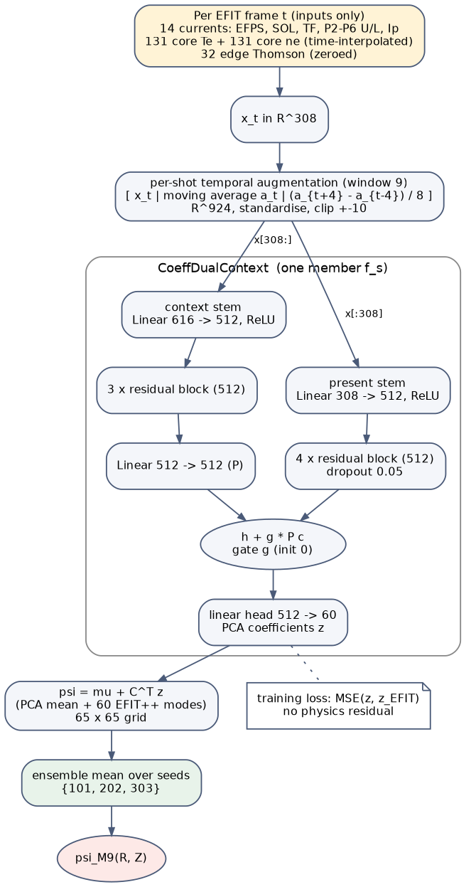
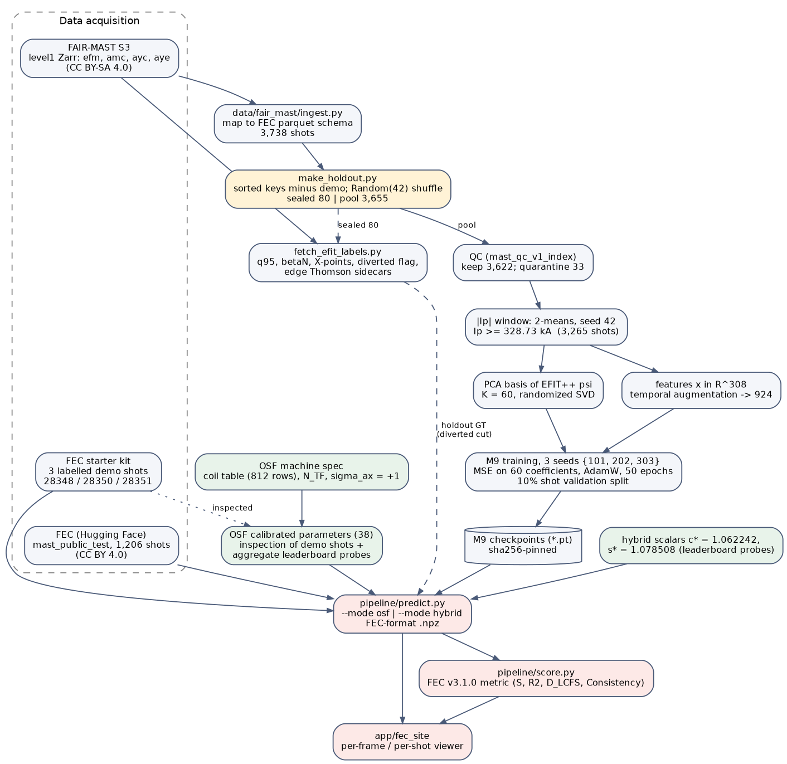
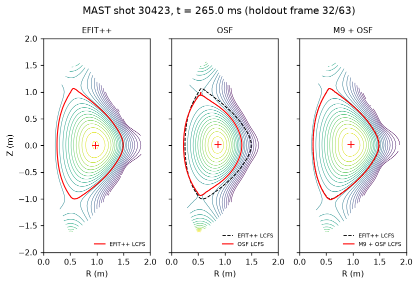
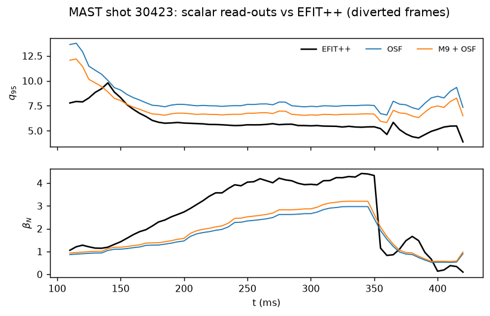

<!-- AUTO-GENERATED by scripts/compile_md_tree.py -- do not edit -->
<!-- Root: paper/MAST.md (64 notes) -->

# MAST Poloidal Flux Imputation in the Absence of Direct Magnetic Sensors

<!--
Root note of the paper. Each bullet links to a short, self-contained note; `python3 scripts/compile_md_tree.py`
flattens the tree in this order into `paper/arxiv.md`, and `bash scripts/build_paper_pdf.sh`
compiles it to `paper/MAST.pdf`. One link hop = one section level.
-->

## Abstract

A model judged by a composite score can reach a high value of that score with a simple loss, such
as mean squared error on a compressed representation of the field, and still fail to reproduce the
physical observables the score is meant to summarise. We state the hypothesis that such a model
generalises less well than one guided by matching those observables in intensity (the flux field
and its scalar time series) and in geometry (the last closed flux surface, O-point and X-points),
and we formalise a two-part objective: the *target* is the challenge score; the *route* is a set of
observable distances computed frame by frame. The setting is the reconstruction of MAST poloidal
flux $\psi(R,Z)$ on a $65\times65$ grid, with $q_{95}$ and $\beta_N$, from poloidal-field coil
currents, plasma current, toroidal-field current and midplane Thomson scattering, with no magnetic
probe or flux-loop input. Two models minimise different parts of the objective: OSF, a
free-boundary Grad–Shafranov forward solver over the 812-element MAST coil set, and M9, a PCA-basis
neural surrogate (not physics-informed) trained with coefficient MSE on 3,622 FAIR-MAST archive
shots. On a sealed, seed-42 FAIR-MAST holdout disjoint from M9 training (65 shots, 3,449 diverted
frames), OSF reaches $S=0.618634$ and the hybrid M9 + OSF $S=0.862677$ with
$R^2_\psi=0.997771$. Yet the same hybrid has a top or bottom boundary-tip gap of at least 50 mm in
24.2% of frames, $R^2=0.577001$ for lower triangularity and $R^2=0.342298$ for $q_{95}$; between
the three validation shots used for model selection and the holdout its flux score barely moves
while its boundary and $q_{95}$ errors grow. These measurements are consistent with the hypothesis but do not test
it; we describe an automated observable audit, implemented, and a FAIR-MAST-only training regime,
planned, that compares MSE-only and observable-guided training on the same data and holdout.

## Introduction


### Problem statement

Equilibrium reconstruction recovers the axisymmetric magnetic equilibrium of a tokamak plasma from
measurements. The standard tool, EFIT [@lao1985] and its MAST implementation EFIT++ [@appel2006],
fits the Grad–Shafranov equation [@shafranov1958; @grad1958] to magnetic probes and flux loops,
optionally constrained by kinetic and internal-field data. The magnetic sensors carry most of the
information about the plasma boundary.

The Fusion Equilibrium Challenge (FEC) [@fec2026dataset; @fec2026starter] poses the inverse
question: how much of $\psi(R,Z)$ can be recovered *without* direct magnetic sensors? Its MAST
[@darke1995; @sykes2001; @lloyd2003] inputs are the actuator currents (solenoid, P2–P6 upper/lower
poloidal-field circuits, the toroidal-field coil and the EFPS circuit), the plasma current $I_p$,
and the core and edge Thomson scattering profiles $T_e(R), n_e(R)$ on the horizontal midplane
[@scannell2010]. The targets are the EFIT++ flux map on a fixed $65\times65$ $(R,Z)$ grid,
$q_{95}$ and $\beta_N$ at each EFIT time.

This paper describes, at the level of the code, a MAST-only system for this task extracted into
the repository `catskillsresearch/mast-flux-imputation`, and reports its measured performance on a
sealed archive holdout.

### Thesis: target and route

The quantity a user of an imputed equilibrium asks for is a score: here the Fusion Equilibrium
Challenge composite $S$, which pools $R^2$ of $\psi$, $q_{95}$ and $\beta_N$ with a boundary
distance and shape consistency terms (Section 6). Call this the **target**. The cheapest way to
raise it is to fit the dominant term with the simplest loss, for example mean squared error on the
leading principal components of $\psi$, since $R^2_\psi$ carries 55% of the weight.

Our thesis is that such a fit can give a superficially high target score on the data it was fitted
or selected on, but need not generalise, unless training and model selection are guided by the
**route**: matching the physical observables a physicist checks in a viewer, in *intensity*
(the $\psi$ field and the scalar time series $q_{95}$, $\beta_N$, $\kappa$, $\delta$, $\ell_i$, $V$)
and in *geometry* (the last closed flux surface, the O-point and the X-points). A pooled pixel
$R^2$ near one is dominated by the large-scale vacuum field; it says little about where the
boundary is, which is what the observables measure.

We treat this as a hypothesis. Section 7 defines the objective, and Section 7.5 reports the
evidence available from the existing models, which is consistent with it: the hybrid model's
$R^2_\psi$ is above 0.997 on both the validation shots and a sealed holdout, while its boundary-tip
and $q_{95}$ errors are large and grow on the holdout, and lower triangularity is poorly reproduced
on both. The direct test, training the
same network on the same FAIR-MAST data with and without observable terms and scoring both once on
the same sealed holdout, is planned (Section 10).

### Contributions

1. A two-part objective for flux imputation: the challenge score as target, and frame-by-frame
   observable distances (field, boundary, O/X-points, scalar traces) as route, with the hypothesis
   that the route is needed for the target to generalise (Section 7).
2. An automated observable audit, `pipeline/audit.py`, that computes the route quantities for every
   frame of any FAIR-MAST shot, reproduces the official composite score, and reports the measured
   gaps between target and route for the existing models (Section 7.5).
3. A complete mathematical description of OSF (`mast_12_osf_0.0.12`), a free-boundary
   Grad–Shafranov forward solver driven by measured currents, separating machine constants from the
   38 calibrated parameters (Section 3).
4. An exact description of M9 (`M9_win50`), an ensemble of three PCA-basis neural surrogates of
   EFIT++ flux trained on FAIR-MAST [@jackson2024fairmast] with coefficient MSE; it is not a
   physics-informed neural network (Section 4).
5. A reproducible build: data acquisition, ingest, quality control, holdout construction with a
   disjointness proof, training, prediction, scoring and a browser viewer (Section 5), with measured
   results on a sealed holdout re-derived from saved prediction files (Section 8).
6. A record of the data each component was trained or tuned on (Section 9.2), and a planned
   FAIR-MAST-only regime that tests the thesis directly (Section 10).

### Related work

Free-boundary equilibrium solvers based on Green's functions of the Grad–Shafranov operator and
Picard iteration go back to [@lackner1976]; textbook treatments are given by
[@freidberg1987; @freidberg2014; @jardin2010; @wesson2011]. Neural networks have been used as
Grad–Shafranov solvers [@vanmilligen1995] and, constrained by measured magnetic signals, for fast
reconstruction [@joung2020]. Physics-informed neural networks (PINNs) [@raissi2019] add a PDE
residual to the training loss; the M9 model below does not. Reduced-order representations of fields
by principal component analysis / proper orthogonal decomposition
[@pearson1901; @hotelling1933; @berkooz1993] underlie the M9 output space.

## Data

Two public sources are used: the FEC MAST split and the FAIR-MAST archive from which the challenge
itself was built. Both carry EFIT++ reconstructions as labels; the models only ever see inputs.

### Fusion Equilibrium Challenge MAST data

The FEC dataset [@fec2026dataset] (CC BY 4.0) stores one Parquet row per shot with nested arrays
for every time series. Its MAST portion used here consists of

* `mast_public_test`: 1,206 shots with inputs only (labels withheld for the leaderboard);
* three labelled starter-kit shots, 28348, 28350 and 28351 (36, 42 and 37 EFIT frames), distributed
  with the starter kit [@fec2026starter] and fetched with `data/fec/fetch.py --demo` (sha256-pinned).

FEC keeps only *diverted* EFIT time slices. For MAST a slice is diverted when EFIT++ reports an
X-point (`efm/xpoint{1,2}`); the challenge reports that this keeps 66.4% of MAST frames
[@fec2026dataset]. The input time series are not subset, so `efit_times` is not contiguous.

### FAIR-MAST archive and ingest

FAIR-MAST [@jackson2024fairmast] publishes the MAST archive as Zarr stores at
`s3://mast/level1/shots/N.zarr` for shot number N (endpoint `s3.echo.stfc.ac.uk`, anonymous, CC BY-SA 4.0). The
ingest (`data/fair_mast/ingest.py`) reads four groups per shot,

| group | content | use |
|---|---|---|
| `efm` | EFIT++: `psirz`, `q_95`, `betan`, X-points | labels only |
| `amc` | coil and plasma currents | inputs |
| `ayc` | core Thomson $T_e, n_e$ | inputs |
| `aye` | edge Thomson $T_e, n_e$ | inputs |

and writes one row in the FEC schema plus `efit_psirz`. Static tables (coil geometry, chord
positions) are copied from a released FEC row; they are given inputs, not labels. 3,738 shots
were ingested. For the same shot and time, FAIR-MAST and FEC flux maps are bit-identical; the
populations differ only because the archive keeps all slices (ramp-up, limited, ramp-down).

`data/fair_mast/fetch_efit_labels.py` adds the scalar labels and the diverted flag. Its rule (any
finite `efm/xpoint{1,2}_rc`) reproduces the FEC frame selection on all three demo shots, and its
`q_95`, `betan` and edge-Thomson arrays match the FEC demo rows exactly (`tests/test_labels.py`).
For the three validation shots 28348, 28350 and 28351, the FAIR-MAST EFIT++ $\psi$, $q_{95}$ and
$\beta_N$ labels are bit-for-bit identical to the challenge organizers' release.

### Input vector and clocks

Per shot the model inputs are:

* **Actuators:** 13 current channels on a 0.2 ms (5 kHz) clock spanning $-2000$ to $4000$ ms
  (30,000 samples): `sol`, `p2u`, `p2l`, `p3u`, `p3l`, `p4u`, `p4l`, `p5u`, `p5l`, `p6u`, `p6l`,
  `tf`, `efps` (kA, or kA·turn for the P circuits), plus $I_p$.
* **Kinetic profiles:** core Thomson $T_e, n_e$ on 131 channels at about 2 ms cadence (130 chord
  radii in the FEC rows) and edge Thomson on 16 channels at $R\approx1.33$–$1.49$ m. All chords lie
  on the midplane $Z=0$ [@scannell2010].
* **Geometry:** the 812-row coil table (656 solenoid rows, 156 P2–P6 elements; centre, width,
  height), the 146-chord Thomson table and the $65\times65$ grid
  $R\in[0.06,2.00]$ m, $Z\in[-2,2]$ m.
* **Output clock:** `efit_times` (ms). Inputs are interpolated onto it.

There are no magnetic-probe ($B_\theta$ pick-up) or flux-loop channels. The labels, however, are
EFIT++ reconstructions that *were* constrained by those sensors.

### Sealed holdout and disjointness

The holdout is the split built into the M9 training code. Let $\mathcal K$ be the sorted list of
3,738 ingested keys and $\mathcal D$ the three demo shots. Then

$$
\mathcal S = \mathrm{first}_{80}\big(\mathrm{shuffle}_{42}(\mathcal K\setminus\mathcal D)\big),\qquad
\mathcal P = (\mathcal K\setminus\mathcal D)\setminus\mathcal S,\quad |\mathcal P| = 3655,
$$

with `random.Random(42).shuffle`. Quality control on $\mathcal P$ keeps 3,622 shots
($\mathcal Q$) and quarantines 33. `data/fair_mast/make_holdout.py` recomputes the split and checks

| check | result |
|---|---|
| recomputed $\mathcal P$ equals the QC training set (keep ∪ quarantine) | true (3,655) |
| QC keep list equals the shipped `mast_qc_keep.txt` | true (3,622) |
| $\mathcal Q\cap\mathcal S$, $\mathcal P\cap\mathcal S$, $\mathcal D\cap\mathcal S$ | ∅, ∅, ∅ |
| quarantined sealed shot | 27373 ∈ $\mathcal S$ |

and every M9 checkpoint records `seed = 42`, `train_shots = 3622`. The holdout is therefore
disjoint from all M9 training and validation data.

**FEC-protocol cut.** Each sealed shot is restricted to its diverted EFIT slices with the FEC rule;
inputs keep their full clocks. Fifteen sealed shots have no diverted slice (24901, 26506, 29932,
24876, 28295, 27681, 23248, 27621, 27720, 29297, 26273, 27819, 27778, 23424, 30442) and are
excluded, leaving **65 shots and 3,449 frames** out of 5,280 EFIT slices. Edge Thomson missing from
the ingest is overlaid from `aye` (60 of 65 shots).

**Caveat.** OSF was not fitted to these shots' labels, but its global scalar factors were tuned
against aggregate leaderboard scores on the public-test fold, and the FAIR-MAST pool likely
overlaps the FEC hidden folds (Section 9).

## Forward Grad–Shafranov model (OSF)

OSF (`models/osf`, model id `mast_12_osf_0.0.12`) computes, independently at every EFIT time, a
free-boundary equilibrium driven by the measured currents. It uses no flux label at inference and
no fit to measured flux. The block diagram is shown below; the following notes derive each block.

{#fig:osf}

### Grad–Shafranov equation and sign convention

In cylindrical coordinates $(R,\varphi,Z)$ an axisymmetric field is
$\mathbf B = \nabla\psi\times\nabla\varphi + F(\psi)\nabla\varphi$, with $\psi$ the poloidal flux per
radian (Wb rad$^{-1}$, the FEC convention) and $F=RB_\varphi$. Force balance
$\mathbf j\times\mathbf B=\nabla p$ with $p=p(\psi)$ gives the Grad–Shafranov equation
[@shafranov1958; @grad1958; @freidberg2014]

$$
\Delta^{*}\psi \equiv R\frac{\partial}{\partial R}\Big(\frac{1}{R}\frac{\partial\psi}{\partial R}\Big)+\frac{\partial^{2}\psi}{\partial Z^{2}}
= -\mu_0 R\,j_\varphi = -\mu_0R^2p'(\psi) - F F'(\psi).
\label{eq:gs}
$$

The toroidal current density is therefore $j_\varphi = R\,p'(\psi) + FF'(\psi)/(\mu_0R)$.

**Sign convention.** In the EFIT++/FAIR-MAST data the magnetic axis is a *maximum* of $\psi$; we
write $\sigma_{\rm ax}=+1$ (DIII-D in the same challenge uses $-1$). OSF solves directly in this
convention (`sigma_ax = 1`), so its output needs no sign flip, and the scorer's global sign probe
selects $s=+1$ on every run reported here.

**Free-boundary form.** With the Green's function $G$ of $\Delta^*$ (next note) the solution in the
whole domain is

$$
\psi(\mathbf x) = \psi_{\rm vac}(\mathbf x) + \int_{\Omega_p} G(\mathbf x,\mathbf x')\,j_\varphi(\mathbf x')\,dA',
\label{eq:freeb}
$$

where $\psi_{\rm vac}$ is generated by the external coils and $\Omega_p$ is the support of the plasma
current [@lackner1976; @jardin2010]. Vessel and passive-structure eddy currents are not modelled.

### Vacuum flux from the coil set

The flux per radian at $(R,Z)$ from a coaxial circular filament of radius $R'$ at height $Z'$
carrying current $I$ is [@jacksonCED1999; @lackner1976]

$$
\psi = I\,G(R,Z;R',Z'),\qquad
G = \frac{\mu_0\sqrt{RR'}}{2\pi k}\Big[(2-k^{2})K(k)-2E(k)\Big],\qquad
k^{2}=\frac{4RR'}{(R+R')^{2}+(Z-Z')^{2}},
\label{eq:green}
$$

with $K$ and $E$ the complete elliptic integrals of the first and second kind
[@abramowitz1964] (SciPy `ellipk`, `ellipe` with parameter $m=k^2$). $G$ is set to 0 on the axis
$R=0$ and $k^2$ is clipped below 1 to avoid the logarithmic singularity at coincident points.

The FEC MAST coil table has 812 rectangular elements: 656 solenoid rows, each one turn carrying
$I_{\rm sol}$, and 156 elements of the P2–P6 upper/lower circuits, each carrying its circuit's
ampere-turns divided by the number of elements of that circuit. Each rectangle of width $w$ and
height $h$ is replaced by the mean of $3\times3$ filaments at offsets $\{-1,0,1\}\cdot w/3$,
$\{-1,0,1\}\cdot h/3$. This gives one unit map $\Psi_c(R,Z)$ per circuit $c$, and

$$
\psi_{\rm vac}(R,Z) = \sum_{c}\lambda_c(b)\,I_c\,\Psi_c(R,Z).
\label{eq:vac}
$$

The TF and EFPS circuits do not enter $\psi_{\rm vac}$. The multipliers $\lambda_c$ are calibrated
functions of the bleed clock $b$ (next note):

| circuit | multiplier |
|---|---|
| P2 upper and lower | $\lambda_V = 1.8 - b$ |
| P2 lower, additionally | $\times\,(1+0.105(1-b))$ |
| P4 pair | $1.15$ |
| P5 pair | $\times\,(1-0.18(1-b))$ |
| solenoid | $0.5+0.10\,b$ |
| P3, P6 | 1 |

The plasma term in \eqref{eq:freeb} uses the same kernel evaluated between grid nodes, assembled once
as a $4225\times4225$ matrix including the cell area $\Delta R\,\Delta Z$.

### Walk and bleed clocks

A MAST discharge moves from a solenoid-driven start-up towards a diverted flat-top. OSF summarises
the phase with two dimensionless "clocks" computed from the measured currents at each EFIT time:

$$
w = \Big(1-\min\Big(\frac{\bar I_{P2}}{|I_p|\,r_\star},\,1\Big)\Big)^{2},\qquad
\bar I_{P2}=\tfrac12\big(|I_{P2U}|+|I_{P2L}|\big),\qquad
b = \mathrm{clip}\Big(\frac{I_{\rm sol}}{I_\star},0,1\Big),
\label{eq:clocks}
$$

with $r_\star=0.34$ and $I_\star=16.3$ kA. The divertor "walk" $w$ approaches 1 as the P2 current
becomes small relative to $I_p$; the solenoid "bleed" $b$ is 1 while the solenoid still carries
positive current and 0 once it has swung through zero. In the code these clocks set the current
support, the coil multipliers, the enclosed-current factor and the read-out laws. They are not
fitted per shot; they are deterministic functions of the actuators, which is how OSF blends
limited-like and diverted-like behaviour without a classifier.

### Current-density ansatz and Ampère constraint

**Support.** The plasma current is confined to a fixed ellipse $\Omega_p$ (the alternative D-shaped
support of the source code is disabled for MAST, `USE_VACUUM_XD = False`):

$$
\begin{aligned}
R_0 &= 0.82+0.10\,w-0.02\,b, & Z_0 &= 0.009-0.004\,b,\\
a_R &= 0.50+0.08\,w, & a_Z &= a_R+0.08+0.42\,b+0.18\,(1-b),
\end{aligned}
$$

all in metres, with the geometric normalised radius
$\tau=\rho^2=((R-R_0)/a_R)^2+((Z-Z_0)/a_Z)^2\in[0,1]$ on $\Omega_p$. $\tau$ is geometric, not a
function of $\psi$: the current shape is held fixed so that it cannot chase an outboard maximum.

**Profiles.** With $s_V$ the volume average over $\Omega_p$ of $s(\tau)=\tfrac12(1-\tau)^2$
(the integral of the pressure-derivative shape from $\tau$ to 1) and
$\Delta\psi=\psi_{\rm ax}-\psi_b$,

$$
p'(\tau) = \frac{\langle p\rangle\,(1-\tau)}{\Delta\psi\,s_V},\qquad
FF'(\tau) = -\bar\gamma\,(1-\tau),\quad \bar\gamma=-1,\qquad
j_\varphi = R\,p' + \frac{FF'}{\mu_0R}\ \text{ on }\Omega_p .
\label{eq:jphi}
$$

The pressure scale comes from a first-guess normalised beta $\beta_N^{(0)}$,

$$
\langle p\rangle = \frac{\beta_N^{(0)}}{100}\,\frac{B_t}{2\mu_0}\,\frac{I_p[\mathrm{MA}]}{a_R},
$$

where $\beta_N^{(0)}$ is
computed from the median Thomson pressure $2n_eT_e e$ over chords with $R\in[0.25,1.45]$ m, clipped to
$[0.2,4]$ (default 1.3 when no chord is valid).

**Ampère constraint.** The amplitude is then rescaled so that the enclosed current matches a
calibrated fraction of the measured plasma current:

$$
\int_{\Omega_p} j_\varphi\,dA = k\,I_p,\qquad k = 0.70+0.30\,w+0.15\,b+0.20\,(1-b).
\label{eq:ampere}
$$

The factor $k\ne1$ absorbs, in an averaged way, the current that a fixed ellipse misplaces and the
missing vessel currents. Only the *ratio* of the $p'$ and $FF'$ terms survives the rescaling, so the
pressure guess shapes the current but does not set its total.

### Picard iteration

Because $p'$ in \eqref{eq:jphi} depends on $\Delta\psi$ and $s_V$, and the read-outs depend on the
flux-surface geometry, the solve is a fixed-point (Picard) iteration. Starting from
$\psi^{(0)}=\psi_{\rm vac}$, pass $n$:

1. locate the O-point and the last closed surface of $\psi^{(n-1)}$; if they are acceptable,
   set $\Delta\psi$ from them and $W=\oint d\ell/(R|\nabla\psi|)$ on the 95% surface, otherwise
   fall back to the maximum of $\psi$ inside $\Omega_p$ and the mean outside;
2. evaluate $j_\varphi$ from \eqref{eq:jphi} and rescale it with \eqref{eq:ampere};
3. update $\psi^{(n)} = \psi_{\rm vac} + G\,j_\varphi$.

The loop stops when $\max|\psi^{(n)}-\psi^{(n-1)}|<10^{-4}$ Wb rad$^{-1}$ *and* the relative
changes of $W$, $\Delta\psi$ and $s_V$ are all below $10^{-3}$, or after 20 passes. "One-shot"
in the name OSF means that nothing is fitted to measured flux; numerically OSF performs up to 20
Picard passes per frame.

### Magnetic topology: O-point, X-points, LCFS

The magnetic axis is the maximum of $\psi$ (since $\sigma_{\rm ax}=+1$) inside the box
$R\in[0.65,1.05]$ m, $|Z|\le0.5$ m. During the iteration the last closed surface is the outermost
compact closed contour around the axis (elongation $\le2.6$, vertical span $\le2.8$ m, outer radius
$\ge1.0$ m, inner radius $\le0.4$ m); candidate X-points are saddles in $R\in[0.25,1.5]$ m with
$|Z|\ge0.4$ m.

For the read-outs, OSF calls the *scorer's* LCFS extractor (`fec_scoring/lcfs.py`, marching squares
via scikit-image [@vanderwalt2014]) restricted by the MAST vessel envelope
`mast_envelope.npz` (`mask_coarse`). OSF uses the envelope
mask in the $q_{95}$ and $\beta_N$ read-outs only. If the scorer extractor fails,
OSF falls back to its own closed-contour search.

### Safety factor read-out

For a flux surface the safety factor is $q = \frac{F}{2\pi}\oint\frac{d\ell}{R^{2}B_p}
= \frac{F}{2\pi}\oint\frac{d\ell}{R\,|\nabla\psi|}$ [@freidberg2014; @wesson2011]. OSF evaluates
the geometric integral on the 95% surface $\psi=\psi_{\rm ax}-0.95\,\Delta\psi$,

$$
W=\oint_{\psi_{95}}\frac{d\ell}{R\,|\nabla\psi|},\qquad q_{\rm map} = \frac{|F_b|\,W}{2\pi},\qquad
F_b = \frac{\mu_0N_{\rm TF}I_{\rm TF}}{2\pi},\ N_{\rm TF}=24,
\label{eq:qmap}
$$

with $F_b$ the *vacuum* toroidal function (no plasma dia/paramagnetism). Because $\psi$ is not
fully self-consistent, $q_{\rm map}$ is corrected by a calibrated factor law in the clocks:

$$
\begin{aligned}
u&=\mathrm{clip}\Big(\frac{q_{\rm map}-8}{17-8},0,1\Big),\qquad
d = 1+0.35\,(1-w)(1-b),\qquad
h = 2\,b(1-b)^{3},\\
q_{95} &= \big(0.55\,u + (1-u)\,d + h\big)\,q_{\rm map}.
\end{aligned}
\label{eq:qlaw}
$$

The "well" weight $u$ is 1 while the surface is long (ohmic phase), $d$ raises $q$ in the diverted
phase, and $h$ is a bump at the solenoid swing. If no closed surface is found the cylindrical
estimate $q^{*} = 5a^{2}|B_t|/(R_0 I_p[\mathrm{MA}])$ is returned. The hybrid mode multiplies the
OSF value by $c^{*}/1.20$ (Section 5).

### Normalised beta read-out

The Troyon-normalised beta [@troyon1984] is
$\beta_N = 100\,\beta_t\,a\,B_t/I_p[\mathrm{MA}]$ with $\beta_t = 2\mu_0\langle p\rangle/B_t^{2}$, i.e.

$$
\beta_N = \frac{100\,\langle p\rangle\,2\mu_0\,a}{B_t\,I_p[\mathrm{MA}]},\qquad B_t = F_b/R_0 .
\label{eq:betan}
$$

OSF estimates $\langle p\rangle$ as the mean of $2n_eT_e e$ (equal ion and electron pressure assumed)
over Thomson chords, interpolated to the EFIT time, whose radius lies inside the extracted LCFS,
$R\in[r_{\rm in},r_{\rm out}]$, with $a=(r_{\rm out}-r_{\rm in})/2$. Per frame the value is
clipped to $[0.2,4]$; over the shot a 7-frame running median removes single laser spikes, and the
result is multiplied by $(1-0.2\,w)$. The pressure is a midplane line average, not a volume average,
which is one reason the $\beta_N$ skill is limited (Section 8).

### Machine constants versus calibrated parameters

`models/osf/calibration.py` splits the symbols of the source file into four groups. The values are
copied exactly; there is no fitting code.

| group | count | examples | origin |
|---|---|---|---|
| `MACHINE_SPEC` | 12 | $N_{\rm TF}=24$, $\sigma_{\rm ax}=+1$, column names | MAST hardware, FEC schema |
| `GRID_GATES` | 15 | O-point box, X-point box, compactness gates | numerical acceptance on the $65\times65$ grid |
| `SWITCHES` | 12 | measured $I_p$ for read-out, LCFS-window pressure | code path |
| `CALIBRATED` | 38 | $r_\star, I_\star$, ellipse, $k$, $\lambda_c$, $q$ law, $\beta$ law | calibration (Section 5) |

The 38 calibrated values are those appearing in \eqref{eq:clocks}–\eqref{eq:qlaw} and the
$\beta_N$ post-processing:

* clocks: $r_\star=0.34$, $I_\star=16.3$ kA;
* ellipse: 0.82, 0.10, 0.02, 0.009, 0.004, 0.50, 0.08, 0.08, 0.42, 0.18;
* profiles: $\bar\gamma=-1$; $k$ coefficients 0.70, 0.30, 0.15, 0.20; two zero offsets;
* coil multipliers: 1.8, $-1$, 0.105, 1.15, $-0.18$, 0.5, 0.10;
* $q$ law: 17, 8, 0.55, 0.35, 2, 3;
* $\beta$ law: 7-frame median, 0.20, clip $[0.2,4]$, fallback 1.3, $s_\beta=1$.

## Archive-trained flux model (M9)

M9 (`models/m9`, checkpoints `CRC_FEQ_mast_M9_win50_i{101,202,303}.pt`) is a data-driven
estimator of $\psi$ learned from FAIR-MAST EFIT++ reconstructions. It produces only the flux map;
in the hybrid mode $q_{95}$ and $\beta_N$ come from OSF.

{#fig:m9}

### What M9 is, and is not

The training script of the source repository is named `run_crc_feq_pinn_mast.py`, and the model was
informally called a "PCA-PINN". It is not a physics-informed neural network in the sense of
[@raissi2019]: the loss is the mean-squared error between predicted and EFIT++ PCA coefficients,

$$
\mathcal L(\theta) = \frac{1}{|B|}\sum_{t\in B}\frac{1}{60}\big\|f_\theta(\tilde x_t) - z_t\big\|_2^{2},
\qquad z_t = C\,(\psi^{\rm EFIT}_t-\mu),
$$

with no Grad–Shafranov residual, boundary condition or conservation term. Any physics in the output
is inherited from the EFIT++ training targets and from the PCA subspace they span. We therefore call
M9 a *PCA-basis neural surrogate*; the "pinn" in the file name is legacy. The network also carries
five scalar heads ($q_{95}$, $\beta_N$, $R_{\rm axis}$, $Z_{\rm axis}$, $\ell_i$) that receive no loss
and are kept only so that the shipped state dictionaries load.

### PCA basis of EFIT++ flux

Each EFIT++ map is flattened to $\mathbf y_t\in\mathbb R^{4225}$. With $\mu$ the sample mean and
$C\in\mathbb R^{60\times4225}$ the leading 60 principal directions (orthonormal rows)
[@pearson1901; @hotelling1933], the reduced representation and its reconstruction are

$$
z_t = C(\mathbf y_t-\mu)\in\mathbb R^{60},\qquad \hat{\mathbf y}_t = \mu + C^{\top}z_t .
\label{eq:pca}
$$

This is the proper orthogonal decomposition of the flux ensemble [@berkooz1993]. Because $C$ has
orthonormal rows, MSE on $z$ equals pixel MSE of the *projected* target. The basis is fitted with
randomized SVD [@halko2011] (scikit-learn [@pedregosa2011], seed 42, three power iterations) on at
most 200,000 frames drawn shot-balanced from the training shots, after the $|I_p|$ window of the
next note. The PCA basis and mean are therefore built from FAIR-MAST EFIT++ labels (Section 9.2).

### Features and temporal context

For each EFIT frame $t$ a raw vector $x_t\in\mathbb R^{308}$ is built:

| slice | content |
|---|---|
| 0–13 | 13 coil currents (EFPS, SOL, TF, P2–P6 lower/upper) and $I_p$, linearly interpolated to $t$ |
| 14–275 | 131 core-Thomson $T_e$ and 131 $n_e$ channels, interpolated in time (0 outside the Thomson clock) |
| 276–307 | 16 + 16 edge-Thomson channels; **zeroed at inference** (`mask_edge`); in training they hold what the ingest carried, which for most archive shots is nothing (60 of the 65 evaluated holdout shots lacked edge Thomson in the ingest) |

No spatial remapping of the Thomson channels is done; channel index stands in for radius. A per-shot
temporal augmentation with window 9 appends the centred moving average $a_t$ (clamped at the shot
edges) and its smoothed central difference $(a_{t+4}-a_{t-4})/8$, giving
$A(x)_t=[x_t\,|\,a_t\,|\,\dot a_t]\in\mathbb R^{924}$. Features are standardised with the training
mean and standard deviation and clipped to $\pm10$:
$\tilde x_t=\mathrm{clip}_{\pm10}\big((A(x)_t-m)/\sigma\big)$.

Since the context uses EFIT frames up to four steps ahead, M9 is a smoother over the shot, not a
causal real-time estimator.

### Network

Each member $f_s$ (`CoeffDualContext`) has two residual encoders [@he2016]:

$$
\begin{aligned}
h &= \mathrm{Res}^{(4)}_{512}\big(\mathrm{ReLU}(W_h\,\tilde x_{[0,308)})\big), &
c &= \mathrm{Res}^{(3)}_{512}\big(\mathrm{ReLU}(W_c\,\tilde x_{[308,924)})\big),\\
h' &= h + g\,P\,c, & z &= W_z\,h' + b_z\in\mathbb R^{60},
\end{aligned}
\label{eq:net}
$$

where $\mathrm{Res}^{(n)}_{512}$ is a stack of $n$ residual blocks of width 512 with dropout 0.05,
$P$ is a $512\times512$ linear projection and $g$ is a scalar gate initialised to 0, so training
starts from the present-frame encoder alone and learns how much temporal context to admit. The
predicted flux is reconstructed with \eqref{eq:pca}.

### Training

The recipe (`models/m9/train.py`, a port of the original with flags
`--seed 42 --epochs 50 --qc --shot-balanced --mask-edge --win`) is:

1. **Split** as in Section 2.4: 80 sealed shots, pool of 3,655.
2. **QC:** quarantine a shot if $\max|\psi|$ exceeds the pool median by more than 10 median
   absolute deviations, or if it is short, non-finite or constant: 3,622 kept.
3. **$|I_p|$ window:** 2-means on all keep-shot frame values of $|I_p|$ (seed 42); frames with
   $|I_p|$ at or above the midpoint of the two centres, $I_p^{\rm lo}=328.7293519015368$ kA, are
   used. 3,265 shots contribute frames. Limited and diverted frames are both included.
4. **PCA** with $K=60$ (Section 4.2).
5. **Validation:** 10% of the windowed shots (seed-42 shuffle).
6. **Optimisation:** AdamW [@loshchilov2019] (learning rate $10^{-3}$, weight decay $10^{-4}$),
   gradient-norm clip 1.0, batches of 2048 frames drawn shot-balanced (uniform shot, then uniform
   frame), $\lceil N_{\rm train}/2048\rceil$ steps per epoch, 50 epochs, keeping the epoch with the
   lowest validation MSE (46, 49 and 46 for the shipped members). PyTorch [@paszke2019].

During extraction the split, QC keep list and $I_p^{\rm lo}$ were reproduced exactly and a one-epoch
smoke test ran, but a full retrain was not carried out; the shipped weights are verified by
sha256 instead (Section 9).

### Ensemble

Three members differ only in their initialisation seed $s\in\{101,202,303\}$ (the data split is
shared). The prediction is the mean of the reconstructed maps,

$$
\hat\psi_{\rm M9} = \frac13\sum_{s\in\{101,202,303\}}\Big(\mu+C^{\top}f_s(\tilde x)\Big).
$$

Each checkpoint stores its own $\mu$, $C$ and feature statistics, so the average is taken in
$\psi$-space. The ported inference reproduces the original ensemble output with maximum absolute difference 0 on the three
demo shots.

## Hybrid mode, build and calibration


### Hybrid M9 + OSF

The shipped submission recipe combines the two models: the flux map comes from M9, the scalars
from OSF after two post-hoc factors,

$$
\psi = \hat\psi_{\rm M9},\qquad
q_{95} = \mathrm{clip}\Big(q_{95}^{\rm OSF}\,\frac{c^{*}}{1.20},\,2,\,25\Big),\qquad
\beta_N = \mathrm{clip}\big(\beta_N^{\rm OSF}\,s^{*},\,0.2,\,5\big),
$$

with $c^{*}=1.062242$ and $s^{*}=1.078508$. The OSF read-outs are evaluated on the OSF flux, not on
the M9 flux. The factors were obtained from aggregate leaderboard scores on the FEC public-test fold
(Section 9).

### Build pipeline

The figure below shows the complete build, from public data to scored predictions and the viewer.
Green boxes are OSF parameters, the amber box is the holdout split, red boxes are the
prediction/evaluation stages.

{#fig:pipeline}

Labels enter in exactly three places: the M9 PCA basis and loss (archive training pool), the
holdout ground truth (sealed shots, evaluation only), and — informally — the OSF calibration
(next note).

### How OSF was calibrated

No fitting code exists for OSF; its 38 calibrated values (Section 3.9) are hand-set constants. Per
the calibration notes of the source repository they were chosen by

* inspecting physics end-members (ohmic start, solenoid swing, diverted flat-top) on the three
  labelled starter-kit shots, with $R^2$ values on those shots quoted to justify shape choices; and
* five aggregate-score probes of the Codabench leaderboard on `mast_public_test`.

The demo shots are therefore *not* held out for OSF, and the public-test fold has been used,
in aggregate, for tuning. The sealed archive holdout is label-disjoint from all of this, but OSF's
global factors were not chosen blind to MAST data. We report the demo-shot scores separately and
for reference only.

### Commands

```
python data/fec/fetch.py --demo           # 3 labelled shots
python data/fec/fetch.py --public-test    # 1,206 public-test shots
python data/fair_mast/ingest.py \
    --pool data/fair_mast/mast_pool3.txt --shots 5000
python data/fair_mast/make_holdout.py     # sealed-80 + checks
python data/fair_mast/fetch_efit_labels.py \
    --keys-json data/fair_mast/holdout_seed42.json
python -m models.m9.train --build-cache
python -m models.m9.train --member all
python -m pipeline.predict --split holdout --mode osf
python -m pipeline.predict --split holdout --mode hybrid
python -m pipeline.score outputs/holdout_hybrid.npz
python -m pipeline.audit outputs/holdout_hybrid.npz \
    --tag holdout_hybrid_shipped          # route quantities
python -m app.fec_site --port 8770
```

Predictions are FEC-format `.npz` files with keys `shot_XXXX_psirz` $(T,65,65)$, `shot_XXXX_q95`
and `shot_XXXX_betaN` $(T,)$, plus a JSON sidecar giving the shot order. Models only see
`inputs_only(row)`, which removes every `efit_*` label column. Paths may point at an existing data
copy through `FEC_MAST_DIR`, `FEC_DEMO_DIR`, `FAIR_MAST_DIR`, `FAIR_MAST_LABELS_DIR`,
`M9_WEIGHTS_DIR` or `CATSKILLS_FUSION_LAB`.

## Scoring

All results use the FEC scoring code v3.1.0 [@fec2026starter], vendored byte-identical in
`fec_scoring/`; `pipeline/score.py` ports the fold reduction.

### Composite score

For a fold of shots, with $R^2 = 1-\mathrm{SS}_{\rm res}/\mathrm{SS}_{\rm tot}$ pooled over all
frames (and, for $\psi$, all pixels) of the fold and $\mathrm{SS}_{\rm tot}$ taken about the
ground-truth mean,

$$
S = 0.55\,\max(0,R^2_\psi) + 0.15\,\max\Big(0,\tfrac12\big(R^2_{q_{95}}+R^2_{\beta_N}\big)\Big)
+ 0.10\,\big(1-\min(1,D_{\rm LCFS})\big) + 0.20\,\mathrm{Cons}.
\label{eq:score}
$$

Pooling over the fold means that shots with many frames weigh more, and that $R^2$ is measured
against the variance *across* shots, which is large for $\psi$ and comparatively small for
$q_{95}$ and $\beta_N$.

### LCFS distance

For each frame the last closed flux surface $\Gamma$ is extracted from the predicted and from the
EFIT++ map by the same code (marching squares inside the vessel envelope). The per-frame distance is
the symmetric Hausdorff distance [@huttenlocher1993] normalised by the reference geometric major
radius of the shot,

$$
d_t = \min\Big(1,\ \frac{d_H(\Gamma^{\rm pred}_t,\Gamma^{\rm EFIT}_t)}{R_{\rm geo}}\Big),\qquad
d_H(A,B)=\max\Big\{\sup_{a\in A}\inf_{b\in B}|a-b|,\ \sup_{b\in B}\inf_{a\in A}|a-b|\Big\}.
$$

$D_{\rm LCFS}$ averages $d_t$ over the frames of a shot and then over shots. A failed predicted
LCFS counts as $d_t=1$; frames whose *reference* LCFS cannot be extracted are dropped.

### Consistency scalars

Seven scalars are derived from each predicted and each EFIT++ map by the same routine
(`fec_scoring/derive.py`): the magnetic-axis position $R_{\rm axis}, Z_{\rm axis}$; elongation
$\kappa$ and upper/lower triangularity $\delta_{\rm top},\delta_{\rm bot}$ from the LCFS extremes;
the plasma volume $V = 2\pi\int_A R\,dR\,dZ$ inside the LCFS; and the internal inductance in the
ITER form $\ell_i(2)=\langle B_p^{2}\rangle_V/(\mu_0I_p/\ell_p)^{2}$, evaluated from $|\nabla\psi|$.
With $R^2_j$ the pooled $R^2$ of scalar $j$,

$$
\mathrm{Cons} = \frac17\sum_{j=1}^{7}\max\big(0,R^2_j\big).
$$

The term measures whether the predicted map is geometrically equivalent to the reconstruction, not
whether it is close pixel by pixel.

### Sign and missing-value policy

A single fold-global sign $s\in\{+1,-1\}$ is chosen to minimise $\mathrm{SS}_{\rm res}(\psi)$, and the
contour work uses the axis sign $\sigma_{\rm ax}s$; all runs here select $s=+1$. Non-finite
predicted pixels or scalars are replaced by the ground-truth mean, and a derived scalar that cannot
be computed from the prediction is replaced in the same way, so failures cost score rather than
being skipped.

## Objective: target and route

The models of Sections 3–5 are two ways of reducing one objective. This section defines that
objective, states the hypothesis it rests on, and reports the evidence the existing models give.

### Target: the challenge score

The target is what the user of the imputation asks for: the composite score $S$ of
Eq. \eqref{eq:score}, with its terms $R^2_\psi$, $R^2_{q_{95}}$, $R^2_{\beta_N}$, $1-D_{\rm LCFS}$ and
the consistency average over $R_{\rm axis}, Z_{\rm axis}, \kappa, \delta_{\rm top},
\delta_{\rm bot}, V, \ell_i$ (Section 6). $S$ is a fold-level number: every $R^2$ is pooled over all
frames of all shots, so it rewards matching the variance *between* shots and is dominated, through
the 0.55 weight on $R^2_\psi$, by the large-scale flux that the coil currents largely determine.

### Route: observable distances

The route consists of the quantities a physicist reads off the viewer `app/fec_site` for each
frame $t$ of a shot: the flux map with its last closed flux surface (LCFS) $\Gamma_t$, enclosed region
$\Omega_t$, O-point $x_{O,t}$ and X-points $x_{X,t}$, and the scalar traces below it. With hats for
the prediction and no hat for EFIT++, the audit `pipeline/audit.py` computes, per frame, the intensity terms

$$
e_{\psi,t}=\frac{1}{N}\sum_{ij}\big(\hat\psi_{t,ij}-\psi_{t,ij}\big)^2,\qquad
e_{s,t}=\big|\hat s_t-s_t\big|,\quad s\in\{q_{95},\beta_N,R_{\rm axis},Z_{\rm axis},\kappa,
\delta_{\rm top},\delta_{\rm bot},V,\ell_i\},
\label{eq:route-intensity}
$$

the geometry terms

$$
h_t=d_H(\hat\Gamma_t,\Gamma_t),\qquad a_t=\frac{|\hat\Omega_t\,\triangle\,\Omega_t|}{|\Omega_t|},\qquad
o_t=|\hat x_{O,t}-x_{O,t}|,\qquad x_t=|\hat x_{X,t}-x_{X,t}|,
\label{eq:route-geometry}
$$

and the indicators $j_t=[\,g_t\ge 50\ \mathrm{mm}\,]$ with
$g_t=\max(|\Delta Z_{\rm top}|,|\Delta Z_{\rm bot}|)$ the vertical gap of the LCFS tips (the
viewer's jump flag), X-point lost or gained, and limited/diverted flip. Per shot, each scalar trace
also gets a lag $\ell_s=\arg\max_{|L|\le4}\mathrm{corr}(\hat s_{t+L},s_t)$, a jitter ratio
$J_s=\mathrm{rms}(\Delta^2\hat s)/\mathrm{rms}(\Delta^2 s)$ and a linear drift of $\hat s-s$.

The route functional is a weighted sum of fold means of these quantities, each scaled by a
reference value $m_k^{\rm ref}$ (for example the value of the current model),

$$
\mathcal R=\sum_k w_k\,\frac{\overline{m}_k}{m_k^{\rm ref}} .
\label{eq:route}
$$

The weights $w_k$ are a design choice of the planned training regime and are not fixed here. For
comparing two models the audit avoids them: it reports every $\overline m_k$ and every target term
separately, and a new model is accepted only if it is at least as good as the old one on each.

### Hypothesis

Let a model be trained by minimising a simple loss $\mathcal L$ that is close to one target term,
here coefficient MSE, which is close to $1-R^2_\psi$ restricted to the PCA subspace. The hypothesis
is:

> **H.** Minimising $\mathcal L$ can give a high target score $S$ on the data used for fitting or
> selection while the route quantities $\overline m_k$ stay large; such a model generalises less
> well, in $S$ and in the route, than one whose training or selection also reduces $\mathcal R$.

The mechanism is that $R^2_\psi$ is pooled over pixels and dominated by the vacuum field, so a
residual concentrated near the boundary, where the LCFS, X-points, $\delta$ and $q_{95}$ are
decided, costs little in $\mathcal L$ but a lot in geometry and in the scalar terms of $S$. Matching
the observables constrains exactly that residual.

### How the current models realise the objective

The two models address different parts of the objective, and neither is trained on $\mathcal R$.

* **M9** minimises coefficient MSE over 60 principal components of EFIT++ flux (Section 4). That
  is an intensity term; the network sees no boundary, point or scalar term. Its training records
  only the validation coefficient MSE, so no route quantities exist for its training data.
* **OSF** imposes Grad–Shafranov physics, which fixes the relation between currents, field and
  boundary, and reads $q_{95}$ and $\beta_N$ off the solved equilibrium (Section 3). Its calibrated
  parameters were set by hand from physics end-members on the three validation shots, inspected in
  the viewer, and from five aggregate-score probes (Section 5.3); this is the route applied by eye.
* **Selection** of the shipped M9 checkpoints used a target threshold on the three validation shots
  ($R^2_\psi\ge0.9976$), not route quantities.

The audit of Section 7.2 is the formal version of the viewer inspection. It now scores both models
(Section 7.5); putting $\mathcal R$ into training and checkpoint selection is the planned regime of
Section 10.

### Evidence from the existing models

The audit was run on the saved predictions of both shipped models, on the three validation shots
(115 frames; used for OSF tuning and the M9 acceptance threshold, Sections 4.5 and 5.3) and on the sealed
holdout (65 shots, 3,449 frames; never used for fitting or selection). It reproduces the official
scorer's $S$ on every run.

| quantity | M9 + OSF demo | M9 + OSF holdout | OSF demo | OSF holdout |
|---|---|---|---|---|
| $S$ | 0.871921 | 0.862677 | 0.774217 | 0.618634 |
| $R^2_\psi$ | 0.998555 | 0.997771 | 0.982004 | 0.917210 |
| $R^2_{q_{95}}$ | 0.818390 | 0.342298 | 0.841487 | 0.164457 |
| $R^2_{\beta_N}$ | 0.594122 | 0.394260 | 0.689767 | 0.379077 |
| $1-D_{\rm LCFS}$ | 0.955503 | 0.945207 | 0.876086 | 0.734036 |
| Cons | 0.606137 | 0.820703 | 0.158309 | 0.000000 |
| $R^2(Z_{\rm axis})$ | -60.084051 | 0.904550 | -0.221832 | -0.137536 |
| $R^2(\delta_{\rm bot})$ | 0.111411 | 0.577001 | -0.133666 | -0.169103 |
| $R^2(\ell_i)$ | 0.933054 | 0.668520 | 0.328462 | -0.278707 |

Table: Target terms from the audit (scorer v3.1.0 definitions).

| quantity | M9 + OSF demo | M9 + OSF holdout | OSF demo | OSF holdout |
|---|---|---|---|---|
| mean LCFS Hausdorff (mm) | 35.6 | 41.3 | 98.6 | 207.2 |
| p95 LCFS Hausdorff (mm) | 64.8 | 108.6 | 215.9 | 585.7 |
| mean LCFS area mismatch | 2.3% | 3.0% | 8.5% | 21.5% |
| mean O-point offset (mm) | 13.2 | 16.2 | 16.0 | 75.1 |
| mean X-point offset (mm) | 7.9 | 21.2 | 77.8 | 109.9 |
| frames with LCFS tip gap $\ge$ 50 mm | 20.0% | 24.2% | 73.0% | 90.5% |
| frames with X-point lost | 0.0% | 0.2% | 4.3% | 1.2% |
| limited/diverted flips | 0.0% | 2.9% | 0.0% | 6.2% |
| mean $\lvert\Delta q_{95}\rvert$ | 0.571964 | 1.383382 | 0.619592 | 1.521025 |
| mean $\lvert\Delta\beta_N\rvert$ | 0.127459 | 0.490140 | 0.111738 | 0.522378 |
| mean absolute lag of scalar traces (frames) | 0.969697 | 0.808239 | 1.272727 | 2.103693 |

Table: Route quantities from the audit: per-frame means or rates pooled over all frames; the lag is averaged over shots and scalar traces.

Three observations bear on the hypothesis.

1. **A near-saturated flux score coexists with large observable errors.** On the holdout the hybrid
   has $R^2_\psi=0.997771$, yet a boundary-tip gap of at least 50 mm in 24.2% of frames, a p95
   Hausdorff distance of 108.6 mm, a limited/diverted flip in 2.9% of frames,
   $R^2(\delta_{\rm bot})=0.577001$ and $R^2_{q_{95}}=0.342298$. The term that coefficient MSE
   targets is almost perfect; the boundary and the scalars are not.
2. **From selection shots to holdout, the target barely moves while the route degrades.** For the
   hybrid, $R^2_\psi$ goes from 0.998555 to 0.997771 and $S$ from 0.871921 to 0.862677, while the
   p95 Hausdorff distance goes from 64.8 to 108.6 mm, the mean X-point offset from 7.9 to 21.2 mm,
   the tip-gap rate from 20.0% to 24.2%, $R^2_{q_{95}}$ from 0.818390 to 0.342298 and
   $R^2(\ell_i)$ from 0.933054 to 0.668520. Selection by $R^2_\psi$ on three shots did not carry
   over to the observables.
3. **The physics model tuned by eye shows the same pattern more strongly.** OSF goes from
   $S=0.774217$ to $0.618634$, and its tip-gap rate from 73.0% to 90.5%.

These observations are consistent with H but do not test it. The validation shots are three
consecutive shots, so their pooled $R^2$ values are noisy: $R^2(Z_{\rm axis})=-60.084051$ there
reflects a tiny between-shot variance, and several consistency terms are *higher* on the holdout
(Cons 0.606137 versus 0.820703). The two populations also differ in shot mix. No model trained with
route terms exists yet, and M9's training logs contain no route quantities. The direct test is the
FAIR-MAST-only regime of Section 10: the same network, data, seeds and holdout, trained once with
coefficient MSE alone and once with route terms in the loss and in checkpoint selection, compared
term by term with this audit.

## Results

Every number in this section is read from the saved prediction and score files
(`outputs/holdout_osf.npz`, `outputs/holdout_hybrid.score.json` and the corresponding demo files) by `scripts/make_result_figures.py`, which
writes the tables imported below and the figures. The holdout runs were produced on 2026-11-18 with
seed 42 and scorer v3.1.0.

### Sealed holdout

Sealed-80 holdout (seed 42), restricted to diverted frames: 65 shots, 3,449 frames.

| model | $S$ | $R^2_\psi$ | $R^2_{q_{95}}$ | $R^2_{\beta_N}$ | $1-D_{\rm LCFS}$ | Consistency |
|---|---|---|---|---|---|---|
| OSF | 0.618634 | 0.917210 | 0.164457 | 0.379077 | 0.734036 | 0.000000 |
| M9 + OSF | 0.862677 | 0.997771 | 0.342298 | 0.394260 | 0.945207 | 0.820703 |

Table: Composite score and terms on the sealed holdout.

| split | model | shots | frames | $\psi$ sign | LCFS fail | derive fail | per-shot mean $R^2_\psi$ | scorer |
|---|---|---|---|---|---|---|---|---|
| holdout | OSF | 65 | 3449 | +1 | 0.0000% | 0.0207% | 0.913002 | v3.1.0 |
| holdout | M9 + OSF | 65 | 3449 | +1 | 0.0000% | 0.0041% | 0.996645 | v3.1.0 |
| demo | OSF | 3 | 115 | +1 | 0.0000% | 0.0000% | 0.981975 | v3.1.0 |
| demo | M9 + OSF | 3 | 115 | +1 | 0.0000% | 0.0000% | 0.998571 | v3.1.0 |

Table: Run facts. LCFS fail is the fraction of frames whose predicted LCFS could not be extracted;
derive fail the fraction of non-computable consistency scalars.

M9 + OSF improves every term. The flux itself is nearly solved by M9 ($R^2_\psi=0.997771$, pooled;
per-shot mean 0.996645), and the LCFS distance falls from 0.266 to 0.055 of the major radius. OSF,
with no flux labels at all, reaches $R^2_\psi=0.917210$ but its geometry is biased enough that every
consistency $R^2$ is negative. The scalar term is weak for both, because both use the OSF
read-outs.

### Consistency components

Pooled $R^2$ of the seven derived scalars on the sealed holdout (before the $\max(0,\cdot)$ of the
Consistency term):

| model | $R_{\rm axis}$ | $Z_{\rm axis}$ | $\kappa$ | $\delta_{\rm top}$ | $\delta_{\rm bot}$ | $V$ | $\ell_i$ |
|---|---|---|---|---|---|---|---|
| OSF | -0.492257 | -0.137536 | -0.069541 | -0.502441 | -0.169103 | -2.645417 | -0.278707 |
| M9 + OSF | 0.889709 | 0.904550 | 0.893904 | 0.906330 | 0.577001 | 0.904904 | 0.668520 |

Table: Consistency components on the sealed holdout.

For M9 + OSF the weakest are $\delta_{\rm bot}$ (0.577001) and $\ell_i$ (0.668520): the lower X-point
region and the current-profile peaking are the least constrained by the inputs. For OSF the volume
$R^2$ of $-2.645417$ reflects a systematically small LCFS (next note).

### Flux maps and per-shot spread

The example frame below is from the holdout shot whose M9 + OSF per-shot $R^2_\psi$ is the median
among shots with at least 40 frames (shot 30423, per-shot $R^2_\psi$ 0.928576 for OSF and 0.999028
for M9 + OSF), at the middle diverted frame.

{#fig:psi}

OSF reproduces the diverted topology, but its LCFS lies inside the EFIT++ LCFS, most visibly on the
outboard side and at the top; M9 + OSF overlays EFIT++ almost exactly. The per-shot distributions show the
same pattern over the whole holdout:

{#fig:pershot}

The eight shots with the lowest M9 + OSF $R^2_\psi$:

| shot | frames | $R^2_\psi$ OSF | $R^2_\psi$ M9+OSF | $D_{\rm LCFS}$ OSF | $D_{\rm LCFS}$ M9+OSF |
|---|---|---|---|---|---|
| 27224 | 10 | 0.8403 | 0.9508 | 0.3643 | 0.2353 |
| 24463 | 19 | 0.9303 | 0.9632 | 0.2126 | 0.1323 |
| 24094 | 75 | 0.9388 | 0.9680 | 0.1829 | 0.0892 |
| 23407 | 49 | 0.8797 | 0.9841 | 0.6483 | 0.1047 |
| 23882 | 75 | 0.9563 | 0.9916 | 0.1747 | 0.0823 |
| 27413 | 56 | 0.8975 | 0.9937 | 0.3433 | 0.1261 |
| 23476 | 64 | 0.9596 | 0.9939 | 0.1528 | 0.0463 |
| 26464 | 76 | 0.9351 | 0.9946 | 0.1805 | 0.1070 |

Table: Worst holdout shots by M9 + OSF per-shot $R^2_\psi$.

### Scalars

{#fig:scatter}

{#fig:traces}

Both read-outs track the trend of EFIT++ within a shot but carry shot-dependent offsets: on shot
30423 the OSF $q_{95}$ is about 2 too high through the flat-top (M9 + OSF about 1) and $\beta_N$ is too low at high
pressure. Two causes are structural: $q_{95}$ uses the vacuum $F$ and an OSF flux whose 95% surface
is too short, and $\beta_N$ uses a midplane line average of $2n_eT_e$ rather than a volume average.
The hybrid factors $c^{*}, s^{*}$ only rescale these values, which raises $R^2_{q_{95}}$ from
0.164457 to 0.342298 and $R^2_{\beta_N}$ from 0.379077 to 0.394260.

### Demo shots (not held out)

For reference, the three labelled FEC demo shots (115 frames). These shots informed the OSF
calibration and the M9 acceptance gate, so they are **not** a held-out test.

| model | $S$ | $R^2_\psi$ | $R^2_{q_{95}}$ | $R^2_{\beta_N}$ | $1-D_{\rm LCFS}$ | Consistency |
|---|---|---|---|---|---|---|
| OSF | 0.774217 | 0.982004 | 0.841487 | 0.689767 | 0.876086 | 0.158309 |
| M9 + OSF | 0.871921 | 0.998555 | 0.818390 | 0.594122 | 0.955503 | 0.606137 |

Table: Composite score on the three FEC demo shots (not held out).

| model | $R_{\rm axis}$ | $Z_{\rm axis}$ | $\kappa$ | $\delta_{\rm top}$ | $\delta_{\rm bot}$ | $V$ | $\ell_i$ |
|---|---|---|---|---|---|---|---|
| OSF | 0.750281 | -0.221832 | -0.594806 | 0.029417 | -0.133666 | -0.024222 | 0.328462 |
| M9 + OSF | 0.891429 | -60.084051 | 0.901171 | 0.596231 | 0.111411 | 0.809666 | 0.933054 |

Table: Consistency components on the FEC demo shots.

With only three shots, the pooled $R^2$ of a scalar with little between-shot variance can be
extreme: $R^2(Z_{\rm axis})=-60.084051$ for M9 + OSF results from a tiny $\mathrm{SS}_{\rm tot}$, not
from a large error. Demo-shot scores overstate holdout performance for the scalars.

### Relation to the training-log figure

The M9 training log reports a "sealed $R^2$" of about 0.378. That figure is a pixel $R^2$ pooled over
*all* 8,161 EFIT slices of the 80 sealed shots — ramp-up, limited and ramp-down phases included —
and it contains shot 27373, quarantined from training as a QC outlier. Recomputed with the shipped
ensemble it is 0.378687, and 0.733818 without shot 27373. On the FEC protocol (diverted slices only)
the same ensemble gives the 0.997771 above. The difference is the frame population, not a different
model.

## Reproducibility and limitations


### Verification of the extraction

| check | result |
|---|---|
| ported OSF vs original code, 3 demo shots | $\max|\Delta\psi|$, $\max|\Delta q_{95}|$, $\max|\Delta\beta_N|$ = 0 |
| ported M9 inference vs original, 3 demo shots | $\max|\Delta\psi|$ = 0 |
| `pipeline.score` vs the source repository's scorer, same predictions | 19 of 19 result fields identical, all four runs |
| M9 split / QC / $|I_p|$ window recomputed | keep list identical; $I_p^{\rm lo}=328.7293519015368$ kA |
| shipped M9 checkpoints | sha256 match the source `SHA256SUMS` |
| FAIR-MAST labels vs FEC demo rows | $\psi$ bit-identical; $q_{95}$, $\beta_N$ and the diverted-frame counts (36/42/37) exact |
| tables of Section 8, regenerated from the saved score files | identical to the repository README |

Not verified: a full M9 retrain to matching weights (only a one-epoch smoke test was run; GPU
non-determinism means a retrain reproduces the recipe, not the bytes), and predictions on the
public-test fold.

### Data use and tuning facts

What each component was trained, tuned or evaluated on, as established from the code and data:

1. M9's training targets and PCA basis are FAIR-MAST EFIT++ $\psi$ from 3,622 archive shots. The
   training pool very likely overlaps the FEC hidden test folds, so M9 is not a zero-shot result.
2. The checkpoint metadata records `train_shots = 3622`; after the $|I_p|$ window 3,265 shots
   contribute frames, and 10% of those shots are the validation split. M9 trains on all windowed
   frames, limited ones included.
3. M9's loss is MSE on the 60 PCA coefficients only; its five scalar heads are untrained.
4. OSF's read-outs extract the LCFS with the scorer's vessel-envelope mask (`mast_envelope.npz`,
   `mask_coarse`).
5. OSF's shape parameters were chosen with reference to $R^2$ values on the three labelled demo shots,
   and the M9 run's acceptance gate is demo $R^2_\psi\ge0.9976$. The demo shots are therefore not
   held out for either model.
6. The hybrid factors $c^{*}=1.062242$ and $s^{*}=1.078508$ were fitted from leaderboard probes on
   the public-test fold.
7. OSF performs up to 20 Picard passes per frame (Section 3.5). Its $q_{95}$ uses the vacuum $F_b$ and
   an empirical factor law (Section 3.7); the hybrid map multiplies it by $c^{*}/1.20$.
8. FAIR-MAST and FEC carry bit-identical EFIT++ $\psi$ for the same shot and time; the two differ in
   frame population (all slices versus diverted slices only).
9. No magnetic sensor is a model input; the EFIT++ labels were reconstructed from magnetic sensors.
10. The sealed-80 holdout is label-disjoint from M9 training, but OSF's global factors and shape
    choices were tuned with public-test probes and the demo shots.
11. The holdout inputs are processed by the archive ingest, which differs from the FEC rows in
    current resampling, edge-Thomson source and core radius table (Section 9.3).
12. The shipped M9 weights match their recorded `SHA256SUMS`.

The same list, with file-level detail, is in `DATA_PROVENANCE.md` of the repository.

### Limitations

* **Labels are magnetics-based.** EFIT++ used probes and flux loops; the task is imputation of a
  magnetics-constrained reconstruction, and its errors are inherited.
* **Archive overlap.** Of roughly 4,566 archive shots with EFIT and core Thomson, FEC curated 2,416;
  the FAIR-MAST training pool very likely contains FEC hidden-fold shots, so M9 is not a zero-shot
  MAST result in the challenge's sense.
* **Not fully blind OSF.** OSF's global factors and some shape choices used aggregate public-test
  scores and the demo shots.
* **Holdout inputs differ from FEC rows.** The archive ingest resamples the currents differently
  (up to 44 kA in $I_p$ on shot 28348, a 0.1 ms clock offset), overlays edge Thomson from `aye`,
  and keeps a 131-entry core radius array. Scores on true FEC rows may differ.
* **Weak scalars.** $q_{95}$ and $\beta_N$ come from OSF's simplified read-outs (vacuum $F$, midplane
  pressure); M9's scalar heads are untrained.
* **Non-causal context.** M9 uses EFIT frames up to four steps ahead; it is an offline smoother.
* **No vessel currents** in OSF, and a fixed elliptical current support.
* **Retrain not reproduced** end to end; see Section 9.1.

## Future work: audit-guided training

During development the author compared imputed and EFIT++ boundaries by eye in the viewer
`app/fec_site`, frame by frame, and inspected the tracked time series for degeneracies. That does
not scale to the 3,738 ingested archive shots, let alone all of FAIR-MAST. The per-frame quantities,
time-series checks and failure tags below are implemented in `pipeline/audit.py` and produced the
evidence of Section 7.5; the ranked reports linked into the viewer, the use of the audit in training,
and the end-to-end workflow are planned and not implemented. Together they form the direct test of
the hypothesis of Section 7.3: an MSE-only model and a route-guided model, trained on the same
FAIR-MAST data and compared on the same sealed holdout.

### What the viewer showed by eye

For one frame of one shot the viewer displays a scorecard ($S$, $R^2_\psi$, $R^2_{q_{95}}$,
$R^2_{\beta_N}$, $1-D_{\rm LCFS}$, Consistency at fold, shot and frame level); a diagnostics line
(frame MSE, a flag for LCFS jumps of 50 mm or more between frames, the Ampère ratio
$\hat I_p/I_p$, validity of equal-$T_e$ chord pairs on the EFIT and model flux, and the share of the
residual lying outside the PCA subspace); side-by-side $\psi$ panels (EFIT++, model, difference)
with LCFS, O-point, X-points and equal-$T_e$ pairs; residual histograms; $j_\varphi$ panels; a zoom on
the X-point region; and $q_{95}$, $\beta_N$ time series against EFIT++ with their difference. Each of
these was a judgement made one frame at a time.

### Per-frame audit quantities

For every frame of every FAIR-MAST shot, compute from the model and EFIT++ maps, with the scorer's
own extractors:

* LCFS symmetric Hausdorff distance and the area of the symmetric difference of the two enclosed
  regions, normalised by the EFIT++ area;
* O-point displacement $|\Delta(R,Z)_{\rm axis}|$ and X-point displacement for each active X-point;
* topology flags: X-point lost or gained, and limited/diverted flips relative to EFIT++;
* errors of $\kappa$, $\delta_{\rm top}$, $\delta_{\rm bot}$, $V$ and $\ell_i$;
* the fraction of the residual outside the 60-mode PCA subspace (what M9 cannot represent);
* for OSF, the Ampère ratio and the number of Picard passes.

### Time-series checks

Along each shot, for the boundary and every scalar above, detect

* **jumps:** frame-to-frame changes exceeding a threshold (e.g. LCFS moves of 50 mm or more) that
  EFIT++ does not show;
* **lag:** the cross-correlation lag between model and EFIT++ series, which exposes the temporal
  window of M9;
* **drift:** a slowly growing offset, found by fitting a low-order trend to the difference;
* **flat-lining or saturation:** stretches where a read-out sits at a clip limit.

### Failure classes and ranked reports

Each frame receives zero or more tags from a small fixed vocabulary — for example *X-point lost*,
*LCFS too wide*, *LCFS too narrow*, *$\kappa$ biased*, *axis displaced*, *temporal jitter*, *lag*,
*drift*, *outside PCA subspace*. Tags are aggregated into ranked worst-shot and worst-frame tables
whose rows link directly to the corresponding frame in the viewer, so that inspection by eye is spent
on the cases the audit has already identified.

### Using the audit in training

The audit turns inspection into training signal:

1. **Reweighting and targeted sampling** of frames and shots in the over-represented failure
   classes, in place of uniform shot-balanced sampling;
2. **Route terms in the loss** beyond MSE on PCA coefficients: LCFS-distance, X-point and
   $\kappa$/$\delta$ penalties evaluated through differentiable surrogates of the quantities in
   Eq. \eqref{eq:route-geometry}, which would also be the first physics-informed element of M9;
3. **A checkpoint gate** defined by route quantities and failure-class rates on a fixed archive
   validation set together with the three validation shots, replacing the current acceptance
   threshold on the three shots alone ($R^2_\psi\ge0.9976$).

The thesis test is a paired comparison: arm A trains with coefficient MSE and selects by
$R^2_\psi$, arm B adds items 1–3; both use the same FAIR-MAST training shots, seeds and network,
and both are scored once on the same sealed holdout with the audit. H predicts that B matches or
exceeds A in $S$ on the holdout and reduces the route quantities, with a smaller gap between
validation and holdout.

### Planned end-to-end automated workflow

*Planned; not implemented.* The repository currently provides the individual steps as separate
commands (Section 5.4). The goal is a single parameterised, controllable workflow that rebuilds both
models from public data with no manual intervention:

1. **Download.** FEC MAST public-test fold and the three labelled starter-kit shots from Hugging Face
   [@fec2026dataset; @fec2026starter]; FAIR-MAST shots from the public S3 archive
   [@jackson2024fairmast], each file checksummed.
2. **Ingest** FAIR-MAST into the FEC parquet schema, using the same clocks, resampling, chord radii
   and edge-Thomson handling as the FEC rows (see the compatibility notes below), and fetch the
   EFIT++ scalar labels.
3. **QC and split.** The quality fence, the $|I_p|$ window and the sealed holdout, all
   recomputed with recorded seeds; the disjointness checks run and fail the workflow if violated.
4. **Calibrate OSF** from scratch: the calibrated parameter group (Section 3.9) fitted by an explicit
   optimiser on training shots only, replacing hand-set values and leaderboard probes.
5. **Train M9** from scratch: PCA basis, network and ensemble members.
6. **Validate and gate.** Validation on the three FEC demo shots — provided the compatibility
   conditions below are met — together with the archive validation split, and the failure-mode audit
   of this section as the acceptance gate for checkpoints and calibrations.
7. **Score the sealed holdout once**, at the end, and write the tables and figures of this paper.

Every parameter (data sources and shot lists, seeds, QC thresholds, PCA rank, network sizes,
optimiser settings, calibration bounds, audit thresholds) would come from one versioned
configuration file, each stage would be cached and resumable, and every run would record its
configuration, data checksums and code version alongside its outputs.

**Demo shots as validation set.** A column-by-column comparison of the FAIR-MAST ingest rows of
shots 28348, 28350 and 28351 with the FEC demo rows shows: the EFIT++ $\psi$ on the 36, 42 and 37
diverted frames is bit-identical; the M9 input features at those frames agree (currents within
0.001 kA, core Thomson to relative $5\times10^{-5}$); and the three shots are excluded from the
training pool, the QC keep list and the PCA basis. They differ in edge Thomson (present in the demo
rows, absent from the ingest rows), in the magnetics clock (a 0.1 ms offset of the raw 5 kHz
series, which changes $I_p$ by up to 63 kA in fast transients but not at the EFIT frames), in the
core chord-radius table (131 versus 130 entries), and in the ingest carrying all EFIT slices but no
scalar labels. With edge Thomson and the clocks harmonised, the demo shots are compatible as a
validation set. They remain a very small one (three consecutive shots, 115 frames) and were already
used for OSF tuning and the M9 acceptance threshold, so they should complement, not replace, a larger
archive validation split, and they cannot be reported as held-out results.

## Conclusion

A score built from pooled $R^2$ values can be pushed high by a simple loss: a PCA-basis neural
surrogate trained with coefficient MSE on 3,622 FAIR-MAST shots, combined with a forward
Grad–Shafranov solver, reaches $R^2_\psi=0.997771$ and $S=0.862677$ on a sealed archive holdout
from coil currents, plasma current and Thomson scattering alone, with no magnetic sensors. The
observables tell a less complete story: a 50 mm or larger boundary-tip gap in 24.2% of holdout
frames, $R^2_{q_{95}}=0.342298$, and boundary and $q_{95}$ errors that grow from the three
selection shots to the holdout while the flux score barely moves. We have therefore proposed that
the objective for flux imputation should combine the score as target with observable distances in
intensity and geometry as route, implemented an audit that measures the route for every frame, and
designed a FAIR-MAST-only experiment that tests whether route-guided training generalises better
than MSE alone. The repository, the paper sources and all result tables are reproducible from
public data, and the data each component was trained or tuned on is documented in Section 9.2.

## References
